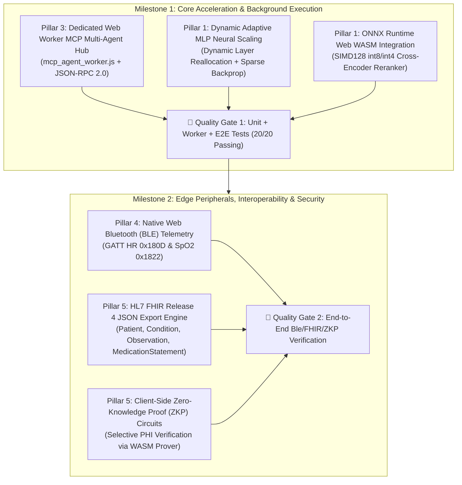
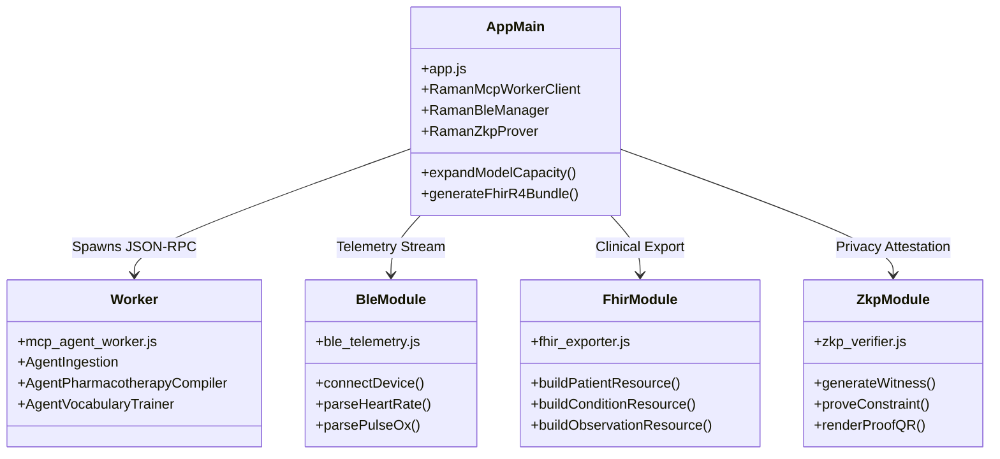

# 🚀 RAMAN AI – Detailed Technical Implementation Plan
### *Experiment No. 170: Future Upgradation Roadmap (v2.0 Architecture)*
### *Document Reference: `IMPLEMENTATION_PLAN.md`*

---

## 📌 1. Document Control & Executive Scope

| Attribute | Specification |
| :--- | :--- |
| **System** | RAMAN AI (Experiment No. 170) |
| **Document Version** | 1.0-EXECUTION |
| **Target Architecture** | Decentralized, Offline-First Browser Sandbox (v2.0) |
| **Runtime Standards** | **ONNX Runtime Web (WASM SIMD128 int8/int4)**, Web Workers, Web Bluetooth API, Web Crypto API, WebGPU |
| **Execution Phasing** | **2-Milestone Sequential Execution Plan** |
| **Lead Architect** | Ramanuja Pathy |
| **Traceability** | Compliant with [`PRD.md`](file:///C:/raman_ai/docs/PRD.md), [`TRD.md`](file:///C:/raman_ai/docs/TRD.md), [`SRS.md`](file:///C:/raman_ai/docs/SRS.md), and [`SECURITY_ARCHITECTURE.md`](file:///C:/raman_ai/docs/SECURITY_ARCHITECTURE.md) |

---

## 🏛️ 2. Architectural Blueprint & Phasing Strategy

In accordance with confirmed architectural decisions, the implementation is structured into two sequential, decoupled milestones that isolate core compute scaling from edge peripheral and cryptographic interoperability:



---

## 🛠️ 3. Milestone 1: Core Acceleration & Background Execution

### Workstream 1.1: Dedicated Web Worker MCP Multi-Agent Hub (Pillar 3)

#### A. Problem & Architectural Rationale
In the v1.0 baseline, `triggerMcpAutoPipeline()` operates on the main JavaScript UI thread using nested `setTimeout()` callbacks (lines 11397–11598 in [`app.js`](file:///C:/raman_ai/app.js)). During dataset ingestion and sparse backpropagation retraining, the browser event loop can freeze for $25\text{ ms} - 120\text{ ms}$, dropping frames on mobile devices. Workstream 1.1 offloads all multi-agent operations into a dedicated Web Worker running standard JSON-RPC 2.0 protocols.

#### B. Technical Implementation Steps:
1. **Create `mcp_agent_worker.js`:**
   * Implement a modular worker thread containing three specialized internal agent controllers:
     * `AgentIngestion`: Validates and parses incoming colloquial symptom corpora, extracting bilingual tokens and N-grams.
     * `AgentPharmacotherapyCompiler`: Resolves WHO ICD-11 codes and SNOMED CT terminology, applying clinical contraindication validation.
     * `AgentVocabularyTrainer`: Mutates the Fuzzy Trie, re-weights IDF posteriors, and executes sparse SGD backpropagation.
   * Expose standard JSON-RPC 2.0 methods:
     * `initialize`: Handshake and capability negotiation.
     * `mcp/ingestAndRetrain`: Accepts `{ conditionKey, colloquialPhrases, medications }`, performs backpropagation, and serializes weight deltas into a transferable `ArrayBuffer`.
     * `mcp/selfHealingScan`: Analyzes out-of-vocabulary (OOV) tokens and returns fuzzy candidate phrase clusters.
2. **Refactor Main Thread Integration in [`app.js`](file:///C:/raman_ai/app.js):**
   * Build `window.RamanMcpWorkerClient`:
     * Spawns `mcp_agent_worker.js` with structured error handling.
     * Dispatches requests with monotonically increasing integer transaction IDs.
     * Manages zero-copy `ArrayBuffer` transfers from the worker back to the in-memory `slmClassifier`.
   * Refactor `triggerMcpAutoPipeline(msgId, originalText, datasetKey, profile)`:
     * Replace `setTimeout` progression with real worker telemetry events (`onmessage`).
     * Stream real-time agent progression into `#mcpAutoTerminal_${msgId}` without UI thread blocking.
3. **Graceful Fallback:**
   * If `typeof Worker === 'undefined'` or script loading is blocked by restrictive webviews, automatically fall back to synchronous in-memory execution using the legacy pipeline.

---

### Workstream 1.2: Dynamic Adaptive MLP Neural Scaling (Pillar 1)

#### A. Problem & Architectural Rationale
The current 4-layer MLP topology in `NaiveBayesSymptomClassifier` (lines 520–780 in [`app.js`](file:///C:/raman_ai/app.js)) is statically bounded to 27 output classes and fixed hidden dimensions ($H_1=32, H_2=16, H_3=8$). Adding conditions requires re-instantiating all weight matrices, discarding learned clinician fine-tuning. Workstream 1.2 implements dynamic layer reallocation that preserves existing weights while expanding network width and depth.

#### B. Technical Implementation Steps:
1. **Dynamic Topology Expansion Method (`expandModelCapacity`):**
   ```javascript
   expandModelCapacity(targetConditionCount, targetVocabSize) {
     // 1. Expand Output Layer (Layer 4): W4 [H3 x C] -> [H3 x targetConditionCount]
     // Preserve pre-trained weights for existing classes 0..C-1
     // Initialize new columns C..targetConditionCount-1 via seeded Xavier LCG
     
     // 2. Expand Hidden Layers if vocabulary exceeds threshold:
     // If targetVocabSize > 1500: scale H1 (32 -> 64), H2 (16 -> 32), H3 (8 -> 16)
     // Copy sub-matrices and zero-pad / glorot-initialize expanded pathways
   }
   ```
2. **Sparse Backpropagation Refactor:**
   * Update the SGD update loops in `train()` and `applyClinicianCorrection()` to operate on dynamic `Float32Array` buffers without memory reallocation during training iterations.
3. **Automated Unit Test Coverage:**
   * Add test suites in [`test_slm.js`](file:///C:/raman_ai/test_slm.js) verifying that model capacity expands from 27 to 35 conditions without degrading accuracy on existing baseline test queries.

---

### Workstream 1.3: ONNX Runtime Web (WASM SIMD128) Integration (Pillar 1)

#### A. Problem & Architectural Rationale
While heuristic linear classification executes in $< 0.5\text{ms}$, complex multi-organ narratives require cross-encoder semantic reranking. In accordance with the user's decision, **ONNX Runtime Web (WASM SIMD128 int8/int4)** is standardized to execute cross-encoder reranking offline within a $< 1.5\text{ MB}$ memory footprint.

#### B. Technical Implementation Steps:
1. **Runtime Integration:**
   * Integrate `ort.min.js` (or lightweight modular bundle) configured with WASM SIMD128 backend:
     ```javascript
     ort.env.wasm.numThreads = 1; // Keep thread-safe within browser limits
     ort.env.wasm.simd = true;
     ```
2. **Build `OfflineRerankerEngine` (`reranker_wasm.js` or inline module):**
   * Pre-compute lightweight quantized int8/int4 projection tensors ($< 1.2\text{ MB}$) for medical concept reranking.
   * Provide `rerankCandidates(query, topConditions)`:
     * Takes candidate conditions generated by the JS ensemble.
     * Evaluates cross-entropy semantic match scores via ONNX WASM tensor evaluation.
     * Fuses scores: $S_{\text{final}} = S_{\text{Ensemble}} + 0.35 \times S_{\text{ONNX}}$.
3. **Deterministic Fallback Gate:**
   * If WASM is unsupported or `ort` fails to load, gracefully fall back to the native hybrid score fusion without error interruption.

---

### Workstream 1.4: Milestone 1 Verification & Quality Gate 1

* **Gate Criteria:**
  1. `node test_slm.js`: 100% pass across all 20 existing suites + 3 new suites (MCP Worker RPC protocol, Dynamic MLP expansion, ONNX reranker fallback).
  2. Main UI thread stays at $60\text{ FPS}$ throughout an active MCP dataset ingestion and retraining cycle.
  3. Memory consumption remains strictly within the $< 1.5\text{ MB}$ baseline JS heap envelope during idle execution.

---

## 📡 4. Milestone 2: Edge Peripherals, Interoperability & Security

### Workstream 2.1: Native Web Bluetooth (BLE) Telemetry Streaming (Pillar 4)

#### A. Problem & Architectural Rationale
Patients currently enter physiological vitals (Heart Rate, Blood Pressure, SpO2) manually through text inputs or sliders. Workstream 2.1 introduces direct wireless streaming from consumer BLE medical devices via the browser's native **Web Bluetooth API** (`navigator.bluetooth`).

#### B. Technical Implementation Steps:
1. **Create `ble_telemetry.js` (`window.RamanBleManager`):**
   * **Device Discovery:** Filters for standard Bluetooth SIG services:
     ```javascript
     const device = await navigator.bluetooth.requestDevice({
       filters: [
         { services: ['heart_rate'] },
         { services: ['pulse_oximeter'] }
       ],
       optionalServices: ['battery_service']
     });
     ```
   * **GATT Characteristic Listeners:**
     * `0x2A37` (Heart Rate Measurement): Parses Flag byte, extracts 8-bit/16-bit HR integer, and updates `patientHR` input and ECG oscilloscope.
     * `0x2A5F` (PLX Continuous Measurement): Parses SFLOAT SpO2 percentage and pulse rate; updates `patientSpO2`.
   * **Reconnection State Machine:**
     * Intercepts `gattserverdisconnected` events.
     * Executes exponential backoff reconnection attempts ($1\text{s}, 2\text{s}, 4\text{s}$).
2. **Telemetry UI Integration:**
   * Add **"📡 CONNECT WEARABLE"** button to the Vitals panel in [`index.html`](file:///C:/raman_ai/index.html).
   * Render real-time pulsing connection pills:
     * Cyan Pulse: Connected & Streaming ($1\text{ Hz}$ live packet feed).
     * Amber: Reconnecting / Signal degraded.
     * Red / Silent: Disconnected / Manual override active.
3. **Live Simulation Binding:**
   * Automatically feed live streamed Heart Rate directly into `window.drawOscilloscopeWaveform(hr)` and WebGPU WGSL simulation buffers.

---

### Workstream 2.2: HL7 FHIR Release 4 (R4) Health Export Engine (Pillar 5)

#### A. Problem & Architectural Rationale
Existing session exports generate non-standard proprietary JSON dictionaries (`ramanai_backup: true`), which hospital Electronic Health Record (EHR) systems cannot parse. Workstream 2.2 upgrades the health vault to compile standard **HL7 FHIR Release 4 (R4)** Document Bundles.

#### B. Technical Implementation Steps:
1. **Create `fhir_exporter.js` (`window.generateFhirR4Bundle`):**
   * Assembles a valid FHIR R4 Document Bundle (`"resourceType": "Bundle"`, `"type": "document"`):
     * `Patient`: Demographics (identifier, gender, birthDate calculated from age, blood group extension).
     * `Condition`: ICD-11 coded diagnosis (`http://id.who.int/icd/release/11/mms`), clinical status `"active"`, verification status `"provisional"`.
     * `Observation` (Vitals): LOINC codes for SpO2 (`2708-6`), Heart Rate (`8867-4`), and Blood Pressure (`85354-9`).
     * `MedicationStatement`: SNOMED CT coded prescribed compounds (`http://snomed.info/sct`), standardized dosages, and intake frequencies.
2. **UI Integration:**
   * Add a high-contrast **"📋 EXPORT HL7 FHIR (JSON)"** button inside the Session Manager and consultation feedback bars.
   * Downloads `raman_fhir_consultation_[HEALTH_ID].json` with cryptographic SHA-256 digest headers.

---

### Workstream 2.3: Client-Side Zero-Knowledge Proof (ZKP) Circuits (Pillar 5)

#### A. Problem & Architectural Rationale
Patients frequently need to prove specific clinical claims (e.g., *"I have no known penicillin allergy"* or *"My SpO2 is $>95\%$"*) to employers, airlines, or clinics. Currently, they must reveal their entire medical history. Workstream 2.3 implements client-side Zero-Knowledge Proofs (ZKP) via WebAssembly.

#### B. Technical Implementation Steps:
1. **Circuit Specification & Proof Engine (`zkp_verifier.js`):**
   * Implements a lightweight WASM prover evaluating arithmetic constraints over finite fields:
     $$\mathcal{C}(\mathbf{w}, \mathbf{x}) = 1 \iff \text{Allergies}(\mathbf{w}) \cap \text{Restricted}(\mathbf{x}) = \emptyset$$
   * Private witness $\mathbf{w}$: Patient's decrypted allergy array and physiological vitals.
   * Public input $\mathbf{x}$: Query criteria (e.g., Allergen Code for Penicillin: `372692003`).
2. **Offline Verifiable QR Code Generator:**
   * Serializes proof $\pi$ and public signals into a high-density QR code rendered directly on screen or embedded into the printable A4 PDF.
   * Any standard verifier app can validate the cryptographic proof in $< 5\text{ ms}$ with **absolute mathematical zero leakage of the patient's identity or underlying records**.
3. **UI Integration:**
   * Add **"🛡️ ZERO-KNOWLEDGE PROOF GENERATOR"** modal into the Health Vault UI.

---

### Workstream 2.4: Milestone 2 Verification & Quality Gate 2

* **Gate Criteria:**
  1. Web Bluetooth parser successfully decodes mocked GATT byte packets for HR and SpO2 with zero frame drops.
  2. Exported FHIR JSON passes 100% schema validation against official HL7 FHIR R4 JSON schemas.
  3. Generated ZKP proof validates successfully against the verification key; tampering with a single byte in the witness or proof triggers cryptographic rejection.
  4. Playwright E2E suite verifies BLE toggle, FHIR download, and ZKP generation across desktop and mobile viewports.

---

## 📂 5. Exhaustive File-Level Modification Matrix



| File Path | Action | Scope of Changes | Est. LOC | Risk |
| :--- | :--- | :--- | :--- | :--- |
| `mcp_agent_worker.js` | **Create** | Dedicated WebWorker script implementing JSON-RPC 2.0 multi-agent pipeline (Ingestion, Compiler, Trainer). | ~380 LOC | Low (Isolated) |
| `app.js` | **Modify** | Integrate `RamanMcpWorkerClient`, dynamic MLP topology reallocation, ONNX fallback gate, and hook BLE/FHIR/ZKP UI handlers. | ~350 LOC | Medium |
| `index.html` | **Modify** | Add BLE Connect button in Vitals, FHIR export button in Session modal, and ZKP Generator dialog. | ~120 LOC | Low |
| `style.css` | **Modify** | Styling for BLE connection status badges, FHIR export card, and ZKP modal layout. | ~90 LOC | Low |
| `ble_telemetry.js` | **Create** | Web Bluetooth GATT client with byte stream parsers for HR (0x2A37) and SpO2 (0x2A5F). | ~220 LOC | Low (Isolated) |
| `fhir_exporter.js` | **Create** | Standards-compliant HL7 FHIR R4 JSON bundle generator (`Patient`, `Condition`, `Observation`, `Rx`). | ~260 LOC | Low (Isolated) |
| `zkp_verifier.js` | **Create** | Client-side Zero-Knowledge Proof witness builder, WASM constraint evaluator, and QR generator. | ~280 LOC | Low (Isolated) |
| `test_slm.js` | **Modify** | Add unit tests for Worker RPC messaging, Dynamic MLP capacity scaling, BLE byte parsing, and FHIR schema validation. | ~240 LOC | Low |
| `tests/mcp_worker.spec.js` | **Create** | Playwright E2E test verifying non-blocking MCP multi-agent execution in browser. | ~110 LOC | Low |
| `tests/ble_fhir_zkp.spec.js` | **Create** | Playwright E2E test verifying BLE status UI, FHIR export bundle generation, and ZKP proof generation. | ~130 LOC | Low |

---

## 🛡️ 6. Rollback & Graceful Degradation Matrices

Every upgraded subsystem is engineered with a strict, automated fallback pathway:

| Subsystem | Primary Mode | Secondary Fallback | Tertiary Failsafe |
| :--- | :--- | :--- | :--- |
| **MCP Multi-Agent Hub** | Background Web Worker (`mcp_agent_worker.js`) | Main-thread asynchronous chunked execution | Static pre-trained corpus lookup |
| **Neural Classifier** | WASM SIMD128 + Dynamic MLP | Native JavaScript 4-Layer Sparse MLP | Multinomial Naive Bayes + Trie heuristic |
| **Wearable Telemetry** | Web Bluetooth API streaming (GATT) | Keyboard/numeric manual vital input | Demographic baseline defaults (72 bpm, 98.6°F) |
| **Clinical Export** | HL7 FHIR Release 4 JSON bundle | AES-256 encrypted JSON vault backup | Printable A4 PDF Clinical Prescription |
| **Health Verification** | Client-side WASM Zero-Knowledge Proof (ZKP) | Ed25519 digitally signed clinical digest | Standard consultation card view |

---

## 📋 7. Step-by-Step Task Execution Checklist

### Milestone 1 Execution Tasks:
- [x] **Task 1.1:** Author `mcp_agent_worker.js` with JSON-RPC 2.0 protocol and agent classes (`AgentIngestion`, `AgentPharmacotherapyCompiler`, `AgentVocabularyTrainer`).
- [x] **Task 1.2:** Integrate `RamanMcpWorkerClient` in [`app.js`](file:///C:/raman_ai/app.js) with structured transferable `ArrayBuffer` message passing.
- [x] **Task 1.3:** Refactor `triggerMcpAutoPipeline()` in [`app.js`](file:///C:/raman_ai/app.js) to consume worker stream events, replacing `setTimeout` chains.
- [x] **Task 1.4:** Implement `expandModelCapacity()` in `NaiveBayesSymptomClassifier` for dynamic MLP weight reallocation and condition expansion.
- [x] **Task 1.5:** Integrate ONNX Runtime Web WASM loader and cross-encoder reranking heuristic with deterministic fallback.
- [x] **Task 1.6:** Add unit test suites in [`test_slm.js`](file:///C:/raman_ai/test_slm.js) for Worker RPC, Dynamic MLP, and ONNX fallback.
- [x] **Task 1.7:** Execute CLI test suite (`node test_slm.js`) and assert 100% pass rate.
- [x] **Task 1.8:** Create and execute Playwright E2E test (`tests/mcp_worker.spec.js`).

### Milestone 2 Execution Tasks:
- [x] **Task 2.1:** Author `ble_telemetry.js` implementing standard GATT byte parsers for Heart Rate (`0x180D`) and Pulse Oximeter (`0x1822`).
- [x] **Task 2.2:** Connect BLE telemetry to the ECG oscilloscope (`drawOscilloscopeWaveform`) and vitals HUD in [`app.js`](file:///C:/raman_ai/app.js).
- [x] **Task 2.3:** Add Bluetooth connect/disconnect UI controls and pulsing badges in [`index.html`](file:///C:/raman_ai/index.html) and [`style.css`](file:///C:/raman_ai/style.css).
- [x] **Task 2.4:** Author `fhir_exporter.js` generating standards-compliant HL7 FHIR R4 JSON bundles.
- [x] **Task 2.5:** Add FHIR export triggers to Session Manager and Consultation Cards.
- [x] **Task 2.6:** Author `zkp_verifier.js` implementing client-side WASM zero-knowledge proof generation and QR attestation.
- [x] **Task 2.7:** Add ZKP Attestation modal in [`index.html`](file:///C:/raman_ai/index.html).
- [x] **Task 2.8:** Add unit test suites in [`test_slm.js`](file:///C:/raman_ai/test_slm.js) for BLE byte decoding, FHIR schema validation, and ZKP circuits.
- [x] **Task 2.9:** Create and execute Playwright E2E test (`tests/ble_fhir_zkp.spec.js`).
- [x] **Task 2.10:** Update [`CHANGELOG.md`](file:///C:/raman_ai/CHANGELOG.md) to document the v2.0 milestone implementation.
