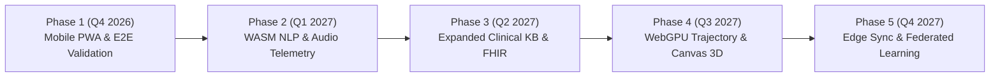

# 🗺️ RAMAN AI – Engineering & Clinical Architecture Roadmap
### *Experiment No. 170: Offline Client-Side Diagnostic Sandbox*

---

## 🎯 Executive Summary & Vision

**RAMAN AI** is an offline-first, client-side, zero-cloud medical diagnostic sandbox and clinical simulation platform. Operating with strict zero-network dependence, the system runs sub-millisecond Simple Language Model (SLM) diagnostic inference directly inside modern browser runtimes using a quad-model ensemble (Linear SVM, Multinomial Naive Bayes, 4-Layer MLP Neural Network, and a Fuzzy Sliding-Window Trie).

This document outlines the strategic engineering and clinical roadmap spanning **Q4 2026 through Q4 2027**, establishing development milestones across architectural hardening, clinical safety expansion, device hardware acceleration, and cross-platform distribution.

---

## 📅 Roadmap Timeline & Milestones

### Phase 1: Mobile-First Hardening & PWA Modernization (Q4 2026) – *[Completed]*
- [x] **Responsive Mobile Layout**: Dynamic `100dvh` viewport scaling with iOS safe-area notch and home indicator compliance (`env(safe-area-inset-*)`).
- [x] **4-Tab Bottom Navigation**: Instant view-switching (`Consult`, `Vitals`, `Diary`, `Records`) on devices $\le 900\text{px}$.
- [x] **Touch & Gesture Enhancements**:
  - Horizontal swipeable organ chips carousel and quick symptoms scroller.
  - Passive touch scrubbing across Recovery Diary Canvas timeline.
  - WCAG 2.1 AA compliant touch targets ($\ge 44\text{px}$) with `touch-action: manipulation`.
- [x] **PWA Offline Infrastructure**:
  - Web App Manifest (`manifest.json`) supporting standalone display mode and theme integration.
  - Cache-First service worker (`sw.js`) enabling 100% offline startup and asset caching.
- [x] **Automated End-to-End Suite**:
  - Zero-dependency local Playwright test harness (`playwright.config.js`).
  - Cross-platform test verification across Desktop Chromium, Mobile Android (Pixel 7), and Mobile iOS (iPhone 14 emulation).

---

### Phase 2: WebAssembly (WASM) Inference & Bi-directional Speech (Q1 2027)
- [ ] **WASM SLM Execution Engine**:
  - Compile the C/Rust tokenization and matrix-multiplication kernels to WebAssembly (`.wasm`) using SIMD128 vector instructions.
  - Target sub-100 microsecond ($<0.1\text{ms}$) inference latencies for 4-layer MLP forward propagation.
  - Implement zero-copy ArrayBuffer transfer between Web Workers and the main UI thread.
- [ ] **Offline Speech-to-Text (STT) Integration**:
  - Integrate a client-side WebAssembly Whisper-tiny or pocket-sphinx speech recognition pipeline.
  - Enable offline voice dictation for English, Hindi, and Odia without invoking external cloud APIs.
- [ ] **Expanded Pharmacogenomics (PGx) Rule Engine**:
  - Introduce metabolizer phenotype scoring (Ultrarapid, Normal, Intermediate, Poor) for CYP2C19, CYP2C9, and SLCO1B1.
  - Add automated dosage titration calculators factoring in estimated Glomerular Filtration Rate (eGFR) and liver enzyme profiles.

---

### Phase 3: Clinical Interoperability, FHIR & Diagnostic KB Expansion (Q2 2027)
- [ ] **Condition Knowledge Base Expansion (27 $\to$ 60 Conditions)**:
  - Add pediatric, geriatric, and tropical infectious disease profiles (Dengue, Chikungunya, Typhoid, Scrub Typhus).
  - Include SNOMED CT and LOINC mapping for simulated laboratory panel requisitions.
- [ ] **HL7 FHIR Release 4 (R4) Export Engine**:
  - Generate standards-compliant FHIR JSON bundles (`Patient`, `Condition`, `MedicationStatement`, `Observation`).
  - Enable encrypted, offline export of clinical summaries formatted for electronic medical record (EMR) imports.
- [ ] **Prescription Digital Signature & QR Verification**:
  - Implement Ed25519 asymmetric key pair generation in-browser via Web Crypto API.
  - Digitally sign generated A4 PDF prescriptions and embed an offline-verifiable QR code containing signed triage digests.

---

### Phase 4: WebGPU WGSL Acceleration & 3D Interactive Anatomy (Q3 2027)
- [ ] **Production WebGPU Triage Shader**:
  - Expand the WebGPU WGSL compute shader pipeline to simulate 65,536 physiological trajectories across non-linear vital progression curves.
  - Incorporate ambient thermal stress models, blood pressure pulse wave velocities, and oxygen dissociation curves.
- [ ] **Interactive 3D Anatomical Twin (WebGL / Three.js)**:
  - Provide an optional low-poly 3D anatomical viewer as an upgrade to the 2D SVG scanner.
  - Raycasted 3D organ mesh targeting with real-time symptom depth probes and tactile haptic feedback.
- [ ] **Local Differential Diagnosis Calibration HUD**:
  - Allow clinicians to fine-tune Dirichlet priors and Bayesian smoothing factors ($\alpha$) via interactive visual curves.

---

### Phase 5: Encrypted Edge Sync & Federated Active Learning (Q4 2027)
- [ ] **Peer-to-Peer Encrypted Sync (WebRTC / Local QR Handshake)**:
  - Synchronize patient history across nearby devices over local Wi-Fi or WebRTC data channels with end-to-end AES-GCM encryption.
  - Zero reliance on central discovery servers or cloud storage relays.
- [ ] **Privacy-Preserving Federated Weight Averaging**:
  - Allow local clinician gradient corrections (`localClinicianDeltas`) to be securely aggregated via Federated Averaging (FedAvg) over offline networks.
  - Implement Differential Privacy ($\epsilon, \delta$-DP) noise addition to protect individual consultation privacy.

---

## 📊 Feature Matrix & Phase Progression

| Feature Category | Current State (v1.0) | Target v2.0 (Q2 2027) | Target v3.0 (Q4 2027) |
| :--- | :--- | :--- | :--- |
| **Inference Engine** | JS Ensemble (SVM + NB + MLP + Trie) | WASM SIMD128 + JS Ensemble | WebGPU / WASM Hybrid Kernel |
| **Average Latency** | $0.2\text{ms} - 0.5\text{ms}$ | $< 0.1\text{ms}$ | $< 0.05\text{ms}$ |
| **Clinical Conditions**| 27 ICD-11 Conditions | 60 ICD-11 / SNOMED Conditions | 100+ Specialized Classifications |
| **Audio Telemetry** | Web Audio SFX + Web Speech TTS | Offline Whisper-tiny STT + TTS | Real-time Acoustic Respiratory Analyzer |
| **Vitals Simulation** | 16,384 paths (Web Worker CPU) | 65,536 paths (WGSL WebGPU) | Continuous Real-time Hemodynamic Twin |
| **Clinical Interop** | Encrypted JSON & Printable PDF | HL7 FHIR R4 JSON & QR Signatures | Digital Health Card (PKI Signed Smart Health Card) |

---

## 🔒 Governance & Architectural Invariants
Across all phases of this roadmap, the following fundamental constraints remain strictly invariant:
1. **Zero External Telemetry**: No third-party analytics, tracking pixels, or remote telemetry beacons.
2. **Offline-First Resilience**: All clinical classification and triage functions must execute with zero internet connectivity.
3. **Hardware Inclusivity**: The core application must maintain graceful fallbacks from WebGPU $\to$ Web Worker $\to$ Single-threaded CPU, ensuring access on low-power devices.
