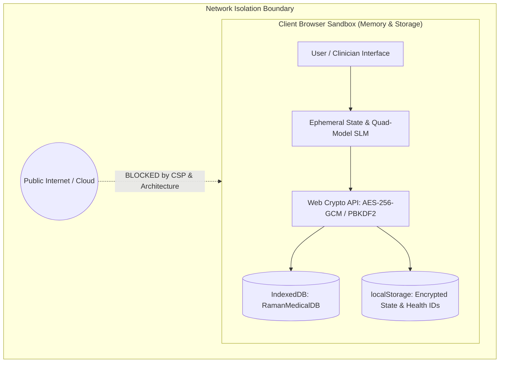

# 🛡️ RAMAN AI – Security, Cryptography & Threat Model Policy
### *Experiment No. 170: Offline Client-Side Diagnostic Sandbox*

---

## 🔒 Security Posture & Zero-Trust Architecture

**RAMAN AI** is designed from the ground up on a **Zero-Cloud, Zero-Telemetry, and Offline-First** architectural model. Because health information and clinical observations represent highly sensitive Protected Health Information (PHI), the entire system operates in local client browser sandbox memory with strict cryptographic safeguards.



---

## 🔑 Cryptographic Implementation Standards

All data storage and backup routines rely on standard browser implementations of the **W3C Web Cryptography API** (`window.crypto.subtle`). No proprietary, unverified, or third-party cryptographic libraries are utilized.

### 1. Data Encryption at Rest & Vault Backups
* **Cipher**: **AES-256-GCM** (Galois/Counter Mode) with 128-bit authentication tags.
* **Key Derivation**: **PBKDF2** (Password-Based Key Derivation Function 2) using **HMAC-SHA-256**.
* **Key Derivation Parameters**:
  * **Iteration Count**: Minimum `100,000` iterations to mitigate GPU/ASIC brute-force attacks.
  * **Salt**: Cryptographically secure pseudo-random 16-byte (`128-bit`) salt generated via `crypto.getRandomValues()`.
  * **Initialization Vector (IV)**: Fresh, non-repeating 12-byte (`96-bit`) IV generated per encryption invocation.
* **Authentication Integrity**: GCM ensures ciphertext confidentiality and tamper detection. Modifying any bit of the vault payload or salt results in immediate rejection by `subtle.decrypt()`.

```javascript
// Web Crypto API Key Derivation Standard (PBKDF2 -> AES-GCM)
const salt = crypto.getRandomValues(new Uint8Array(16));
const iv = crypto.getRandomValues(new Uint8Array(12));
const keyMaterial = await crypto.subtle.importKey(
  "raw",
  new TextEncoder().encode(userPassphrase),
  "PBKDF2",
  false,
  ["deriveKey"]
);
const aesKey = await crypto.subtle.deriveKey(
  {
    name: "PBKDF2",
    salt: salt,
    iterations: 100000,
    hash: "SHA-256"
  },
  keyMaterial,
  { name: "AES-GCM", length: 256 },
  false,
  ["encrypt", "decrypt"]
);
```

---

## 🎯 Threat Model & Risk Mitigations

### 1. Threat Matrix

| Threat Category | Attack Vector | Severity | Implemented Mitigation |
| :--- | :--- | :--- | :--- |
| **Data Exfiltration** | Third-party script injection or network egress | High | Strict offline runtime, zero remote CDN scripts, Content Security Policy (`default-src 'self'`). |
| **Cross-Site Scripting (XSS)** | Malicious clinical prompt injection rendering HTML | High | Strict output sanitization via `cleanAIResponse`, text escaping for all user inputs before insertion into the DOM. |
| **Offline Data Exposure** | Unauthorized access to local browser storage | Medium | AES-256-GCM vault encryption for exported backups; option to seal and wipe session data on demand. |
| **Tampering & Integrity Loss** | Modification of trained weights or clinical KB | Medium | In-memory immutable constants for `SLM_TRAINING_CORPUS` and `MEDICAL_KB`; validated automated test suite (`npm test`). |
| **Denial of Service (DoS)** | Exhaustive inference loops locking browser UI thread | Low | Sub-millisecond matrix operations ($< 0.5\text{ms}$), sparse SGD backpropagation updates, Web Worker offloading for trajectory simulations. |

---

## 🌐 Network Isolation & Zero-Telemetry Policy

1. **No Outbound Network Calls**:
   - The primary application functions 100% disconnected from the internet.
   - No analytics SDKs (Google Analytics, Mixpanel, Sentry, etc.) are embedded.
   - Simulated imaging files (ECGs, X-rays, MRIs) are synthesized locally as in-memory data URLs.
2. **Optional External Cloud LLM Gateways**:
   - If an optional cloud provider (Anthropic Claude or Google Gemini) is explicitly configured by the user via the API Settings modal, keys are stored in `sessionStorage` or local memory only, never broadcast to telemetry servers.
   - Clear UI banners alert the user whenever an external API toggle is engaged.

---

## 💉 Clinical Input Sanitization & XSS Defense

All user inputs and synthetic AI responses pass through multi-layered sanitization pipelines:
* **`cleanAIResponse(html)`**: Strips internal model reasoning blocks (`<think>...</think>`, markdown blocks, thinking process delimiters).
* **Attribute & Script Escaping**: Dynamic DOM manipulation uses `textContent` and `createElement()` rather than insecure `innerHTML` string concatenation whenever rendering patient-supplied demographic strings (names, notes, custom allergy tags).
* **Inline Event Handlers**: Key UI actions are bound to sanitized, globally declared window handlers or standard `addEventListener` hooks.

---

## 📋 Recommended Content Security Policy (CSP)

When serving RAMAN AI in production or healthcare kiosk environments, the following HTTP response header configuration is recommended:

```http
Content-Security-Policy: default-src 'self'; script-src 'self' 'unsafe-inline'; style-src 'self' 'unsafe-inline'; img-src 'self' data: blob:; font-src 'self' data:; connect-src 'self' https://api.anthropic.com https://generativelanguage.googleapis.com; worker-src 'self' blob:; object-src 'none'; frame-ancestors 'none';
```

---

## 🚨 Reporting a Vulnerability

Security researchers and clinical engineers are encouraged to report potential vulnerabilities or safety oversights responsibly:
1. **Scope**: Local storage vulnerabilities, cryptographic weaknesses, DOM injection vectors, or clinical safety contraindication bypasses.
2. **Responsible Disclosure**: Please file a private issue or email the maintainer (**Ramanuja Pathy**) directly with a reproducible proof of concept.
3. **Response SLA**: Vulnerability reports will be acknowledged within **48 hours**, and critical fixes will be prioritized in the next maintenance release.
