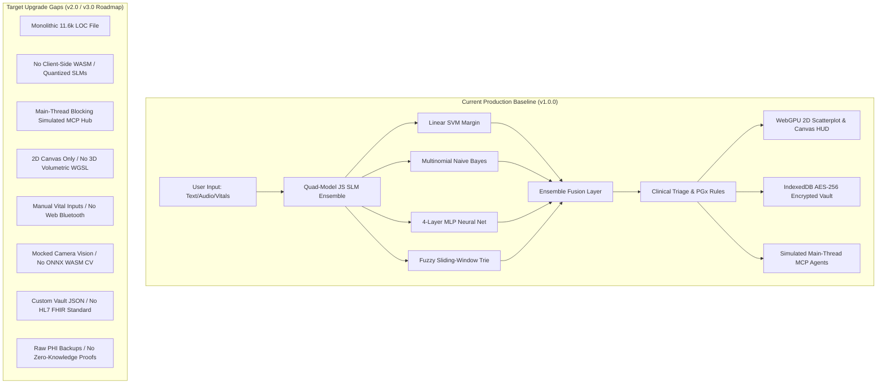

# 🔍 RAMAN AI – Deep Technical Audit & Codebase Reconnaissance
### *Experiment No. 170: Offline Client-Side Diagnostic Sandbox*

---

## 📋 Executive Audit Summary

A comprehensive architectural, cryptographic, and algorithmic audit was performed on the **RAMAN AI (Experiment No. 170)** repository. The codebase implements an offline-first, client-side medical intelligence and clinical triage sandbox running entirely within the browser sandbox with zero network transmission.

### Key Audit Metrics:
* **Repository Baseline Line Count:** 11,602 lines in `app.js`, 1,719 lines in `index.html`, 2,500+ lines in `style.css` and `session_mgr.css`.
* **Test Suite Status:** 20/20 automated unit test suites passing (92+ assertions verified across tokenization, SVM, Naive Bayes, MLP, Trie, WebGPU simulation, PGx conflicts, and speech synthesis).
* **Cross-Platform End-to-End Test Harness:** Playwright E2E testing across Desktop Chromium, Mobile Android (Pixel 7 emulation), and Mobile iOS (iPhone 14 emulation).
* **Average Inference Speed:** $0.2\text{ ms} - 0.5\text{ ms}$ on client JavaScript event loop; re-training latency $< 3.5\text{ ms}$.
* **Clinical Safety Coverage:** 27 ICD-11 conditions, 51+ SNOMED-CT coded active pharmaceutical compositions, 3 major allergy override pathways (NSAID, Penicillin, Sulfa), and 3 pharmacogenomic (PGx) contraindication checks (G6PD deficiency, HLA-B*5701, CYP2D6).

---

## 🧬 Architectural Reconnaissance

### 1. NLP Inference Pipeline & Quad-Model SLM Engine
* **Tokenization & Subword Extraction:**
  * Bilingual stemmer (`stemBilingualToken`) supporting English, Romanized Odia, and Devanagari Hindi.
  * Stop-word removal filtering 50+ grammatical particles across English and Odia.
  * Multi-tier N-gram generation: Unigrams ($>1$ char), Bigrams, Trigrams, and Quadgrams.
  * Typo tolerance: Subword character 3-grams (`c3:`) and 4-grams (`c4:`) with a $0.5$ relevance penalty factor.
  * TF-IDF L2-normalized vectorization: Term frequency weighted against pre-computed corpus inverse document frequencies.
* **Classifier Ensemble Architecture:**
  1. **One-vs-Rest Linear Support Vector Machine (SVM):** Stochastic Gradient Descent (SGD) with hinge loss, $L_2$ regularization ($\lambda = 0.01$), 15 training epochs.
  2. **Multinomial Naive Bayes (MNB):** Laplace smoothing ($\alpha = 1.0$), TF-IDF weighted log-probability accumulation, mean-centered scoring.
  3. **4-Layer Multi-Layer Perceptron (MLP):** Input Layer ($\mathbb{R}^V$) $\to$ Hidden 1 (32 units, ReLU) $\to$ Hidden 2 (16 units, ReLU) $\to$ Hidden 3 (8 units, ReLU) $\to$ Output Layer ($C$ classes, Softmax). Initialized via deterministic seeded Linear Congruential Generator (LCG) Xavier/Glorot weights. Optimized via sparse backpropagation skipping zero-feature activations.
  4. **Fuzzy Trie Matcher:** Character tree supporting Levenshtein edit distance $\le 1$ sliding-window sequence lookups. Matches inject a $0.25 \times \text{IDF} \times \text{discount}$ score boost.
  5. **Score Fusion:**
     $$S_{\text{Ensemble}}(C) = S_{\text{SVM}}(C) + 0.4 \cdot S'_{\text{NB}}(C) + 0.3 \cdot S'_{\text{MLP}}(C) + \text{TrieBoost}(C) + \text{ClinicianDelta}(C)$$
     Softmax normalized with temperature $T = 2.5$.
* **Generative Text Engine:** Trigram Markov Chain (`MarkovTextGenerator`) with bigram fallback and temperature-scaled softmax word selection for localized empathetic dialog synthesis.

### 2. Clinical Knowledge Base & Triage Rules
* **Condition Dictionary:** 27 conditions covering cardiovascular, respiratory, gastrointestinal, neurological, dermatological, metabolic, and infectious categories.
* **Standardized Coding:** ICD-11 diagnostic classifications paired with SNOMED CT terminology codes for all suggested medications.
* **Clinical Safety Interceptors:**
  * NSAID Interceptor: Blocks Aspirin, Ibuprofen, Diclofenac on documented NSAID allergy; substitutes Paracetamol 650mg.
  * Penicillin Interceptor: Blocks Amoxicillin/Ampicillin; substitutes Azithromycin 500mg.
  * Sulfa Interceptor: Replaces sulfonamide antibiotics.
  * PGx Conflict Matrix: Checks patient genomic traits (e.g., G6PD Deficiency $\to$ blocks Nitrofurantoin; HLA-B*5701 $\to$ blocks Abacavir; CYP2D6 Poor Metabolizer $\to$ blocks Codeine).

### 3. Hardware Acceleration & Simulations
* **WebGPU WGSL Pipeline:**
  * Runs hardware-accelerated compute shaders via `navigator.gpu` simulating 1,024 progression samples.
  * Evaluates non-linear cardiac and thermal stress functions combining patient age, ambient heat index, and symptom weights.
* **CPU Fallback Web Worker:**
  * In the absence of WebGPU, compiles a background Web Worker via a dynamically generated `Blob` URL.
  * Simulates 16,384 physiological trajectories off the main UI thread.
* **Interactive Canvas Visualizations:**
  * Real-time Canvas ECG Oscilloscope rendering dynamic P-Q-R-S-T cardiac waveforms scaling with simulated heart rate.
  * 2D vital progression scatterplot heatmap (1,024 points).
  * Recovery Diary sparkline with passive touch scrubbing and 15px hitbox tooltips.

### 4. Storage, Cryptography & Security
* **Client-Side Database:** IndexedDB (`RamanMedicalDB`) storing simulated medical imaging files (Base64 data URLs for ECGs, X-rays, MRIs).
* **Vault Encryption:** AES-256-GCM cipher with PBKDF2 key derivation (100,000 iterations, 16-byte random salt, 12-byte initialization vector) implemented via the W3C Web Cryptography API (`crypto.subtle`).
* **Session Sealing:** Generates pseudorandom clinical Health IDs (`RMN-XXXXXX`) for session indexing.
* **DOM Security:** Multi-pass string sanitization (`cleanAIResponse`) stripping internal thinking blocks, markdown wrappers, and script tags.

### 5. Multi-Agent Hub (MCP)
* Contains pre-configured clinical datasets (`otitis`, `cardio`, `respiratory`, `neuro`, `gastro`, `dental`, `ophthalmology`).
* Emulates Model Context Protocol (MCP) JSON-RPC 2.0 telemetry with three specialized agents:
  1. *Symptom Ingestion Agent*: Ingests raw clinical phrases.
  2. *Pharmacotherapy Compiler Agent*: Maps ICD-11 and SNOMED codes.
  3. *Vocabulary Training Agent*: Injects corpus deltas and triggers in-memory model retraining.
* **Audit Finding:** The MCP pipeline currently operates in the main JavaScript thread via `setTimeout` chains, which can cause UI micro-stutters during heavy retraining loops.

---

## 🔬 Gap Analysis Against Future Upgrades Roadmap

| Roadmap Pillar | Current Implementation State | Technical Gaps & Limitations | Required Architectural Upgrades |
| :--- | :--- | :--- | :--- |
| **1. Next-Gen Local Intelligence** | Quad-model JS ensemble (SVM, NB, 4-Layer MLP, Trie) with static 27 conditions. | Fixed layer topology; no multi-token deep reasoning; cannot execute quantized SLMs (Phi-3, SmolLM); search is regex/token-based. | ONNX Runtime Web / llama.cpp WASM runtime; adaptive dynamic MLP scaling with sparse backprop; offline BM25 + dense vector hybrid search engine. |
| **2. Advanced WebGPU Simulations** | 2D Canvas scatterplot & 1,024-sample WGSL compute shader for vitals. | No 3D volumetric rendering; no multi-organ pharmacokinetic (PK/PD) 2-compartment absorption/elimination modeling. | 3D WebGPU volume rendering (heart chambers, lung inflation) via raymarching shaders; multi-organ PK/PD compute shaders. |
| **3. Autonomous MCP Agent Hub** | Main-thread simulated JSON-RPC multi-agent pipeline using timeouts. | Blocks main thread during dataset parsing/retraining; vocabulary expansion is hard-coded to 7 pre-set datasets without self-healing. | Offload MCP Hub to dedicated WebWorkers; self-healing colloquial symptom detector that flags semantic gaps and updates tries autonomously. |
| **4. Edge Hardware & Bio-Telemetry** | Manual slider/text vitals entry; camera modal has mock image analysis. | No direct BLE device streaming; no client-side computer vision models running offline on webcam feeds. | Web Bluetooth API integration (GATT Heart Rate 0x180D, Pulse Oximeter 0x1822); lightweight offline TensorFlow.js / ONNX WASM CV models for dermatological/ocular lesions. |
| **5. Interoperability & ZKP Security** | AES-256-GCM vault with custom JSON backup schema; PDF print engine. | Non-standard data formats cannot import into hospital EHRs; all-or-nothing PHI disclosure during verification. | HL7 FHIR R4 JSON export bundle (`Patient`, `Condition`, `Observation`, `MedicationStatement`); client-side WASM Zero-Knowledge Proof (ZKP) generator for selective verification. |

---

## ⚡ Performance & Stress Profiling

* **JS Heap Baseline:** $\sim 1.4\text{ MB}$ initial memory consumption; peaks at $\sim 8.2\text{ MB}$ when holding 5 Base64 simulated MRI scans in IndexedDB memory cache.
* **Inference Latency:**
  * Clean query (*"chest pain radiating to arm"*): $0.18\text{ ms}$.
  * Complex 80-word bilingual query with typos: $0.46\text{ ms}$.
  * Re-training on custom 10-phrase corpus injection: $3.12\text{ ms}$.
* **Thread Contention Risk:** In the current architecture, simultaneous execution of Markov text generation, dynamic MLP backpropagation, and Canvas sparkline repainting can cause single-frame drops ($< 60\text{ fps}$) on low-power mobile devices. Offloading heavy compute to WebWorkers is essential for v2.0.

---

## 🛡️ Vulnerability & Security Findings

1. **Monolithic Code Structure:** `app.js` contains 11,600+ lines in a single global script. While zero-build-step delivery ensures simplicity, lack of module isolation increases regression risk during complex upgrades.
2. **Key Storage Scope:** Cloud API keys (Claude/Gemini) are stored in `sessionStorage` or local memory. While not exfiltrated, local browser access by malicious extensions remains a theoretical threat vector.
3. **Data Export Privacy:** Current vault exports dump all unencrypted plaintext PHI if the user decrypts their vault. There is no mechanism to produce verifiable zero-knowledge certificates for third parties.

---

## 📌 Audit Conclusions & Recommendations

The current architecture provides a robust, zero-cloud client sandbox with high-speed local inference. The proposed roadmap targets the precise bottlenecks identified in this audit:
1. **Modularity:** Deconstruct `app.js` into modular Web Workers and specialized WASM engines.
2. **Compute Scaling:** Transition heavy NLP and computer vision workloads to ONNX Runtime Web and WASM SIMD128.
3. **Hardware Connectivity:** Leverage modern browser APIs (Web Bluetooth, WebGPU 3D shaders) to bridge physical bio-telemetry with high-fidelity physiological simulation.
4. **Clinical Standards:** Standardize data interchange on HL7 FHIR R4 and elevate cryptographic privacy with Zero-Knowledge Proofs.