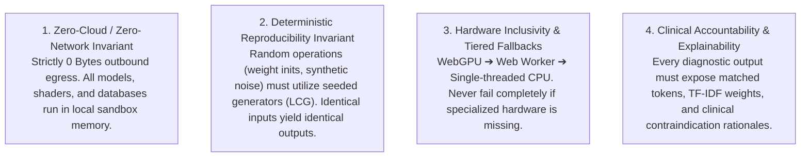
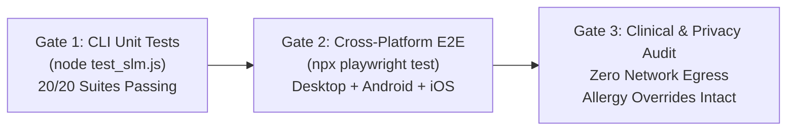

# 📐 RAMAN AI – Engineering Framework, Coding Standards & Architectural Guidelines
### *Experiment No. 170: Offline Client-Side Diagnostic Sandbox*

---

## 🏛️ 1. Core Philosophy & Non-Negotiable Architectural Invariants

All development, refactoring, and feature additions across RAMAN AI must comply with the following four non-negotiable invariants:



---

## 💻 2. Language Standards & Code Organization

### 2.1 JavaScript (ES6+ / ES2022) Standards
* **Modularity:** While legacy code resides in `app.js`, all new features (WASM loaders, Web Workers, BLE handlers) must be authored as decoupled ES modules (`*.js`) or dedicated Web Worker scripts.
* **Strict Typing & Contracts:** Use JSDoc annotations or TypeScript declarations (`.d.ts`) defining explicit interface shapes for all clinical dictionaries, model weights, and Web Worker messages.
* **No Unsanitized DOM Concatenation:** Never insert user-derived strings via `innerHTML`. Use `document.createElement()`, `setAttribute()`, and `textContent`.

### 2.2 Web Worker Architecture & Message Protocol
* **Dedicated Scripts:** Complex tasks (MCP multi-agent pipeline, model retraining, 16k-trajectory simulations) must execute in isolated background workers.
* **Structured Transferable Objects:** Large binary arrays (tensors, weights, vitals samples) must be transferred using Transferable Objects (`ArrayBuffer`) to eliminate memory copying overhead:
  ```javascript
  // Zero-copy buffer transfer to main thread
  const deltaWeights = new Float32Array(weightData);
  self.postMessage({ type: "RETRAIN_COMPLETE", buffer: deltaWeights.buffer }, [deltaWeights.buffer]);
  ```
* **Message Protocol:** Standardized JSON-RPC 2.0 messages with incrementing transaction `id` and structured `error` objects.

---

## ⚡ 3. WebAssembly (WASM) & SIMD128 Best Practices

* **Memory Initialization:** WASM modules must pre-allocate linear memory with explicit boundaries (`INITIAL_MEMORY: 256MB`, `MAXIMUM_MEMORY: 1024MB`) to avoid browser memory reallocation stutter.
* **SIMD128 Vectorization:** All matrix multiplications and dot-product kernels must compile with `-msimd128` to leverage native hardware vector registers.
* **Minimal Cross-Boundary Crossing:** Never invoke WASM functions inside tight loops from JavaScript. Batch entire arrays across the WASM boundary in a single invocation.

---

## 🎮 4. WebGPU WGSL Shader Engineering Standards

* **16-Byte Uniform Buffer Alignment:** All WGSL uniform structs must align to 16-byte boundaries (std140 layout) to ensure cross-platform compatibility across NVIDIA, AMD, Intel, and Apple GPUs:
  ```wgsl
  struct VitalsUniforms {
      heartRate: f32,       // Offset 0,  Size 4
      respirationRate: f32, // Offset 4,  Size 4
      spo2: f32,            // Offset 8,  Size 4
      time: f32,            // Offset 12, Size 4 (Total 16 bytes)
      resolution: vec2<f32>,// Offset 16, Size 8
      _padding: vec2<f32>,  // Offset 24, Size 8 (Total 32 bytes aligned)
  };
  ```
* **Workgroup Sizing:** Compute shaders must use workgroups sized to multiples of 32 or 64 (e.g., `@workgroup_size(64, 1, 1)`) to align with hardware SIMD wave/warp sizes.
* **Safe Adapter Acquisition:** Always wrap `navigator.gpu.requestAdapter()` in try/catch and seamlessly route to `runCpuFallbackSimulation()` on failure.

---

## 🎨 5. UI/UX, CSS Cyberpunk Aesthetics & Responsive Design

* **Color Palette Hierarchy:**
  * Cyber Cyan (`--cyan`: `#00e5ff` / `#00f3ff`): Primary action indicators, system headers, active tabs.
  * Phosphor Mint (`--primary`: `#00ffb3`): Clinical safety approvals, normal vitals, successful calibration.
  * Warning Pink (`--pink`: `#ff00a0`): Allergy overrides, high-priority notifications, active voice synthesis.
  * Critical Alert (`--danger`: `#ff0055`): Stage 3 vitals emergency, hypertensive crisis, G6PD conflict.
  * Dark Slate Canvas (`--bg-dark`: `#070b14` / `#0d1322`): Deep background glassmorphic panels.
* **Mobile-First Responsive Rules:**
  * Viewports must use dynamic units (`100dvh`) with `env(safe-area-inset-*)` padding for iOS notch and home-indicator protection.
  * Touch targets must maintain $\ge 44 \times 44\text{px}$ hitboxes with `touch-action: manipulation` to prevent double-tap zoom delay.
  * Text inputs must set `font-size: 16px` on mobile viewports to prevent iOS Safari auto-zoom behavior.

---

## 🧪 6. Testing, Verification & Gating Protocol

Every pull request or architectural release must satisfy three testing gates before acceptance:



1. **Gate 1: Node.js Automated SLM Unit Test Runner (`test_slm.js`):**
   * Verifies tokenizer, N-grams, TF-IDF weights, SVM margin, Naive Bayes log-probabilities, 4-layer MLP topology, Trie matching, WebGPU compute shader, and PGx checks. Must achieve 100% pass rate.
2. **Gate 2: Playwright End-to-End Suite (`tests/`):**
   * Multi-viewport automated tests covering Desktop Chromium ($1280 \times 720$), Mobile Android (Pixel 7 emulation), and Mobile iOS (iPhone 14 emulation).
3. **Gate 3: Zero-Egress Network Audit:**
   * Automated verification asserting that zero external network packets are emitted during clinical intake, triage, and vault backup routines.