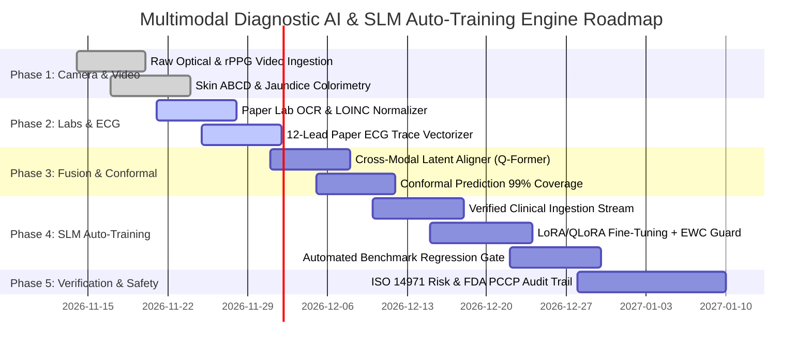

# Implementation Plan: Multimodal Medical AI Platform & Continuous SLM Learning Engine
**Document Version:** 1.0.0  
**Target Repository:** `c:\raman_ai` (RAMAN AI Medical Intelligence System)  
**Execution Horizon:** 5 Core Engineering Milestones  

---

## 1. Overview & Phased Roadmap

This plan translates the PRD, TRD, and Safety/Compliance framework into concrete engineering deliverables within the RAMAN AI ecosystem. It bridges client-side edge inference (sub-millisecond execution, zero-trust privacy) with the newly required **Multimodal Ingestion Pipelines** (Camera Photos/Videos, Paper Labs, 12-lead ECG, Radiology/Ultrasound) and the **Automated Continuous SLM Auto-Training Engine**.

---

## 2. Milestone Breakdown & Technical Tasks

### Milestone 1: Advanced Camera & Video Telemetry Module (`vision_diagnostics.js` expansion)
* **Objective:** Expand existing offline computer vision to extract physiological signals from camera video frames and calibrated dermatological images.
* **Key Tasks:**
  1. *Video rPPG Pulse & Oxygenation:* Implement Chrominance-based (CHROM) and Plane-Orthogonal-to-Skin (POS) algorithms on continuous RGB video to extract Blood Volume Pulse (BVP), calculating Heart Rate (BPM), Heart Rate Variability (HRV SDNN), and Respiratory Rate.
  2. *Colorimetric Lesion Calibration:* Implement gray-world & reference patch color-normalization to standardize skin lesion images across illumination conditions and Fitzpatrick skin tones I-VI.
  3. *Motor Tremor & Kinematics:* Implement skeletal keypoint frequency analysis (FFT) to extract 4–6 Hz resting tremor signatures.

### Milestone 2: Diagnostic Documents & Waveform Vectorizer (`multimodal_diagnostic_engine.js`)
* **Objective:** Build an end-to-end ingestion pipeline for analog paper reports (Labs, ECGs) and DICOM radiology/ultrasound loops.
* **Key Tasks:**
  1. *Paper Lab Test Tabular Parser:* Extract test names, numeric values, operators ($<, >$), reference intervals, and map extracted analytes to standard LOINC and SNOMED codes.
  2. *12-Lead Paper ECG Trace Digitizer:* Convert scanned paper ECG strips into 12 1D voltage-time arrays ($mV$ vs. $ms$), filtering background calibration grids and calculating PR, QRS, and QT intervals.
  3. *Radiology & Sonography Feature Extractors:* Ingest chest X-ray and cardiac ultrasound features (chamber volume delta, ejection fraction estimation).

### Milestone 3: Multimodal Fusion & Conformal Prediction Engine
* **Objective:** Synthesize multi-source inputs into an aligned clinical reasoning tensor with mathematically guaranteed safety bounds.
* **Key Tasks:**
  1. *Intermediate Token Fusion:* Merge visual tokens, waveform vectors, and laboratory JSON embeddings into a unified latent space.
  2. *Split Conformal Prediction:* Calculate non-conformity scores and return valid prediction sets $\mathcal{C}(X)$ under $99\%$ statistical confidence bounds ($\alpha = 0.01$).
  3. *Differential Ambiguity Alerts:* Automatically flag high-uncertainty multi-condition cases for mandatory specialist physician review.

### Milestone 4: Continuous SLM Auto-Training Engine (`continuous_slm_trainer.js`)
* **Objective:** Operationalize the automated feedback loop where clinician-verified cases auto-train the local Small Language Model (SLM).
* **Key Tasks:**
  1. *Curation & HIPAA De-Identification:* Scrub 18 HIPAA Safe Harbor identifiers (textual masking, visual bounding-box redaction, date shifting).
  2. *Supervised & DPO Dataset Synthesis:* Automatically compile verified input/output pairs into Instruction Tuning sets and Direct Preference Optimization (DPO) pairs (winning clinician report vs. losing initial draft).
  3. *Continual LoRA Adaptation with EWC Guard:* Implement continual weight updates using Low-Rank Adaptation (LoRA) coupled with Elastic Weight Consolidation (EWC) and a 30% historical replay buffer to prevent catastrophic forgetting.
  4. *Automated Benchmark Regression Gate:* Block deployment if accuracy on holdout validation suites decreases by $> 0.5\%$.
  5. *Model Compression & OTA Export:* Quantize adapter weights and generate cryptographically signed update payloads for edge devices.

### Milestone 5: Verification, Testing & Regulatory Compliance (FDA PCCP)
* **Objective:** Ensure all software modifications comply with ISO 14971, IEC 62304, and FDA Predetermined Change Control Plans (PCCP).
* **Key Tasks:**
  1. *Automated Test Harness (`test_multimodal_slm.js`):* Unit and integration test suites covering all newly introduced diagnostic and auto-training pipelines.
  2. *Audit Trail & WORM Logging:* Cryptographically sign every inference, clinician edit, and model retraining run.
  3. *FDA PCCP Validation Protocol:* Document automated change-control boundaries ensuring continuous learning remains within pre-cleared regulatory limits.
