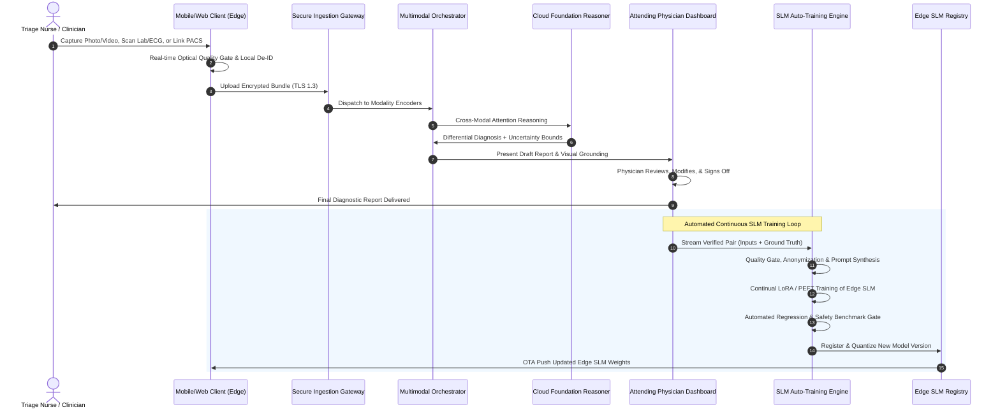

# Product Requirements Document (PRD)
## Multimodal Medical AI Diagnostic Platform & Continuous SLM Learning Engine
**Document Version:** 1.0.0  
**Status:** Approved for Architectural Design  
**Target Systems:** Edge Mobile (iOS/Android), Web Clinical Portal, Cloud Diagnostic Orchestrator  

---

## 1. Executive Summary & Product Vision

### 1.1 Vision Statement
To establish an enterprise-grade, clinically validated **Multimodal Medical AI Diagnostic Platform** that ingests heterogeneous patient data—ranging from smartphone photos/videos (dermatology, rPPG hemodynamics, motor kinematics) and paper-based records (lab test panels, ECG printouts) to hospital-grade imaging (X-rays, MRIs, CTs, ultrasound loops)—and produces unified, explainable clinical decision support. Crucially, the platform features a closed-loop **Continuous SLM (Small Language Model) Auto-Training Flywheel** that securely curates clinician-verified data to auto-train, compress, and deploy high-performance edge models for decentralized, low-latency point-of-care diagnostics.

### 1.2 Core Problem Statement
1. **Diagnostic Fragmentation:** Healthcare facilities and remote clinics operate with disjointed point-solutions (e.g., a standalone dermatology app, a separate ECG reader, and a disconnected PACS). There is no unified system capable of contextualizing a skin lesion alongside lab chemistry and cardiac rhythms.
2. **Standardization Barrier:** Consumer smartphone captures suffer from lighting, sensor, and optical variations, while paper-based lab tests and ECG strips remain trapped in analog or static PDF formats.
3. **Data Wastage & Cold Models:** In typical deployments, billions of clinical data points collected daily are discarded or siloed. Static AI models degrade over time due to clinical drift, missing an automated, compliant pipeline to continuously train efficient Small Language Models (SLMs) from real-world clinical feedback.

---

## 2. Personas & Stakeholder Workflows

```
┌─────────────────────────────────────────────────────────────────────────────┐
│                            CORE SYSTEM PERSONAS                             │
├───────────────────┬─────────────────────────────────────────────────────────┤
│ Persona           │ Role & Primary Needs                                    │
├───────────────────┼─────────────────────────────────────────────────────────┤
│ 1. Point-of-Care  │ Captures patient photos, videos, paper records, and     │
│    Nurse / Tech   │ bedside vitals; needs real-time quality feedback        │
│                   │ (lighting, framing, focus) and rapid triage flags.      │
├───────────────────┼─────────────────────────────────────────────────────────┤
│ 2. Attending      │ Reviews AI differential diagnoses, heatmaps, and        │
│    Physician      │ confidence intervals; edits/validates report; provides  │
│                   │ legal electronic sign-off (HITL gatekeeper).            │
├───────────────────┼─────────────────────────────────────────────────────────┤
│ 3. ML Platform    │ Monitors model drift, data curation queues, automated   │
│    Engineer       │ SLM training pipelines, benchmark regression gates, and │
│                   │ edge OTA (over-the-air) model updates.                  │
├───────────────────┼─────────────────────────────────────────────────────────┤
│ 4. Compliance &   │ Audits audit logs, patient consent, de-identification   │
│    Safety Officer │ pipelines, and FDA PCCP (Change Control) validation.   │
└───────────────────┴─────────────────────────────────────────────────────────┘
```

---

## 3. High-Level Product Architecture & Data Flow



---

## 4. Functional Requirements (FR)

### 4.1 Epics 1: Optical & Video Capture (Edge Mobile)
* **FR-1.1 Real-Time Capture Guidance:** The mobile camera client MUST run on-device computer vision to evaluate lighting lux level, motion blur, and framing distance, preventing capture until quality thresholds are satisfied.
* **FR-1.2 Raw Bayer Ingestion:** For dermatological and wound captures, the system MUST support acquiring uncompressed RAW (Bayer CFA) frames via Android Camera2 / iOS AVFoundation to bypass aggressive OEM consumer tone-mapping.
* **FR-1.3 Video Physiological Sensing (rPPG):** The video ingestion module MUST capture a minimum of 30 seconds of continuous 60 fps facial video at fixed exposure to compute blood volume pulse (BVP), resting heart rate, respiratory rate, and HRV.
* **FR-1.4 Motor & Gait Kinematics:** The video engine MUST extract 33-point skeletal landmark graphs per frame to track tremor frequency (Hz), step length, cadence, and postural stability.

### 4.2 Epic 2: Document & Waveform Digitization
* **FR-2.1 Lab Report OCR & Layout Parsing:** The system MUST extract tabular data from photographed paper or PDF laboratory reports, isolating analyte name, numeric value, operator flags ($<, >$), reference range, and units.
* **FR-2.2 Terminology Mapping:** Extracted lab analytes MUST automatically map to standardized **LOINC** and **SNOMED CT** concept codes with a top-1 mapping accuracy $\ge 98\%$.
* **FR-2.3 Paper ECG Vectorization:** The system MUST process paper ECG strips, eliminate the background millimeter grid (pink/red grid filtering), deskew traces, and output 12 synchronized 1D voltage-time waveforms ($mV$ vs. $ms$).

### 4.3 Epic 3: Radiological & Sonographic Ingestion
* **FR-3.1 DICOM & PACS Interoperability:** The platform MUST support DICOMweb (WADO-RS, STOW-RS, QIDO-RS) to query and retrieve multi-slice CT/MRI series and ultrasound DICOM video loops.
* **FR-3.2 Volumetric & Video Parsing:** The engine MUST handle multi-sequence MRIs (T1, T2, FLAIR, DWI) with automated Hounsfield/intensity normalization and dynamic ultrasound video frame-rate synchronization.

### 4.4 Epic 4: Multimodal Synthesis & Clinical Reasoning
* **FR-4.1 Omnimodal Cross-Modal Reasoning:** The reasoning engine MUST synthesize diagnoses across all provided modalities, dynamically handling missing inputs without pipeline failure.
* **FR-4.2 Visual Grounding & Saliency:** Every predicted pathology MUST include spatial or temporal grounding: bounding boxes / segmentation heatmaps on images, slice indices on 3D CT/MRIs, and time intervals on ECG/video streams.
* **FR-4.3 Conformal Prediction Uncertainty:** The engine MUST calculate mathematically valid prediction sets $\mathcal{C}(X)$ under a user-defined risk bound ($1 - \alpha = 99\%$). If multiple candidate conditions exist, it MUST flag the case as "High Diagnostic Uncertainty" for specialist review.
* **FR-4.4 Standardized Report Generation:** The system MUST automatically draft reports adhering to FHIR `DiagnosticReport` specifications with grounded bibliographic medical citations.

### 4.5 Epic 5: Continuous SLM Auto-Training Engine (The Flywheel)
* **FR-5.1 Secure Clinical Ingestion Stream:** All user inputs and finalized, clinician-signed diagnostic outputs MUST be streamed into an isolated training queue.
* **FR-5.2 Quality Curation & Anonymization Gate:** The auto-training engine MUST verify that:
  1. The case has received formal attending physician sign-off (or biopsy/lab ground truth).
  2. All 18 HIPAA Safe Harbor identifiers are scrubbed via automated multi-pass NLP and visual redaction.
  3. Image/signal quality metrics exceed curation thresholds.
* **FR-5.3 Automated Instruction & DPO Pair Synthesis:** The system MUST automatically structure the multimodal inputs into instruction-tuning datasets and Direct Preference Optimization (DPO) pairs (chosen clinician-approved rationale vs. rejected initial draft).
* **FR-5.4 Continual Parameter-Efficient Fine-Tuning (PEFT):** The engine MUST execute automated scheduled training runs (e.g., weekly or upon accumulating $N = 5,000$ verified cases) updating Low-Rank Adaptation (LoRA / QLoRA) weights of a compact multimodal SLM (e.g., 2B to 8B parameters).
* **FR-5.5 Automated Benchmark & Safety Gate:** Retrained candidate weights MUST pass automated regression benchmarks (preventing catastrophic forgetting) on standard medical sets (MIMIC-CXR, PTB-XL, ISIC, MedQA) before deployment.
* **FR-5.6 Automated Quantization & Edge OTA Deployment:** Validated SLM weights MUST be automatically compiled into 4-bit INT4/AWQ quantized formats and staged for over-the-air (OTA) distribution to mobile edge clients.

---

## 5. Non-Functional Requirements (NFR)

### 5.1 Performance & Latency SLAs
* **NFR-1.1 Edge Quality Gate Latency:** Optical quality assessment on mobile device MUST complete in $< 100\text{ ms}$ per frame.
* **NFR-1.2 Edge SLM Inference:** On-device SLM triage inference on modern mobile NPUs (Apple Neural Engine, Qualcomm Snapdragon NPU) MUST execute in $< 1.5\text{ seconds}$ for static images.
* **NFR-1.3 Cloud Foundation Diagnostic Latency:** End-to-end cloud multimodal reasoning for a complete patient case (Photo + Labs + ECG + X-ray) MUST return results in $< 8.0\text{ seconds}$.

### 5.2 Scalability & Reliability
* **NFR-2.1 Availability:** Cloud orchestrator uptime $\ge 99.99\%$.
* **NFR-2.2 Concurrency:** Scalable to 10,000 concurrent edge device streams with elastic pod autoscaling.
* **NFR-2.3 Offline Capability:** Edge client MUST support offline capture, local preliminary triage via on-device SLM, and automatic background sync upon network reconnection.

### 5.3 Data Governance & Retention
* **NFR-3.1 Data Lineage:** Full provenance tracking for every training example used to fine-tune each SLM model iteration.
* **NFR-3.2 Opt-Out & Right to Erasure:** Complete automated pipeline to purge specific patient data from future training cycles within 30 days upon request, adhering to GDPR Article 17.

---

## 6. Success Metrics & Key Performance Indicators (KPIs)

| KPI Category | Metric Name | Target Benchmark |
| :--- | :--- | :--- |
| **Diagnostic Accuracy** | Top-1 & Top-3 Differential Accuracy | $\ge 92\%$ across all standard validated disease classes |
| **Safety & Calibration** | Conformal Prediction Coverage | $\ge 99\%$ coverage at $\alpha = 0.01$ |
| **Optical Quality** | Re-capture Rate due to Blurry/Dark Media | $< 4.5\%$ of all mobile sessions |
| **SLM Continual Learning** | Out-of-Distribution Error Reduction | $\ge 15\%$ relative error reduction per quarterly SLM retraining cycle |
| **Catastrophic Forgetting**| Historical Benchmark Degradation | $< 1.0\%$ drop on historical benchmark suites |
| **Workflow Efficiency** | Clinician Diagnostic Documentation Time | $\ge 40\%$ reduction in physician time-to-report |
