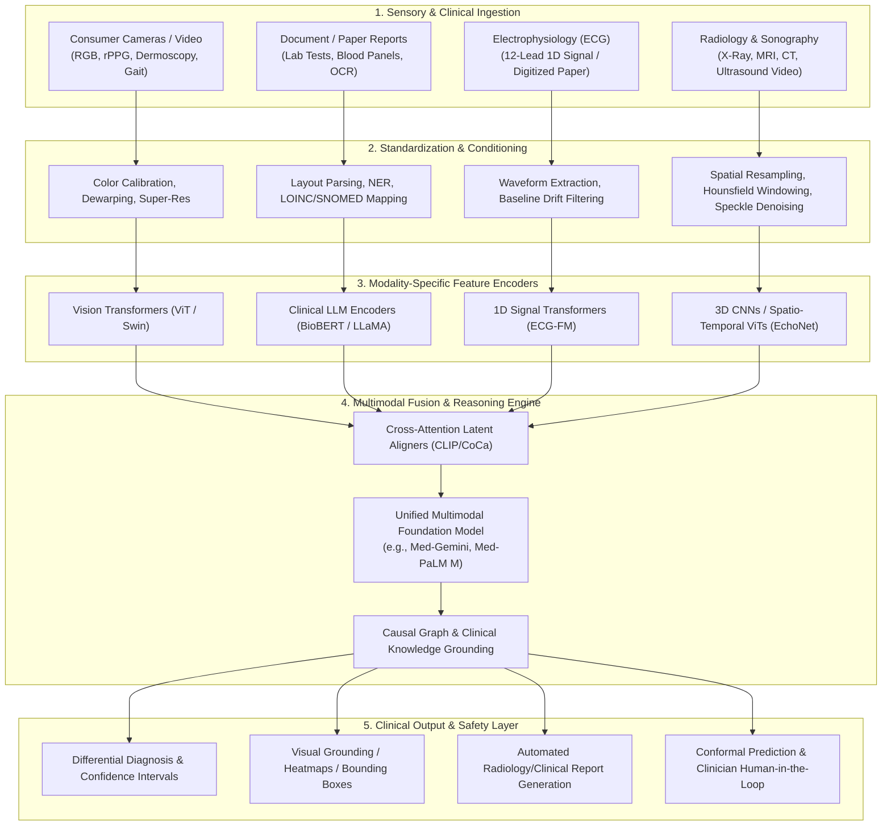

# Multimodal Medical AI & Camera-Based Diagnostic Systems: Reconnaissance, Architecture, and Improvement Roadmap

---

## Executive Summary

The convergence of high-resolution consumer camera sensors, specialized medical imaging modalities, edge computing, and **Multimodal Medical Foundation Models (MMFMs)** has fundamentally shifted clinical diagnostics. What once required fragmented, single-task deep learning classifiers (e.g., a standalone ResNet for melanoma or a CNN for chest X-rays) is rapidly transitioning toward **unified omnimodal clinical reasoning systems**. 

This comprehensive reconnaissance and technical study examines:
1. **Camera-Based Disease Identification:** How optical photos and continuous video streams captured on smartphones and point-of-care cameras are parsed to diagnose dermatological, ophthalmological, oral, neurological, and hemodynamic conditions.
2. **Multimodal Clinical Processing Pipeline:** How complex clinical inputs—including laboratory test reports (unstructured text/tables), 1D/2D Electrocardiograms (ECGs), projection radiography (X-rays), volumetric tomographies (MRIs, CTs), and dynamic sonography (ultrasound videos)—are ingested, digitized, standardized, and fused.
3. **End-to-End System Architectures:** From edge sensory acquisition and optical calibration to cross-modal attention transformers, causal graphs, uncertainty quantification, and EHR/PACS integration.
4. **Feasibility, Bottlenecks, and Scientific Innovations:** A deep evaluation of technical, clinical, and regulatory feasibility, paired with an engineering roadmap to drastically improve accuracy, robustness across diverse demographics, and real-time inference latency.

---



---

## 1. Disease Identification via Photos and Videos (Camera-Based Diagnostics)

Smartphones and commodity camera sensors capture photons across RGB channels (typically 400–700 nm wavelengths). Applying computer vision and signal processing to these optical signals allows non-invasive screening and functional monitoring across multiple medical domains:

### 1.1 Dermatology and Wound Care (Static Photos & Dermoscopy)
* **Pathologies Identified:** Melanoma, Basal Cell Carcinoma (BCC), Squamous Cell Carcinoma (SCC), atopic dermatitis, psoriasis, diabetic foot ulcers (tissue granulation vs. necrotic slough), burn depth assessment, and viral exanthems (e.g., mpox, shingles).
* **Sensor Mechanics & Calibration:**
  * Consumer smartphones suffer from white balance shifts, specular highlights (flash glare), non-Lambertian skin reflection, and variable lens distortion.
  * **Color Constancy Algorithms:** Grey-World, Shades of Gray, and chromatic adaptation transforms (von Kries, CIELAB color space) normalize illuminants.
  * **Color Checker Calibration Targets:** Physical calibrated reference patches (e.g., X-Rite Classic or adhesive miniaturized color discs placed on healthy skin adjacent to lesions) enable sub-millimeter scale calibration and reflectance normalization ($R(\lambda)$ extraction).
  * **Dermoscopy Attachments:** Polarized light cross-filters eliminate stratum corneum surface reflection, exposing sub-epidermal melanin patterns, atypical pigment networks, and arborizing vessels.
* **Underlying Deep Learning Architectures:**
  * Convolutional Neural Networks (ResNet-50, EfficientNet-B6) and hierarchical Vision Transformers (Swin-Transformer, MaxViT).
  * Ensembles trained on large benchmarks (e.g., ISIC Archive, Fitzpatrick17k, HAM10000).
  * Segmentation heads (e.g., Mask2Former, U-Net with attention gates) isolate lesion boundaries to compute mathematical ABCD criteria (Asymmetry index, Border irregularity, Color variance, Diameter in mm).

### 1.2 Ophthalmology and Optometry (Anterior & Fundus Imaging)
* **Pathologies Identified:** Diabetic Retinopathy (microaneurysms, hemorrhages, hard exudates), Glaucoma (cup-to-disc ratio), Cataracts (lens opacity grading), Age-related Macular Degeneration (AMD), and Corneal Ulcers.
* **Optical Pipeline:**
  * Handheld smartphone fundus adapters (e.g., D-Eye, Volk iNview) align the camera optical axis with condensing lenses (20D/28D) to visualize the retina through a dilated or non-mydriatic pupil.
  * High-resolution anterior photography evaluates corneal transparency, conjunctival injection, and anterior chamber depth.
* **Algorithmic Methods:**
  * Multi-scale feature pyramids (FPN) detect subtle micro-vascular lesions (< 15 microns across).
  * Vessel segmentation via modified U-Nets to measure arteriolar-to-venular diameter ratio (AVR), a systemic biomarker for hypertension and stroke risk.

### 1.3 Facial Phenotyping and Neurological Dysmorphology
* **Pathologies Identified:** Rare genetic syndromes (Down syndrome, Cornelia de Lange, Angelman syndrome, Fragile X), Bell's Palsy, acute ischemic stroke (facial droop), Parkinsonian hypomimia ("masked facies"), and neonatal hyperbilirubinemia (jaundice).
* **Processing Mechanics:**
  * **Dense 3D Landmark Estimation:** 468-point 3D facial mesh tracking (e.g., MediaPipe Face Mesh, Dense Landmark Networks) calculates metric distances between inter-pupillary line, philtrum, nasal bridge, and commissures.
  * **DeepGestalt / Face2Gene Architectures:** Metric learning with ArcFace / Cosine-margin loss functions projects facial morphology into an embedding space clustered by cytogenetic aberrations.
  * **Scleral Colorimetry for Jaundice:** Isolating the white sclera of the eye via semantic segmentation, calculating yellowness indices ($b^*$ channel in $L^*a^*b^*$ space) calibrated against ambient light, correlating directly with total serum bilirubin (TSB).

### 1.4 Video-Based Physiological Sensing (rPPG & Kinematics)
Continuous camera capture unlocks dynamic physiological metrics that static imagery cannot convey:

```
[Ambient / Flash Light] 
       │
       ▼
[Subdermal Arterial Pulsation] ──▶ [Volumetric Blood Volume Changes]
                                           │
                                           ▼
[Smartphone Video (30-60 fps)] ◀── [Pulsatile Green/Red Color Shifts (rPPG)]
       │
       ▼
[POS / CHROM Extraction Algorithms] ──▶ [Filtered BVP Signal] ──▶ [Heart Rate, HRV, SpO2, Resp Rate]
```

#### A. Remote Photoplethysmography (rPPG)
* **Principle:** As the left ventricle contracts, pulse waves traverse the arterial tree. Facial capillaries expand, altering optical absorption of light—predominantly in the green spectrum (~520–580 nm) due to the peak absorption band of oxygenated hemoglobin ($HbO_2$).
* **Mathematical Recovery:**
  * Standard RGB video captures $C(t) = [R(t), G(t), B(t)]^T$.
  * Algorithms like **Plane-Orthogonal-to-Skin (POS)** and **Chrominance-based (CHROM)** project color signals onto dynamic projection planes orthogonal to skin-tone drift vectors, canceling out rigid head motion and ambient illumination flicker:
    $$S_{CHROM} = 3(1 - \alpha/2)R - 2(1 + \alpha/2)G + 3\alpha B$$
  * **Deep Learning rPPG:** PhysNet (3D-CNN) and TS-CAN (Temporal Shift Convolutional Attention Network) isolate subtle Blood Volume Pulse (BVP) waveforms, yielding resting heart rate, pulse rate variability (PRV/HRV), respiratory rate, and blood pressure surrogate estimations.

#### B. Neuromotor, Gait, and Kinematic Video Analysis
* **Pathologies:** Parkinsonian tremor (resting 4–6 Hz frequency), bradykinesia, freezing of gait, post-stroke hemiparetic gait, and cerebral palsy in infants (General Movement Assessment - GMA).
* **Processing Stack:**
  * Multi-person 2D/3D skeletal pose estimation (e.g., OpenPose, HRNet, ViTPose).
  * **Spatio-Temporal Graph Convolutional Networks (ST-GCN):** Joint coordinates ($x, y, z$) form graph nodes connected by natural bones and temporal trajectory edges.
  * Fast Fourier Transform (FFT) and continuous wavelet transforms (CWT) applied to hand/finger trajectories to isolate tremor spectral density and movement arrest.

#### C. Endoscopic & Surgical Video Analysis
* **Pathologies:** Colorectal polyps (adenomas vs. hyperplastic), Barrett's esophagus, bleeding lesions, surgical margin identification.
* **Pipelines:** High-frame-rate real-time object detection (YOLOv8-Medical, RT-DETR) coupled with temporal Kalman tracking filters (e.g., Medtronic GI Genius). Deep feature representations classify mucosal vascular patterns under Narrow Band Imaging (NBI).

---

## 2. Processing Multimodal Diagnostic Inputs (Labs, ECG, X-Rays, MRIs, Sonography)

Modern clinical diagnosis is inherently multimodal. A doctor rarely looks at a photograph without reviewing laboratory chemistry, cardiac tracings, or radiological cross-sections. Below is the technical breakdown of how diverse clinical data streams are transformed into machine-actionable tensors:

```
┌─────────────────────────────────────────────────────────────────────────────┐
│                   HETEROGENEOUS CLINICAL DATA PROCESSING                    │
├─────────────────┬──────────────────────┬─────────────────┬──────────────────┤
│ Modality        │ Input Format         │ Key Processing  │ Output Form      │
│                 │                      │ Engine          │                  │
├─────────────────┼──────────────────────┼─────────────────┼──────────────────┤
│ Lab Test        │ Scanned PDF / Image  │ LayoutLMv3,     │ Structured JSON, │
│ Reports         │ or HL7 v2 / FHIR     │ BioBERT, LOINC  │ normalized units,│
│                 │                      │ standardizers   │ delta-trends     │
├─────────────────┼──────────────────────┼─────────────────┼──────────────────┤
│ 12-Lead ECG     │ Paper printout photo │ Dewarping U-Net,│ 12x5000 tensor   │
│                 │ OR raw DICOM/XML     │ vectorizer,     │ (mV vs time),    │
│                 │                      │ 1D ResNet/Transf│ rhythm classes   │
├─────────────────┼──────────────────────┼─────────────────┼──────────────────┤
│ Chest / Skeletal│ 2D DICOM             │ CheXzero,       │ Segmentation map,│
│ X-Rays          │ (16-bit grayscale)   │ Swin Transformer│ disease probas,  │
│                 │                      │ MedCLIP         │ visual grounding │
├─────────────────┼──────────────────────┼─────────────────┼──────────────────┤
│ Volumetric      │ Multi-sequence DICOM │ nnU-Net,        │ 3D voxel masks,  │
│ CT & MRI        │ (3D tensors)         │ Swin UNETR,     │ volumetric ratios│
│                 │                      │ SegMamba        │ tissue perfusion │
├─────────────────┼──────────────────────┼─────────────────┼──────────────────┤
│ Sonography /    │ B-mode / Doppler     │ EchoNet-Dynamic,│ LVEF %, strain %,│
│ Ultrasound      │ DICOM video loops    │ EchoCLIP,       │ chamber tracking,│
│                 │                      │ spatio-temp ViT │ Doppler spectrum │
└─────────────────┴──────────────────────┴─────────────────┴──────────────────┘
```

### 2.1 Laboratory Test Reports (OCR, Document Layout Analysis, and Normalization)
1. **Document Digitization & Optical Character Recognition:**
   * Images or paper photos undergo perspective transformation (corner detection via quad-mesh solvers).
   * **Visual-Textual Encoders:** LayoutLMv3, Donut, and TrOCR process both textual tokens and bounding box 2D coordinate embeddings simultaneously.
2. **Biomedical Named Entity Recognition (NER) & Relation Extraction:**
   * Biomarker extraction (e.g., "Creatinine", "HbA1c", "Troponin I", "eGFR").
   * Numerical value parsing, parsing operator flags (e.g., "$<$ 0.01", "$>$ 100"), and reference range extraction (e.g., "0.7 - 1.3 mg/dL").
3. **Semantic Standardization (Ontology Mapping):**
   * Raw text terms map to **LOINC** (Logical Observation Identifiers Names and Codes) and **SNOMED CT**.
   * Unit unification (e.g., converting $\text{mmol/L}$ to $\text{mg/dL}$ for glucose via chemical molar conversions) to eliminate multi-laboratory drift.
   * Temporal Delta Analysis: Tracking rate-of-change ($\frac{\Delta \text{Value}}{\Delta t}$) across longitudinal records to flag acute kidney injury or fulminant sepsis.

### 2.2 Electrocardiograms (ECGs): 1D Physiological Waveforms vs. Digitized Paper
ECGs represent electrical dipoles of the heart over time:
* **Direct Digital Ingestion:** 12 leads sampled at 250 Hz to 1000 Hz recorded in XML, EDF (European Data Format), or DICOM-ECG formats.
* **Paper ECG Digitization (Scans & Photos):**
  * When only paper prints exist, an optical reconstruction pipeline is applied:
    1. *Grid Removal / Separation:* Color thresholding in HSV space or U-Net segmentation isolates the pink/red 1mm/5mm calibration grid from black ink ECG traces.
    2. *Perspective & Skew Correction:* Radon transform or Hough line transforms rectify perspective distortions.
    3. *Trace Vectorization:* Skeletonization (thinning algorithms) converts pixel masks into single-pixel continuous curves, followed by 1D signal interpolation generating 12 separate 1D voltage-time functions $V_l(t)$ at millivolt scales.
* **Neural Feature Extraction:**
  * **1D ResNets & Transformers (ECG-FM, PTB-XL Models):** Attention-based architectures evaluate P-wave morphologies, PR intervals, QRS complexes, ST segments, and T-waves.
  * **Clinical Targets:** Left ventricular hypertrophy, atrial fibrillation, acute ST-elevation myocardial infarction (STEMI), Brugada syndrome, hyperkalemia (peaked T-waves), and subclinical heart failure with reduced ejection fraction (HFrEF) prior to echocardiographic detection.

### 2.3 Projection Radiography (X-Rays)
* **Data Properties:** 2D projections of 3D anatomical densities stored in 16-bit depth DICOM images.
* **Preprocessing Pipeline:** Contrast-Limited Adaptive Histogram Equalization (CLAHE), lung field segmentation, window-level normalization.
* **Foundational Modeling:**
  * Dual-encoder vision-language architectures (e.g., **MedCLIP**, **CheXzero**, **BioViL**) trained on pairs of chest X-rays and unstructured radiology reports (from MIMIC-CXR, CheXpert).
  * Capable of zero-shot classification and disease localization (pneumothorax, pleural effusion, consolidation, cardiomegaly, rib fractures) via cross-modal attention maps and Grad-CAM/Score-CAM overlays.

### 2.4 Volumetric Tomography (CT and MRI)
* **Data Structure:** 3D voxel grids ($H \times W \times D$) representing volumetric electron density (CT, measured in calibrated Hounsfield Units: Air = -1000 HU, Water = 0 HU, Bone = +1000 HU) or proton relaxation times (MRI: T1-weighted, T2-weighted, FLAIR, Diffusion-Weighted Imaging [DWI]).
* **Algorithmic State-of-the-Art:**
  * **nnU-Net & MedSAM3D:** Self-adapting 3D U-Net frameworks that dynamically configure patch sizes, spacing, and normalization per dataset.
  * **3D Swin UNETR & SegMamba:** Shifted-window transformers and state-space models that scale to full volumetric sequences without GPU memory explosion, segmenting glioblastomas, ischemic stroke penumbras, pulmonary nodules, and multi-organ abdominal anatomy.
  * **Registration & Motion Correction:** Deformable registration networks (e.g., VoxelMorph) register longitudinal follow-up scans to measure volumetric tumor response (RECIST criteria).

### 2.5 Sonography and Echocardiography (Dynamic Ultrasound Video)
* **Intrinsic Challenges:** Severe acoustic speckle noise, acoustic shadows behind bone/calcification, transducer angle variability, and operator dependency.
* **Video Deep Learning Pipeline:**
  * **EchoNet-Dynamic & EchoCLIP:** Deep spatio-temporal (3D ResNet, Video Vision Transformers) models trained on cardiac ultrasound video loops (apical 4-chamber, parasternal long axis).
  * **Automated Functional Metrics:** Pixel-level left ventricular endocardial boundary tracing across cardiac cycles to automatically calculate End-Diastolic Volume (EDV), End-Systolic Volume (ESV), and Left Ventricular Ejection Fraction (LVEF):
    $$\text{LVEF} = \frac{\text{EDV} - \text{ESV}}{\text{EDV}} \times 100\%$$
  * Real-time Point-of-Care Ultrasound (POCUS) AI (e.g., Caption Health / GE HealthCare): Directs novice nurses or paramedical workers on how to rotate, tilt, and slide the ultrasound probe to acquire diagnostic-grade acoustic windows.

---

## 3. Multimodal Clinical Fusion Architectures

Combining these disparate modalities into a coherent diagnostic reasoning engine requires overcoming extreme dimensional heterogeneity:

```
[Camera Photo / Video]   ──▶ ViT / Video-ViT Encoder  ──▶ [Tokens: 1 x 768]
[12-Lead ECG Signal]     ──▶ 1D Temporal Transformer  ──▶ [Tokens: 1 x 768]
[3D CT / MRI Scans]      ──▶ 3D Swin / ResNet Encoder ──▶ [Tokens: 1 x 768]   ──▶ [Cross-Modal Unified Latent Space]
[Lab Biomarkers (JSON)]  ──▶ Tabular / MLP Embedder   ──▶ [Tokens: 1 x 768]            (Perceiver / Q-Former)
[Clinical Text / Notes]  ──▶ LLM Text Embedder        ──▶ [Tokens: 1 x 768]                     │
                                                                                                ▼
                                                                                   [Large Multimodal Reasoner]
                                                                                     (e.g., Med-Gemini Engine)
                                                                                                │
                                                                                                ▼
                                                                                   [Differential Diagnosis,
                                                                                    Uncertainty Score & Report]
```

### 3.1 Fusion Paradigms
1. **Early Fusion (Pixel/Signal Level):** Impractical across diverse modalities (e.g., merging a 1D ECG array with a 3D MRI volume).
2. **Late Fusion (Decision Level):** Separate networks predict disease probabilities independently (e.g., $P_{\text{Derm}}(\text{Melanoma})$, $P_{\text{Lab}}(\text{Elevated LDH})$), and a meta-classifier (XGBoost or logistic regression) averages outputs. *Limitation: Fails to capture non-linear, cross-modal physiological interactions.*
3. **Intermediate / Joint Cross-Attention Fusion (Current State-of-the-Art):**
   * Modality-specific foundational encoders project heterogeneous data into a unified vector space of identical embedding dimension ($d = 768$ or $1024$).
   * **Perceiver Resampler / Querying Transformers (Q-Former):** A fixed set of learnable query tokens attends to variable-length visual, signal, and tabular tokens via cross-attention layers.
   * **Multimodal Medical Foundation Models (e.g., Google Med-Gemini, Med-PaLM M, LLaVA-Med):** The aligned tokens are injected directly into the transformer context of an autoregressive LLM. The model processes the patient's ECG trace, chest radiograph, skin lesion photograph, and laboratory panel as an interleaved conversation:
     > *"Given the ST-segment elevation on lead V2–V4, the elevated serum Troponin I of 4.5 ng/mL, and the pulmonary congestion visible on the AP chest X-ray, synthesize the acute diagnosis, calculate GRACE risk score, and propose emergency revascularization protocol."*

---

## 4. Scope and Feasibility to Improve the System

To evolve from experimental prototypes to robust, globally scalable clinical platforms, several technological and methodological breakthroughs are required:

### 4.1 Technical Feasibility Matrix

| Axis | Current State | Target Next-Gen State | Feasibility | Primary Technological Enablers |
| :--- | :--- | :--- | :--- | :--- |
| **Optical Robustness (Photos/Videos)** | Highly sensitive to lighting, camera sensor ISP, and skin tone bias (poor on Fitzpatrick V-VI). | Invariant to sensor, ambient lighting; unbiased across all global skin types. | **High (1-2 yrs)** | Raw Bayer sensor data access, hardware color-calibration patches, Monk Skin Tone datasets, synthetic diffusion data. |
| **Missing Modality Handling** | Models fail or crash if one input (e.g., lab test or ECG) is missing. | Dynamic inference over arbitrary subsets of modalities without retrained sub-models. | **High (Achieved in research)** | Masked Multimodal Autoencoders (e.g., MultiMAE), dynamic token dropping, drop-path attention. |
| **Paper-to-Signal Digitization** | Heuristic computer vision struggles with creases, coffee stains, low contrast. | End-to-end diffusion restoration and vector graph neural networks. | **Medium-High (2 yrs)** | Foundation OCR-Layout models, synthetic paper-distortion augmentations, vector tracing nets. |
| **Real-Time Edge Execution** | Heavy multi-billion parameter foundation models require cluster GPUs ($A100/H100$). | Sub-500ms multi-modal inference running locally on modern smartphone NPUs. | **High (Active rollout)** | 4-bit / 2-bit quantization (AWQ, GPTQ), speculative decoding, compact SLMs (MobileNetV4, Gemma-2-2B). |
| **Uncertainty & Hallucination Mitigation** | Confident false positives; LLMs hallucinating non-existent lesions or lab values. | Mathematically guaranteed risk bounds; explicit "I do not know" deferral. | **Medium-High (1-3 yrs)** | Conformal Prediction, calibrated Monte Carlo epistemic dropout, causal graphical constraints. |
| **Cross-Institutional Privacy** | Siloed hospital databases prevent central training of multimodal AI models. | Privacy-preserving federated foundation models without data leaving hospital firewalls. | **Medium (3-4 yrs)** | Federated Learning (FL), Differential Privacy ($\epsilon, \delta$), Swarm Learning on confidential enclaves. |

---

### 4.2 Key Scientific Innovations and Breakthrough Areas

#### A. Raw Sensor-Level Processing (Bypassing Mobile ISP Artifacts)
* **Problem:** Smartphone cameras run proprietary Image Signal Processors (ISPs) that perform aggressive non-linear tone mapping, bilateral skin-smoothing, and edge sharpening designed to make selfies look appealing. This destroys microvascular pulsatile signals and dermatological skin textures.
* **Innovation:** Direct ingestion of **Raw Bayer CFA (Color Filter Array) data** via Android Camera2 API / iOS AVFoundation. Processing linear 12-bit/14-bit DNG files preserves absolute photon counts, enabling laboratory-grade colorimetric quantification directly on consumer devices.

#### B. Synthetic Data Generation via Guided Diffusion Models
* **Problem:** Medical datasets are plagued by severe class imbalances—rare genetic conditions, uncommon melanoma variants, or rare arrhythmias have few real-world examples.
* **Innovation:** Latent Diffusion Models (LDMs) conditioned on structured clinical parameters (e.g., MedDDPM, RoentGen). Synthesizing photorealistic, clinically verified pathology variations (e.g., generating high-risk melanomas across Fitzpatrick skin types V and VI) to balance training distributions and eliminate demographic bias.

#### C. Causal Deep Learning and Spurious Correlation Pruning
* **Problem:** Standard vision models latch onto spurious confounders (e.g., hospital-specific radiology position markers, ECG paper background grid patterns, or dermoscopy ruler markings) rather than true biological pathology.
* **Innovation:** **Structural Causal Models (SCMs)** and Counterfactual Reasoning architectures. By formulating the diagnostic task as a causal graph ($X \rightarrow Y$ mediated by true biology $M$, with confounder $U$), causal invariant risk minimization forces the neural network to ignore hospital-specific acquisition signatures.

#### D. Conformal Prediction for Patient Safety
* **Problem:** Standard neural network softmax scores are not calibrated probabilities and exhibit overconfidence on out-of-distribution inputs.
* **Innovation:** **Split Conformal Prediction**. Instead of outputting a single diagnosis, the system outputs a prediction set:
  $$\mathcal{C}(X) \subseteq \{d_1, d_2, \dots, d_K\}$$
  guaranteed to contain the true ground-truth diagnosis with user-specified statistical confidence (e.g., $1 - \alpha = 99\%$). If the set contains multiple conflicting diagnoses, the system automatically triggers an urgent escalation to a specialist physician.

---

## 5. Architectural Blueprint for an End-to-End Multimodal Diagnostic Platform

The following production-ready architecture illustrates how modern engineering combines edge capture with cloud-scale multimodal reasoning:

```
┌─────────────────────────────────────────────────────────────────────────────┐
│                           1. CLIENT / EDGE LAYER                            │
│  - Smartphone Native App (Flutter / React Native + C++ Native Plugin)      │
│  - Raw Sensor Capture (Camera2 API / AVFoundation: Bayer RAW + 60fps Video) │
│  - On-Device Quality Gate (Real-Time Focus, Lighting, and Framing Guidance) │
│  - Edge Pre-Inference: Face Mesh / Lesion Segmentation (NPU Quantized)      │
│  - Local De-Identification / HIPAA Stripping (Face Blurring, EXIF Deletion) │
└──────────────────────────────────────┬──────────────────────────────────────┘
                                       │ Encrypted TLS 1.3 / gRPC
                                       ▼
┌─────────────────────────────────────────────────────────────────────────────┐
│                        2. INGESTION & GATEWAY LAYER                         │
│  - API Gateway: Reverse Proxy & Load Balancer (Envoy / Kong)                │
│  - Modality Router & Dispatcher (Apache Kafka / Redis Streams)              │
│  - Hospital EHR Connectors: DICOM PACS Bridge (dcm4chee), HL7/FHIR Ingester │
└──────────────────────────────────────┬──────────────────────────────────────┘
                                       │
                                       ▼
┌─────────────────────────────────────────────────────────────────────────────┐
│                3. SPECIALIZED PREPROCESSING & INFERENCE MICROSERVICES       │
├────────────────────────────────┬────────────────────────────────────────────┤
│ Service A: Document & Lab OCR  │ LayoutLMv3 + Donut + LOINC Concept Resolver │
│ Service B: Waveform Processor  │ Paper Dewarping + 1D ResNet/Transformer     │
│ Service C: Radiology 2D/3D     │ nnU-Net + MedCLIP + 3D Swin UNETR           │
│ Service D: Ultrasound Video    │ EchoNet-Dynamic + Temporal ViT              │
│ Service E: Skin & Photo Vision │ Swin-L + Raw-Bayer Colorimetric Calibrator  │
└────────────────────────────────┬────────────────────────────────────────────┘
                                 │ Feature Embeddings (d = 1024)
                                 ▼
┌─────────────────────────────────────────────────────────────────────────────┐
│                 4. MULTIMODAL FOUNDATION REASONING CORE                     │
│  - Modality Aligner: Cross-Attention Query Transformer (Q-Former)          │
│  - Clinical Reasoning Engine: Large Multimodal Model (e.g., Med-Gemini-70B) │
│  - Grounding Knowledge Base: Vector DB (Pinecone/Milvus) with Up-to-Date    │
│    Medical Guidelines (PubMed Central, UpToDate, Cochrane Reviews)         │
│  - Safety & Verification Layer: Conformal Prediction Set Evaluator          │
└──────────────────────────────────────┬──────────────────────────────────────┘
                                       │
                                       ▼
┌─────────────────────────────────────────────────────────────────────────────┐
│                         5. CLINICAL DELIVERY LAYER                          │
│  - FHIR DiagnosticReport Resource Generation                                │
│  - Interactive Diagnostic Dashboard: Visual Saliency / Bounding Box Overlays │
│  - Clinician Approval & Electronic Signature Workflow (Human-in-the-Loop)   │
│  - Continuous Learning Pipeline: Audited Feedback to Secure Cold-Storage    │
└─────────────────────────────────────────────────────────────────────────────┘
```

---

## 6. Regulatory, Ethical, and Implementation Realities

Navigating real-world deployment requires balancing engineering capability with stringent regulatory oversight:

1. **Regulatory Pathways (FDA SaMD / EU MDR):**
   * An algorithm interpreting camera images or multimodal tests for medical decisions qualifies as **Software as a Medical Device (SaMD)**.
   * Under the US FDA, diagnostic systems typically fall under **Class II (510(k) cleared via predicate or De Novo classification)** or **Class III (PMA - Premarket Approval)** if autonomous.
   * **Predetermined Change Control Plans (PCCP):** Allows machine learning models to iteratively update post-market without requiring a new 510(k) for every retraining cycle, provided modification protocols and validation metrics are strictly pre-specified.
2. **Clinical Liability & Human-in-the-Loop (HITL):**
   * Autonomous AI diagnosis carries significant malpractice and product liability risks. 
   * Current best practice configures AI as a **"Clinical Decision Support" (CDS)** system. The AI provides probability rankings, highlighted regions of interest, and differential rationales, but the final diagnostic code and prescription remain explicitly signed by a licensed physician.
3. **Demographic Equity & Bias Auditing:**
   * Models trained exclusively on Western hospital data or light-skinned populations experience catastrophic drop-offs in sensitivity when deployed in diverse global settings.
   * Mandatory stratified validation across sex, age, socioeconomic background, and Fitzpatrick/Monk skin tone scales is now a non-negotiable requirement for regulatory submissions and ethical medical practice.

---

## 7. Strategic Recommendations for Building or Upgrading Medical AI Systems

To build a competitive, clinically validated, and technologically advanced medical imaging and diagnostic platform:

1. **Shift to Raw Optical Capture:** Abandon processed JPEG/PNG image ingestion. Implement Camera2/AVFoundation capture routines to extract uncompressed Bayer data, coupling smartphone photos with standardized optical reference markers.
2. **Adopt a Modular Foundation Model Spine:** Avoid isolated, disjointed classifiers. Use a unified multimodal foundation model backbone (such as Med-Gemini or an open equivalent like LLaVA-Med / BiomedCLIP) connected via cross-attention to modality-specific feature extractors.
3. **Build Native Support for Missing Data:** Design the multimodal fusion layers with masked dropout during pre-training so the platform can deliver optimal inferences whether a patient provides five modalities or only a smartphone photograph and a blood pressure reading.
4. **Enforce Conformal Prediction Set Outputs:** Replace raw softmax probabilities with calibrated confidence sets. Refuse single-disease classification when uncertainty thresholds are exceeded, providing transparent safety fallbacks for clinical review.
5. **Bridge the Interoperability Chasm:** Implement native **FHIR (Fast Healthcare Interoperability Resources)** and **DICOMweb** standards from day one to ensure frictionless integration into existing hospital Electronic Health Records (Epic, Cerner) and PACS archives.
