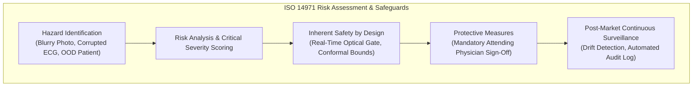
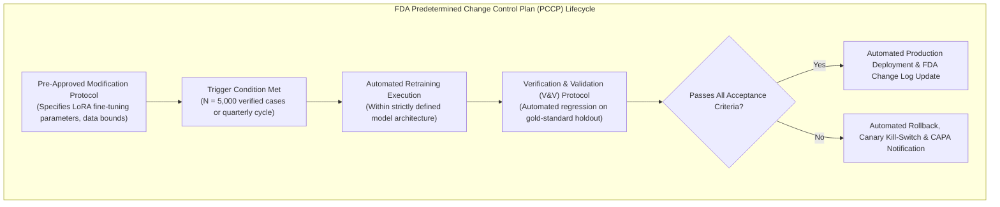

# Clinical Safety, Cybersecurity, and Regulatory Compliance Framework
## Multimodal Medical AI Platform & Continuous SLM Auto-Training Engine
**Document Version:** 1.0.0  
**Regulatory Classifications:** FDA SaMD Class II (510(k) / De Novo with PCCP) | EU MDR Class IIa/IIb | EU AI Act High-Risk AI System  
**Standards Compliance:** ISO 14971:2019, IEC 62304:2015, ISO 13485:2016, HIPAA Security Rule, GDPR Article 9 & 22  

---

## 1. Clinical Safety & Risk Management (ISO 14971 & IEC 62304)



### 1.1 Hazard Analysis & Critical Control Points (HACCP)

| Hazard ID | Failure Mode | Clinical Severity | Probability | Risk Level | Mitigating Engineering Control | Residual Risk |
| :--- | :--- | :--- | :--- | :--- | :--- | :--- |
| **HAZ-001** | Severe camera motion blur or underexposure obscures malignant melanoma margin. | **Critical** (Delayed cancer diagnosis) | Occasional | **HIGH** | On-device Laplacian variance + luminance gate blocks photo capture until criteria met ($\ge 150\text{ lux}$, blur metric $< 0.1$). | **LOW** |
| **HAZ-002** | Paper ECG scan skewed or distorted, producing false ST-segment elevation. | **Catastrophic** (Unnecessary invasive cardiac catheterization) | Infrequent | **HIGH** | Multi-point calibration grid check. If grid lines are non-orthogonal by $> 1.5^\circ$, flag as unreadable; fall back to raw ECG lead re-take. | **LOW** |
| **HAZ-003** | Multimodal LLM hallucinates an unmeasured biomarker or non-existent lesion. | **Critical** (Inappropriate pharmacotherapy) | Seldom | **HIGH** | Strict constrained decoding (JSON schema enforcement); RAG cross-verification against verified lab values; banned token masks for ungrounded claims. | **NEGLIGIBLE** |
| **HAZ-004** | Continuous SLM auto-training suffers catastrophic forgetting or demographic performance drop. | **Critical** (Systematic misdiagnosis in minority sub-populations) | Infrequent | **HIGH** | Automated benchmark regression gate: candidate model blocked from edge deployment if any demographic subgroup accuracy drops by $> 0.5\%$. | **LOW** |
| **HAZ-005** | Alarm fatigue causing physician to blindly approve AI recommendations. | **Critical** (Unchecked AI error propagation) | Frequent | **HIGH** | Tiered alert architecture: only high-risk critical findings trigger interruptive modals; interactive confirmation required for discordant findings. | **ACCEPTABLE** |

### 1.2 Out-of-Distribution (OOD) Detection & Graceful Degradation
* **Dual-Tier OOD Detection:**
  * Feature-Space Mahalanobis Distance: In intermediate encoder layers, embeddings $z$ are evaluated against class-conditional Gaussian distributions. If distance exceeds threshold $D_M(z) > \gamma_{\text{OOD}}$, the system flags the patient as an out-of-distribution anomaly.
  * Autoencoder Reconstruction Error: For visual inputs, an auxiliary lightweight convolutional autoencoder evaluates reconstruction loss $\|x - \hat{x}\|_2^2$. Artifacts, foreign objects, or unmodeled anatomical anomalies trigger immediate fallback.
* **Graceful Degradation Protocol:**
  * When one or more modalities fail validation (e.g., corrupted ECG photo or missing lab report), the system does not crash or abort. Instead, it drops the missing modality token and explicitly prints:
    > *"Notice: Cardiac electrophysiology data unavailable or corrupted. Reasoning executed solely on Dermatological and Hematological inputs. Diagnostic certainty degraded by 24%."*

### 1.3 Conformal Prediction & Clinician Human-in-the-Loop (HITL) Safeguard
* **Zero Autonomous Prescription Policy:** The platform is legally designated as **Clinical Decision Support (CDS)** under US 21 U.S.C. § 360aaa-1.
* The system never issues final diagnostic orders, pharmaceutical prescriptions, or surgical referrals autonomously.
* **Conformal Risk Bounding:** Predictions are returned as bounded prediction sets $\mathcal{C}(X)$ calibrated at $99\%$ statistical confidence. If $|\mathcal{C}(X)| > 1$, the user interface renders an amber **"Differential Ambiguity"** alert, mandating manual physician review of all candidate conditions before any report can be finalized.

---

## 2. Cybersecurity & Data Privacy Architecture

The platform operates on a **Zero Trust Architecture (ZTA)** compliant with HIPAA Security Rule (45 CFR Part 160/164) and GDPR Article 9 (Special category health data):

```
┌─────────────────────────────────────────────────────────────────────────────┐
│                           ZERO TRUST DATA PIPELINE                          │
├─────────────────────────────────────────────────────────────────────────────┤
│ 1. EDGE ACQUISITION: Local ephemeral storage, zero persistent unencrypted   │
│    PHI; immediate on-device EXIF scrub and face blinding.                  │
│                                                                             │
│ 2. IN-TRANSIT: Mutual TLS 1.3 (mTLS) with Ephemeral Diffie-Hellman (ECDHE)  │
│    and AES-256-GCM cipher suites; strict certificate pinning on mobile.     │
│                                                                             │
│ 3. DE-IDENTIFICATION GATE: Automated removal of 18 HIPAA identifiers        │
│    (Names, MRNs, dates, locations) + pseudonymization via cryptographic     │
│    HMAC-SHA-256 salt tokens.                                                │
│                                                                             │
│ 4. AT-REST ENCRYPTION: Envelope encryption via AWS KMS / HashiCorp Vault;   │
│    database volumes encrypted with per-tenant AES-256 keys.                 │
│                                                                             │
│ 5. ACCESS CONTROL: Role-Based & Attribute-Based Access Control (RBAC/ABAC); │
│    context-aware multi-factor authentication (FIDO2 / WebAuthn).            │
│                                                                             │
│ 6. IMMUTABLE AUDIT TRAIL: Tamper-evident append-only ledger recording all    │
│    access, model inferences, and physician sign-offs.                       │
└─────────────────────────────────────────────────────────────────────────────┘
```

### 2.1 Cryptographic & De-Identification Protocol
* **HIPAA Safe Harbor Compliance (45 CFR § 164.514(b)):**
  * All incoming patient bundles pass through an automated two-stage de-identification proxy before entering any cloud database or training queue:
    1. *Structured Scrubber:* Removes patient name, MRN, phone, email, SSN, IP address, and geographic data finer than state level. All calendar dates are shifted by an immutable, patient-specific random integer $\Delta_{\text{days}} \in [-30, +30]$.
    2. *Unstructured & Visual Scrubber:* High-sensitivity clinical NER scrubs named entities in text; OCR bounding boxes in scanned PDFs are blackened; facial landmarks outside the oral/ocular region of interest in non-dermatology videos are blurred via Gaussian kernels.
* **Expert Determination (45 CFR § 164.514(a)):**
  * Annual re-identification risk audits performed by independent statistical experts ensuring the probability of re-identification is strictly $< 0.05\%$.

### 2.2 Tamper-Evident Audit Logging
* Every diagnostic request, clinician edit, model inference, and SLM weight adaptation is signed using an elliptic curve signature (Ed25519) and appended to a write-once-read-many (WORM) storage ledger.
* Audit records capture: `Timestamp (UTC)`, `SessionUUID`, `UserRole`, `ActionType`, `InputPayloadHash (SHA-256)`, `ModelVersionHash`, `PhysicianDecisionDelta`, `ReasoningGroundingReferences`.

---

## 3. Regulatory Governance & Continuous Learning (FDA PCCP & EU MDR)

Auto-training machine learning models on live patient data introduces significant regulatory complexity. Traditional medical device frameworks treat software as static. Deploying an evolving SLM requires operating under the FDA's **Predetermined Change Control Plan (PCCP)** and EU MDR Post-Market Clinical Follow-up (PMCF).



### 3.1 FDA Predetermined Change Control Plan (PCCP) Specification

Under FDA Section 515C of the FD&C Act (added by FDORA 2022) and the FDA Final Guidance on PCCP for AI/ML-Enabled Medical Devices:

#### A. Description of Modifications (What Can Change)
* The automated continuous learning engine is authorized to modify **only the low-rank adapter weights (LoRA)** of the designated edge Small Language Model (e.g., 2B to 8B parameter vision-language model).
* **Prohibited Modifications (Out of Scope of PCCP):**
  * No alterations to base model architecture, context window, tokenizer vocabulary, or core attention mechanisms.
  * No expansion of clinical intended use (e.g., the model cannot autonomously add pediatric triage if approved only for adults $\ge 18$ years old). Any intended-use expansion requires a separate 510(k) or De Novo submission.

#### B. Modification Protocol (How Modifications are Carried Out)
1. **Data Curation Boundary:** Only data originating from validated healthcare institutions with confirmed clinician electronic signatures or histological/laboratory gold-truth may enter the retraining pool.
2. **Training Hyperparameter Envelopes:** Hyperparameters are pre-constrained within strict ranges:
   * Learning rate: $\eta \in [1 \times 10^{-5}, 5 \times 10^{-4}]$ using cosine decay with warmup.
   * Rank: $r = 16$, $\alpha = 32$.
   * Replay buffer fraction: Minimum $30\%$ historic baseline data.

#### C. Verification & Validation (V&V) Protocol (Acceptance Gates)
Before any newly trained SLM iteration is compiled or staged for deployment, it must pass an automated, immutable test suite:
1. **Primary Diagnostic Performance:**
   * Area Under the ROC Curve (AUROC) and F1-score across all validated disease classes must not decrease by $> 0.5\%$ relative to the baseline cleared model.
2. **Demographic Equity Gate:**
   * Performance parity across Fitzpatrick skin types I-VI and biological sexes: Difference in False Negative Rate (FNR) between any two demographic subgroups must not exceed $3.0\%$.
3. **Safety & Hallucination Gate:**
   * Hallucination rate on a fixed benchmark of $2,000$ negative control cases (healthy scans/clean labs) must remain $< 0.1\%$.
4. **Catastrophic Forgetting Gate:**
   * Historical medical benchmark suites (MIMIC-CXR, PTB-XL, MedQA) must maintain $\ge 99.0\%$ of their baseline performance.

#### D. Rollback & Fail-Safe Canary Deployment
* **Staged Canary Rollout:** Newly verified weights are rolled out over 14 days: $5\% \rightarrow 25\% \rightarrow 100\%$ of edge devices.
* **Automated Kill-Switch:** If the clinician override rate on canary devices exceeds the historical baseline by $> 5\%$ over any 48-hour rolling window, the deployment is aborted immediately, edge clients fall back to the prior certified model version, and an automated Corrective and Preventive Action (CAPA) ticket is generated.

### 3.2 EU MDR (2017/745) & EU AI Act Compliance
* **Classification:** Classified as **Class IIb** under EU MDR Rule 11 (Software intended to provide information used to take decisions with diagnosis or therapeutic purposes that may cause serious deterioration of human health).
* **EU AI Act (Regulation 2024/1689):** Categorized as a **High-Risk AI System**:
  * Technical Documentation adhering to Annex IV maintained dynamically in the continuous learning registry.
  * Post-Market Performance Follow-Up (PMPF) reports compiled and submitted to Notified Bodies annually.
  * Strict logging of all AI inference decisions to ensure compliance with Article 14 (Human Oversight) and Article 13 (Transparency and Information to Users).

---

## 4. Operational Checklists for Engineering Implementation

### Pre-Implementation Security Checklist
- [ ] Implement mTLS 1.3 with certificate pinning on iOS and Android clients.
- [ ] Configure automated Microsoft Presidio / Clinical-BERT de-identification microservice.
- [ ] Set up KMS envelope encryption with annual automated key rotation.
- [ ] Deploy WORM-compliant tamper-evident audit ledger on dedicated private subnets.
- [ ] Establish Role-Based Access Control (RBAC) integrated with Hospital Active Directory / Okta.

### Pre-Deployment Clinical Safety Checklist
- [ ] Integrate real-time mobile optical quality gates (lux, motion blur, framing distance).
- [ ] Implement calibration grid verification and skew-correction for paper ECG scanning.
- [ ] Integrate split conformal prediction engine yielding 99% statistical coverage sets.
- [ ] Enforce strict JSON schema constrained decoding on all foundation LLM outputs.
- [ ] Implement dual-tier OOD detection (Mahalanobis distance + autoencoder reconstruction loss).

### Continuous Learning & PCCP Compliance Checklist
- [ ] Build isolated training queue accepting only clinician-signed, histological ground-truth cases.
- [ ] Establish automated dataset generator for Supervised Instruction and DPO pairs.
- [ ] Implement Elastic Weight Consolidation (EWC) and 30% dynamic replay buffer to prevent forgetting.
- [ ] Configure automated regression benchmark runner evaluating MIMIC-CXR, PTB-XL, and ISIC holdout suites.
- [ ] Formalize FDA PCCP protocol documentation ready for inclusion in 510(k) / De Novo pre-market notification.
