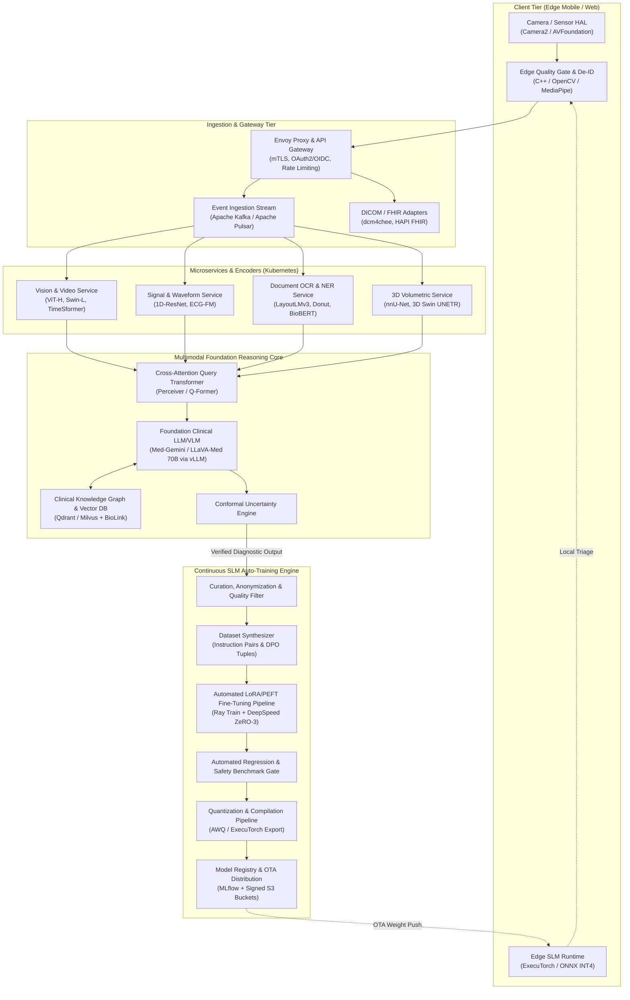
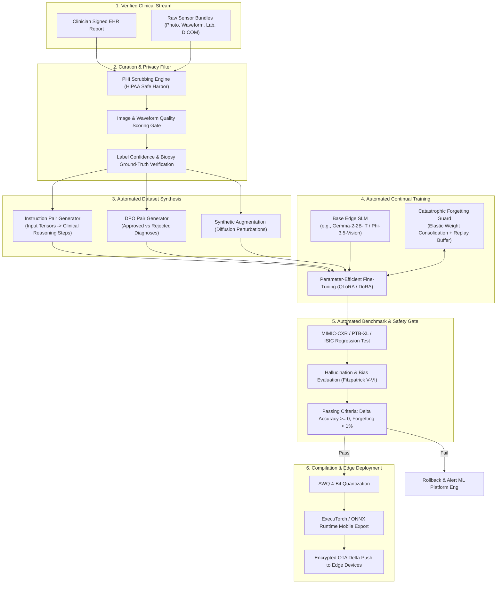

# Technical Requirements Document (TRD)
## Multimodal Medical AI Platform & Continuous SLM Auto-Training Engine
**Document Version:** 1.0.0  
**Target Architecture:** Distributed Hybrid Edge-Cloud System  
**Frameworks:** PyTorch, ExecuTorch, ONNX Runtime Mobile, HuggingFace TRL, vLLM, Triton Inference Server  

---

## 1. System Architecture (C4 Model)



---

## 2. Modality Encoders & Deep Learning Specifications

### 2.1 Edge & Camera Video Processing
* **Mobile Image ISP Bypass:**
  * Ingest Raw Bayer sensor data (`.dng` format) using Android Camera2 `RAW_SENSOR` or iOS `AVCapturePhotoOutput`.
  * Pre-demosaicing processing preserves linear photon intensity for colorimetric calibration against reference color discs.
* **Remote Photoplethysmography (rPPG) Video:**
  * Input: 30-second continuous 60 fps facial video at $1080p$.
  * Processing: Spatial face-ROI extraction with temporal chromaticity normalization:
    $$S_{CHROM} = 3(1 - \alpha/2)R - 2(1 + \alpha/2)G + 3\alpha B$$
  * Model: Spatio-temporal 3D-CNN (PhysNet) outputs raw Blood Volume Pulse (BVP) waveform sampled at 60 Hz.
* **Motor Kinematics:**
  * 33 skeletal keypoints extracted per frame via ViTPose.
  * Spatial-Temporal Graph Convolutional Network (ST-GCN) computes joint angle velocities, tremor PSD (Power Spectral Density), and gait asymmetry metrics.

### 2.2 Paper & Signal Ingestion (ECG & Labs)
* **ECG Digitization Pipeline:**
  1. *Color Segmentation:* Convert scanned image to HSV space; isolate pink/red grid via mask $[H: 330-360, S: 20-100, V: 50-100]$.
  2. *Adaptive Thresholding & Skeletonization:* Morphological thinning reduces traces to single-pixel paths.
  3. *Signal Reconstruction:* Trace paths are vectorized into 12 1D arrays: $V_l[t]$, normalized to standard calibration scale ($10\text{ mm/mV}$, $25\text{ mm/s}$).
  4. *Deep Feature Encoder:* 1D-ResNet-101 / ECG-FM produces an embedding vector $e_{\text{ECG}} \in \mathbb{R}^{1024}$.
* **Lab Test Extraction:**
  * Multi-modal document transformer (LayoutLMv3) extracts tokens $w_i$, 2D coordinates $b_i$, and image patches $p_i$.
  * Sequence classification heads tag entities: `ANALYTE`, `VALUE`, `UNIT`, `REF_LOW`, `REF_HIGH`, `FLAG`.
  * Post-processing links entities via a relation extraction classifier and maps `ANALYTE` to LOINC ontology through nearest-neighbor search in BioLinkBERT embedding space.

### 2.3 Radiology & Sonography
* **2D Radiography (Chest/Skeletal):**
  * Input: 16-bit DICOM, resized to $512 \times 512$ with lung-window CLAHE.
  * Encoder: ViT-Large/16 (MedCLIP backbone), yielding spatial feature tokens $T_{\text{Xray}} \in \mathbb{R}^{32 \times 32 \times 1024}$.
* **3D Volumetric Imaging (CT/MRI):**
  * Input: Multi-slice isotropic $1.0\text{ mm}^3$ voxel grids ($128 \times 128 \times 128$).
  * Encoder: 3D Swin UNETR hierarchical window transformer, generating pooled volumetric embedding $e_{\text{3D}} \in \mathbb{R}^{1024}$.
* **Dynamic Ultrasound Video:**
  * Input: 256-frame apical 4-chamber video loop ($112 \times 112$).
  * Encoder: EchoCLIP video transformer with temporal self-attention, generating continuous chamber volume curves and ejection fraction estimates.

---

## 3. Multimodal Reasoning & Cross-Modal Fusion Architecture

To fuse these heterogeneous tokens without dimension mismatch, the system implements a **Perceiver Resampler / Querying Transformer (Q-Former)** layer:

```
[Visual Tokens: N_v x 1024] ──┐
[ECG Tokens:    N_s x 1024] ──┼─▶ [Cross-Attention Layers] ◀── [Learnable Queries: 64 x 1024]
[Lab Tokens:    N_d x 1024] ──┘               │
                                              ▼
                             [Aligned Latent Tokens: 64 x 4096]
                                              │
                                              ▼
                             [LLM Backbone Context Window]
                               (e.g., Med-Gemini / LLaVA-Med)
```

1. **Cross-Attention Fusion:**
   * A fixed set of $K = 64$ learnable query tokens $Q \in \mathbb{R}^{64 \times 1024}$ interacts with the variable-length concatenated modality tokens $M = [T_{\text{Visual}}, T_{\text{ECG}}, T_{\text{Lab}}, T_{\text{3D}}]$ via multi-head cross-attention:
     $$\text{Attention}(Q, M, M) = \text{softmax}\left(\frac{Q W_Q (M W_K)^T}{\sqrt{d_k}}\right) M W_V$$
2. **Linear Projection:**
   * Output tokens are projected via a two-layer MLP into the word-embedding dimension of the clinical LLM (e.g., $d_{\text{LLM}} = 4096$).
3. **Conformal Prediction Formulation:**
   * For the predicted softmax distribution $\hat{P}(y \mid X)$, the system calculates the non-conformity score $s_i = 1 - \hat{P}(y_i \mid X)$.
   * Given calibration significance $\alpha = 0.01$, the prediction set $\mathcal{C}(X)$ is:
     $$\mathcal{C}(X) = \left\{ y \in \mathcal{Y} : s(X, y) \le \hat{q}_{1-\alpha} \right\}$$
   * Guarantees $P(Y \in \mathcal{C}(X)) \ge 99\%$.

---

## 4. Continuous SLM Auto-Training Engine (The Flywheel)

The core requirement stipulates that all ingested and clinician-verified diagnostic data must be automatically leveraged to continually train and upgrade a Small Language Model (SLM) for edge deployment.



### 4.1 Curation, De-Identification, and Quality Filtering
1. **PHI Redaction Pipeline:**
   * Text: Microsoft Presidio + fine-tuned Clinical De-ID BERT detects and masks patient names, dates, MRNs, phone numbers, and addresses.
   * Images/PDFs: OCR bounding boxes corresponding to PHI headers are pixel-sanitized (burned black). Facial features on non-dermatological photos are blinded with 3D facial mesh masks.
2. **Quality Scoring Function:**
   * Every incoming sample must exceed a composite quality score $Q_{\text{composite}} \ge 0.85$:
     $$Q_{\text{composite}} = w_1 Q_{\text{optical}} + w_2 Q_{\text{signal\_snr}} + w_3 C_{\text{clinician}}$$
   * Where $C_{\text{clinician}} = 1.0$ if signed by a certified specialist physician, or $0.7$ for triage staff.

### 4.2 Automated Training Dataset Generation
* **Supervised Instruction Pairs ($SFT$):**
  * Input: Standardized prompt containing multimodal tokens (e.g., `<vision_patch>`, `<ecg_lead_v1>`, `<lab_panel>`).
  * Target Output: Clinician-edited diagnostic summary, differential list, and rationale.
* **Direct Preference Optimization ($DPO$) Pairs:**
  * Winning Response ($y_w$): The finalized, clinician-signed report.
  * Losing Response ($y_l$): The initial raw draft generated by the cloud model prior to physician edits.
  * Loss Function:
    $$\mathcal{L}_{\text{DPO}}(\theta; \pi_{\text{ref}}) = -\mathbb{E}_{(x, y_w, y_l)} \left[ \log \sigma \left( \beta \log \frac{\pi_\theta(y_w \mid x)}{\pi_{\text{ref}}(y_w \mid x)} - \beta \log \frac{\pi_\theta(y_l \mid x)}{\pi_{\text{ref}}(y_l \mid x)} \right) \right]$$

### 4.3 Continual Learning & Catastrophic Forgetting Mitigation
* **Base Architecture:** Compact open-weights multimodal model (e.g., **Gemma-2-2B-IT** or **Phi-3.5-Vision** with a 128k context window).
* **Parameter-Efficient Fine-Tuning (PEFT):**
  * Instead of modifying all parameters, **Quantized Low-Rank Adaptation (QLoRA)** inserts trainable rank decomposition matrices ($r = 16, \alpha = 32$) into linear attention projection layers ($W_q, W_k, W_v, W_o$).
* **Mitigating Catastrophic Forgetting:**
  * **Dynamic Replay Buffer:** Every training batch blends $70\%$ newly curated patient pairs with $30\%$ historical golden benchmark cases across prior disease distributions.
  * **Elastic Weight Consolidation (EWC) Loss:** Penalizes shifting parameters crucial to previous tasks based on the diagonal of the Fisher Information Matrix $F$:
    $$\mathcal{L}_{\text{total}}(\theta) = \mathcal{L}_{\text{SFT}}(\theta) + \sum_i \frac{\lambda_{\text{EWC}}}{2} F_i (\theta_i - \theta_{i, \text{old}})^2$$

### 4.4 Automated Regression Gate, Compilation, and Deployment
* **Automated Benchmark Gate:**
  * Pipeline automatically evaluates the retrained candidate model on a static suite of $10,000$ validated holdout cases (MIMIC-CXR, PTB-XL, HAM10000, MedQA).
  * Gating Rule: The model is approved if and only if:
    1. Overall accuracy improves or stays flat: $\Delta \text{Acc} \ge 0.0\%$.
    2. Subgroup parity: No demographic drop $> 0.5\%$ on Fitzpatrick V-VI or elderly cohorts.
    3. Historical task degradation $< 1.0\%$.
* **Edge Optimization:**
  * Activation-aware Weight Quantization (**AWQ**) compresses weights to 4-bit integers (`INT4`).
  * Model graph is compiled to **ExecuTorch** (for iOS/Android native execution utilizing Apple Neural Engine and Qualcomm Hexagon DSP).
* **OTA Delta Deployment:**
  * Only the updated LoRA weight adapter file ($\sim 35\text{ MB}$ to $80\text{ MB}$, rather than the full multi-gigabyte model) is signed cryptographically and pushed to edge clients via background synchronization.

---

## 5. Data Schemas & Interoperability Specs

### 5.1 FHIR R4 DiagnosticReport Mapping
The platform outputs standardized HL7/FHIR resources:

```json
{
  "resourceType": "DiagnosticReport",
  "id": "diag-report-20261114-001",
  "status": "final",
  "category": [
    {
      "coding": [
        {
          "system": "http://terminology.hl7.org/CodeSystem/v2-0074",
          "code": "MDx",
          "display": "Multimodal Diagnostic Support"
        }
      ]
    }
  ],
  "code": {
    "coding": [
      {
        "system": "http://loinc.org",
        "code": "11526-1",
        "display": "Pathology study diagnostic statement"
      }
    ]
  },
  "subject": {
    "reference": "Patient/anon-uuid-8f92b"
  },
  "conclusion": "High clinical suspicion of acute ST-Elevation Myocardial Infarction with concomitant diabetic microvascular ulceration.",
  "conclusionCode": [
    {
      "coding": [
        {
          "system": "http://snomed.info/sct",
          "code": "401303003",
          "display": "Acute ST segment elevation myocardial infarction"
        }
      ]
    }
  ],
  "extension": [
    {
      "url": "http://medical-ai.org/fhir/StructureDefinition/conformal-prediction-set",
      "valueString": "['STEMI', 'Pericarditis']"
    },
    {
      "url": "http://medical-ai.org/fhir/StructureDefinition/uncertainty-risk-alpha",
      "valueDecimal": 0.01
    },
    {
      "url": "http://medical-ai.org/fhir/StructureDefinition/model-provenance",
      "valueString": "Med-Gemini-Cloud-v1.4 + Edge-SLM-LoRA-v2.1"
    }
  ]
}
```

### 5.2 Normalized Lab Ingestion Schema
```json
{
  "encounter_id": "enc-9941a",
  "source_type": "scanned_paper_pdf",
  "analytes": [
    {
      "raw_name": "Troponin I, High Sensitivity",
      "loinc_code": "89579-7",
      "loinc_display": "Troponin I.cardiac [Mass/volume] in Serum or Plasma by High sensitivity method",
      "numeric_value": 45.2,
      "units": "pg/mL",
      "reference_interval": {
        "low": 0.0,
        "high": 19.8
      },
      "abnormal_flag": "HIGH",
      "extraction_confidence": 0.994
    }
  ]
}
```

---

## 6. API Specifications (gRPC & REST)

### 6.1 gRPC Multimodal Ingest & Inference Protocol (`diagnostic_service.proto`)

```protobuf
syntax = "proto3";

package medical.ai.v1;

service MultimodalDiagnosticService {
  rpc IngestAndDiagnose (DiagnosticRequest) returns (DiagnosticResponse);
  rpc StreamVideoAnalysis (stream VideoFrameChunk) returns (VideoTelemetryResponse);
  rpc RegisterClinicianVerification (VerificationFeedback) returns (FeedbackAck);
}

message DiagnosticRequest {
  string session_id = 1;
  string patient_pseudo_id = 2;
  repeated MediaAttachment attachments = 3;
  repeated LabObservation lab_data = 4;
  SignalAttachment ecg_waveform = 5;
  ClientInferenceContext edge_context = 6;
}

message MediaAttachment {
  enum MediaType {
    DERM_PHOTO_RAW = 0;
    FUNDUS_PHOTO = 1;
    CHEST_XRAY_DICOM = 2;
    CT_SERIES_DICOM = 3;
    ULTRASOUND_LOOP_MP4 = 4;
  }
  MediaType type = 1;
  bytes payload = 2;
  map<string, string> metadata = 3;
}

message DiagnosticResponse {
  string session_id = 1;
  repeated DifferentialCandidate differential_diagnosis = 2;
  repeated string conformal_prediction_set = 3;
  double statistical_confidence_bound = 4;
  string structured_clinical_report = 5;
  repeated GroundingAnnotation visual_annotations = 6;
}

message VerificationFeedback {
  string session_id = 1;
  string signed_diagnosis_snomed = 2;
  string physician_edited_report = 3;
  bool approved_for_slm_training = 4;
  string attending_physician_id_hash = 5;
}

message FeedbackAck {
  bool queued_for_training = 1;
  string dataset_batch_id = 2;
}
```

---

## 7. Compute & Infrastructure Specifications

| Component | Target Workload | Minimum Compute Spec | Redundancy / Scaling |
| :--- | :--- | :--- | :--- |
| **Edge Mobile Client** | Real-time quality gate, local SLM triage | Apple A16 Bionic / Snapdragon 8 Gen 2+ with dedicated NPU, 8GB RAM | Client-side standalone offline fallback |
| **Ingestion & Gateway** | TLS termination, de-ID, routing | 8x vCPU, 32GB RAM per pod (Kubernetes) | Multi-AZ auto-scaled behind Envoy (HPA) |
| **Modality Microservices**| Batch ViT, Swin, LayoutLMv3 inference | NVIDIA L4 (24GB VRAM) or A10G GPUs | Dynamic GPU node pool scaling (KEDA) |
| **Cloud Foundation LLM** | Med-Gemini / LLaVA-Med 70B reasoning | 4x NVIDIA A100-SXM4-80GB or 2x H100 (vLLM tensor-parallel = 2) | Multi-replica failover with dynamic batching |
| **SLM Training Engine** | Continual LoRA / DPO training | 8x NVIDIA H100-80GB (Ray Train + DeepSpeed ZeRO-3) | Scheduled batch training jobs (Kubeflow / Slurm) |
| **Clinical Vector DB** | Guidelines, LOINC ontology retrieval | 16x vCPU, 64GB RAM, SSD NVMe | 3-node distributed cluster (Qdrant) |
