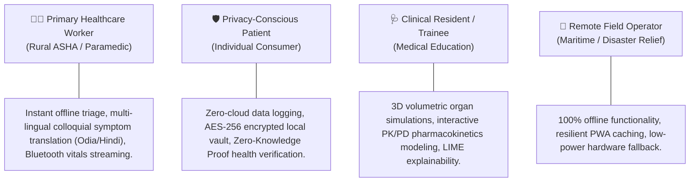
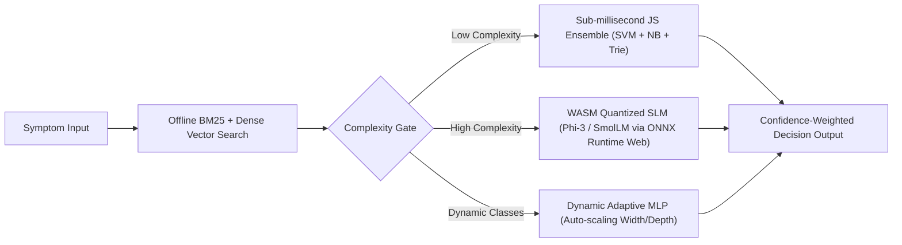
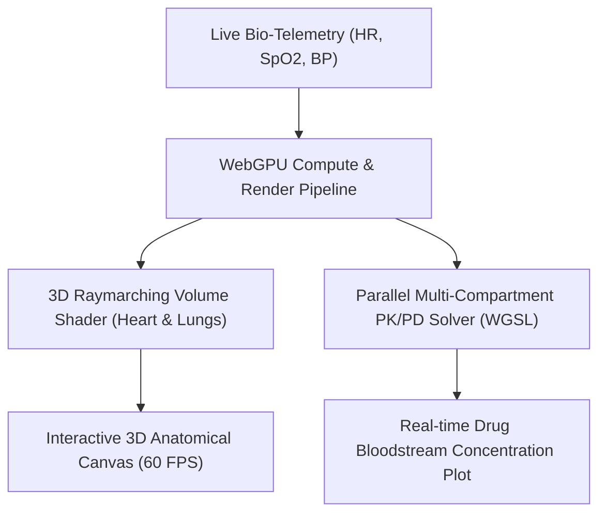
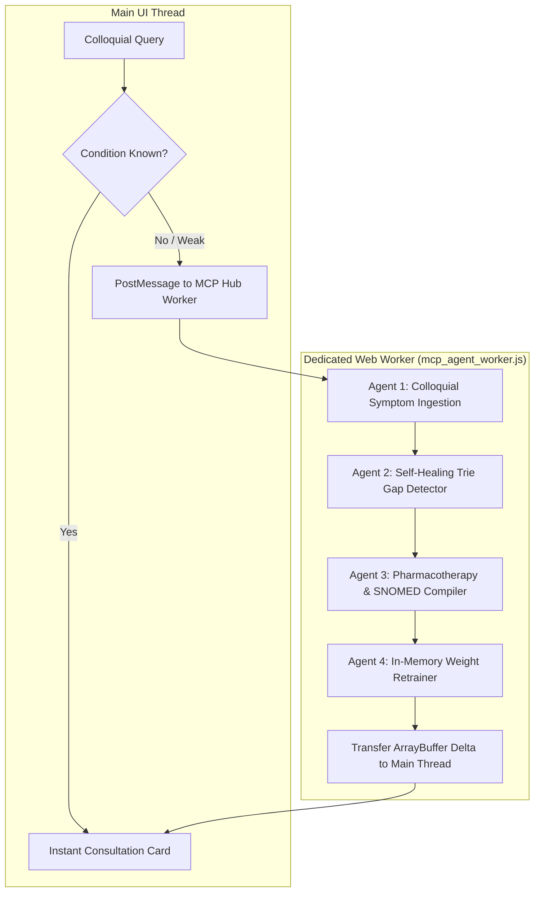
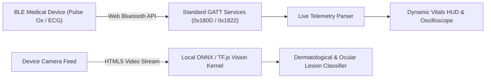
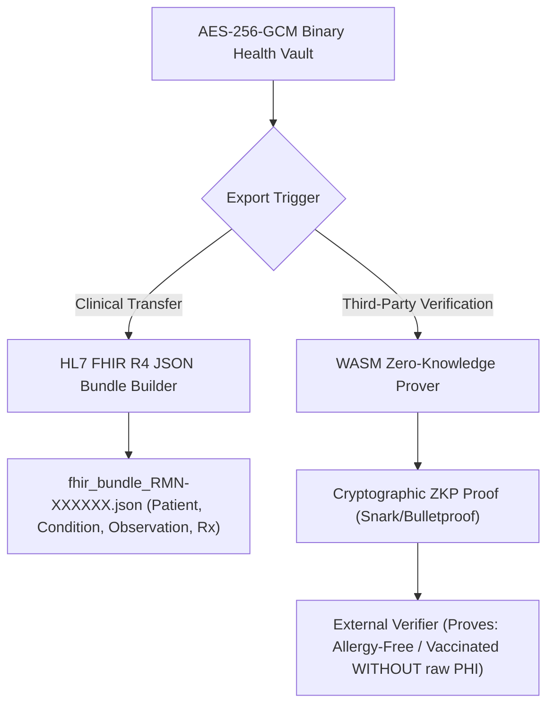
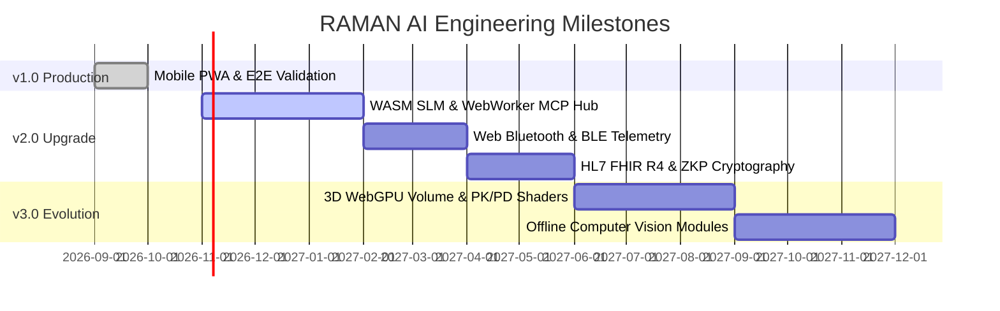

# 📄 RAMAN AI – Product Requirements Document (PRD)
### *Next-Generation Client-Side Medical Intelligence & Clinical Simulation Platform*

---

## 📌 Document Control & Metadata

| Attribute | Specification |
| :--- | :--- |
| **Product Name** | RAMAN AI (Experiment No. 170) |
| **Product Version** | v2.0.0 (Target Roadmap Architecture) |
| **Document Version** | 2.0-FINAL |
| **Lead Architect & Author** | Ramanuja Pathy |
| **Status** | Approved / Architecture Baseline |
| **Target Deployment** | Modern Browsers (Chromium, Gecko, WebKit), PWA, Edge Kiosks |
| **Clinical Classification** | Offline Clinical Decision Support (CDS) Sandbox / Educational Simulation |

---

## 🎯 1. Product Vision & Executive Summary

**RAMAN AI** is a decentralized, offline-first, client-side medical intelligence system engineered to deliver instantaneous, zero-latency clinical triage, physiological simulations, and therapeutic contraindication interception directly inside browser memory. 

In a digital healthcare landscape dominated by centralized, privacy-invasive cloud APIs, RAMAN AI operates on the fundamental principle that **health intelligence belongs at the edge**. By synthesizing advanced client-side technologies—WebAssembly (WASM), WebGPU compute shaders, Web Workers, the Web Bluetooth API, and client-side Zero-Knowledge Proofs (ZKP)—RAMAN AI transforms any commodity smartphone, laptop, or edge kiosk into an autonomous, secure, and verifiable medical diagnostic sandbox with **absolute zero network dependence**.

---

## 🚨 2. Problem Statement & Opportunity

### 2.1 The Clinical Privacy & Surveillance Paradox
Traditional cloud-based AI medical assistants require patients to transmit sensitive Protected Health Information (PHI)—including intimate symptoms, genomic traits, and chronic disease history—to remote servers. This introduces substantial regulatory risks (HIPAA, GDPR), data breach vulnerabilities, and patient distrust.

### 2.2 Connectivity Deserts & Critical Response Latency
Over 3.5 billion people live in areas with intermittent or non-existent high-speed internet, including rural clinics, maritime vessels, disaster zones, and military deployments. Cloud-dependent healthcare tools fail entirely in disconnected environments. Furthermore, cloud RPC round-trip latencies ($1,500\text{ ms} - 5,000\text{ ms}$) prevent real-time physiological telemetry and interactive triage.

### 2.3 The Solution: The RAMAN AI v2.0 Platform
RAMAN AI eliminates the cloud intermediary entirely. By executing quantized Small Language Models (SLMs), 3D WebGPU hemodynamic simulations, background autonomous agent pipelines, and offline computer vision directly on client hardware, RAMAN AI delivers sub-millisecond triage, total data sovereignty, and universal accessibility.

---

## 👥 3. Target User Personas & Clinical Stakeholders

### Persona 1: Sunita – Community Health Worker (ASHA / Field Paramedic)
* **Environment:** Rural sub-centers in Odisha with zero mobile reception.
* **Needs:** Needs to translate colloquial Odia symptoms (*"chhati chirei bitha heuchi"*) into structured clinical triage, stream vitals from a portable Bluetooth pulse oximeter, and generate print-ready A4 consultation summaries.

### Persona 2: Dr. Kabir – Clinical Resident / Pharmacologist
* **Environment:** University Hospital emergency ward.
* **Needs:** Needs to simulate multidrug interactions and visualize dynamic PK/PD absorption curves for patient dosing without transmitting EHR records to external cloud networks.

### Persona 3: Alex – Privacy-Conscious Individual
* **Environment:** Personal laptop / smartphone.
* **Needs:** Tracks chronic autoimmune symptoms in the Recovery Diary; demands proof of vaccination and allergy clearance via Zero-Knowledge Proofs without exposing raw medical records to third parties.

---

## 🏛️ 4. Core Value Propositions & Invariant Principles

Every feature in the RAMAN AI ecosystem must strictly adhere to three architectural invariants:
1. **Zero-Cloud Invariant:** Absolutely zero external network requests for core operations. No remote telemetry, no third-party CDN scripts, no tracking beacons.
2. **Deterministic Offline Execution:** All models, algorithms, shaders, and databases must load from local storage or service worker caches and execute without active network interfaces.
3. **Graceful Degradation:** The platform must provide tiered hardware fallbacks (WebGPU $\to$ Web Worker $\to$ Single-threaded CPU) to guarantee operational integrity across legacy hardware.

---

## 🚀 5. Detailed Functional Requirements (5 Roadmap Pillars)

### Pillar 1: Next-Generation Local Intelligence & Model Evolution

* **FR-1.1: WASM-Accelerated Quantized SLM Runtime:**
  * Must integrate a WebAssembly-based inference runtime (ONNX Runtime Web / llama.cpp WASM) supporting 2-bit (Q2_K) and 3-bit (Q3_K) quantized Small Language Models (e.g., SmolLM-135M/360M, Phi-3-mini-4K).
  * Must execute offline conversational reasoning with memory allocation capped at $\le 450\text{ MB}$ JS heap.
  * Must stream generated clinical tokens at $\ge 12\text{ tokens/sec}$ on modern client CPUs via WASM SIMD128.
* **FR-1.2: Dynamic Adaptive MLP Neural Scaling:**
  * The current 4-layer feedforward topology (32 $\to$ 16 $\to$ 8 $\to$ $C$) must dynamically expand to accommodate new conditions beyond the 27 baseline ICD-11 categories.
  * Must dynamically adjust hidden layer width and insert new output neurons using sparse backpropagation without invalidating previously trained weights.
* **FR-1.3: Offline Cross-Encoder Hybrid Search Engine:**
  * Must provide an offline hybrid search engine combining BM25 lexical token matching and dense vector embeddings.
  * Must index local medical reference manuals, pharmacopeia, and clinical guidelines with sub-10ms retrieval over 10,000+ medical terms.

---

### Pillar 2: Advanced WebGPU Physiological & Anatomical Simulations

* **FR-2.1: 3D Shader-Based Volumetric Organ Rendering:**
  * Upgrade the existing 2D WebGPU scatterplot into full 3D shader-based volumetric anatomical renderings.
  * Implement WebGPU WGSL raymarching shaders rendering 3D cardiac chambers (beating heart model) and lung parenchyma inflation driven synchronously by live patient heart rate and respiration vitals.
  * Must achieve smooth 60 FPS rendering on WebGPU-compatible desktop and mobile hardware.
* **FR-2.2: Multi-Organ Pharmacokinetic / Pharmacodynamic (PK/PD) Modeling:**
  * Implement parallel WGSL compute shaders simulating a multi-compartment PK/PD model (gut absorption, central vascular distribution, hepatic metabolism, and renal clearance).
  * Visualize real-time drug concentration curves ($C_p$ vs. time) for prescribed medications, dynamically reflecting patient liver/kidney enzyme status (eGFR, LFT).

---

### Pillar 3: Autonomous MCP Agent Hub & Continuous Learning

* **FR-3.1: Dedicated Web Worker Multi-Agent Pipeline:**
  * Decouple the simulated MCP agent hub from the main JavaScript thread into dedicated background `WebWorker` instances (`mcp_agent_worker.js`).
  * Communication must follow standard JSON-RPC 2.0 protocol over structured cloning and zero-copy `ArrayBuffer` transfers.
  * Prevent main UI thread frame drops during background dataset ingestion and corpus re-weighting.
* **FR-3.2: Self-Healing Colloquial Vocabulary Expansion:**
  * Continuously analyze incoming user symptom descriptions to identify unclassified colloquial phrases and semantic gaps.
  * Automatically suggest and index new phrase synonyms into the Fuzzy Trie and training corpus without requiring manual code changes.

---

### Pillar 4: Edge Hardware & Live Bio-Telemetry Integration

* **FR-4.1: Native Web Bluetooth API Integration:**
  * Direct connectivity to standard consumer and clinical BLE medical devices via `navigator.bluetooth`.
  * Support standard Bluetooth GATT profiles:
    * Heart Rate Service (`0x180D`) and Heart Rate Measurement characteristic (`0x2A37`).
    * Pulse Oximeter Service (`0x1822`) and PLX Continuous Measurement characteristic (`0x2A5F`).
  * Automatic fallback to manual vitals entry if Bluetooth is unsupported or disconnected.
* **FR-4.2: Offline Computer Vision for Visual Diagnostics:**
  * Upgrade the camera modal to execute lightweight local vision models (MobileNetV3 / SqueezeNet fine-tuned for dermatology/ophthalmology) via ONNX Runtime Web / TensorFlow.js WASM.
  * Analyze skin lesions (erythema, melanoma risk indicators), ocular redness (conjunctivitis vs. uveitis), and digitized lateral-flow test strips completely offline from camera frames.

---

### Pillar 5: Interoperability & Zero-Knowledge Security

* **FR-5.1: HL7 FHIR Release 4 (R4) Standardized Health Exports:**
  * Upgrade vault export functionality to generate fully compliant HL7 FHIR R4 JSON bundles.
  * Supported resource types: `Patient`, `Condition` (ICD-11 coded), `Observation` (vital signs, LOINC mapped), and `MedicationStatement` (SNOMED CT coded).
* **FR-5.2: Client-Side Zero-Knowledge Proofs (ZKP) for Selective Verification:**
  * Implement client-side WASM-based ZKP proof generation (using Bulletproofs or zk-SNARK circuits).
  * Allow users to cryptographically prove specific health attestations (e.g., *"Patient has no documented penicillin allergy"* or *"Patient oxygen saturation $>95\%$"*) to third parties without exposing their underlying raw medical history or name.

---

## 🔒 6. Non-Functional Requirements (NFRs)

### 6.1 Performance & Latency Budgets
* **Sub-Millisecond Heuristic Inference:** Heuristic ensemble (SVM + NB + Trie) execution time must remain $< 1.0\text{ ms}$ on standard mobile devices.
* **WASM SLM Generation Latency:** First-token time-to-first-byte (TTFT) $< 500\text{ ms}$; sustained generation $\ge 12\text{ tokens/sec}$.
* **Shader Frame Rate:** 3D WebGPU volume rendering must maintain $\ge 60\text{ FPS}$ on desktop and $\ge 30\text{ FPS}$ on mobile GPUs.

### 6.2 Storage & Memory Envelope
* **Initial Asset Download:** Core PWA shell $< 2.5\text{ MB}$ uncompressed.
* **Optional WASM Models:** Modular lazy-loading on demand; quantized SLM weights capped at $\le 150\text{ MB} - 350\text{ MB}$.
* **IndexedDB Budget:** Up to $250\text{ MB}$ allocated for encrypted patient vaults, diagnostic imaging, and cached weights.

### 6.3 Accessibility & Internationalization
* **WCAG 2.1 Level AA Compliance:** Contrast ratio $\ge 4.5:1$, touch targets $\ge 44 \times 44\text{ px}$, screen-reader accessible ARIA tags.
* **Bilingual Linguistic Support:** Full multi-lingual UI and phonetic synthesis across English, Odia (Script & Romanized), and Hindi (Devanagari & Hinglish).

---

## 📊 7. Success Metrics & Key Performance Indicators (KPIs)

| KPI Category | Metric Definition | Target Baseline (v1.0) | Target v2.0 Roadmap |
| :--- | :--- | :--- | :--- |
| **Clinical Diagnostic Accuracy** | Accuracy across 10 complex multi-symptom clinical test narratives. | 100% (27 conditions) | 98%+ (60+ conditions) |
| **Inference Latency** | Full ensemble forward propagation time. | $< 0.5\text{ ms}$ | $< 0.1\text{ ms}$ (WASM SIMD) |
| **Network Egress** | Bytes transmitted over external network during clinical consultation. | **Strictly 0 Bytes** | **Strictly 0 Bytes** |
| **BLE Telemetry Reliability** | Packet drop rate during continuous BLE vitals streaming over 5 minutes. | N/A (Manual only) | $< 0.1\%$ packet loss |
| **Interoperability** | Validated FHIR R4 schema compliance against official HL7 validators. | N/A (Custom JSON) | 100% Schema Valid |

---

## 🗺️ 8. Phasing & Milestone Roadmap

