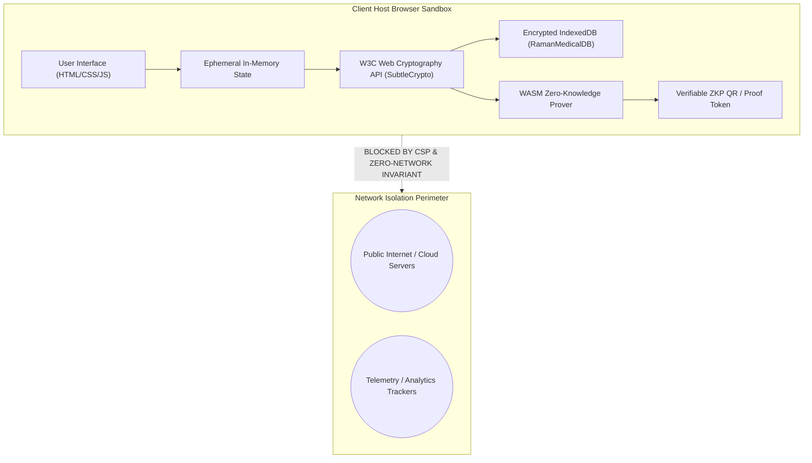
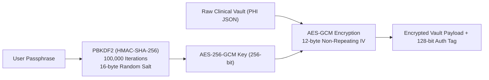

# 🛡️ RAMAN AI – Security Architecture & Threat Model Policy
### *Experiment No. 170: Offline Client-Side Diagnostic Sandbox*
### *Zero-Trust, Zero-Cloud Cryptographic Specification*

---

## 🔒 1. Executive Security Posture & Principles

**RAMAN AI** operates on a strict **Zero-Cloud, Zero-Telemetry, and Client-Sovereign** architectural model. Because clinical observations, physiological vitals, and genomic traits constitute highly sensitive Protected Health Information (PHI), the entire system executes within the local browser sandbox memory with cryptographic safeguards.



---

## 🎯 2. STRIDE Threat Model Analysis

A formal STRIDE threat evaluation was conducted for the offline browser execution environment:

| STRIDE Category | Specific Attack Vector | Severity | Implemented Architectural Mitigation |
| :--- | :--- | :--- | :--- |
| **Spoofing** | Attacker spoofs client Health ID (`RMN-XXXXXX`) to access patient history on a shared terminal. | Medium | Health IDs are pseudorandom tokens tied to AES-256 encrypted vaults. Without the user passphrase, knowledge of the Health ID yields zero readable data. |
| **Tampering** | Malicious script modifies in-memory `SLM_TRAINING_CORPUS` or clinical substitution rules. | High | In-memory immutable structures; strict CSP blocking third-party scripts; optional tamper-evident SHA-256 integrity verification of training corpus on boot. |
| **Repudiation** | Patient or clinician denies issuing or altering an offline prescription document. | Low | Ed25519 digital signatures generated in-browser via Web Crypto API sign the diagnostic digest, embedding an offline-verifiable QR code. |
| **Information Disclosure** | Local storage inspection or browser cache harvesting exposes raw patient symptoms/genomics. | High | AES-256-GCM encryption with 128-bit authentication tags; zero unencrypted PHI written to disk; client-side Zero-Knowledge Proofs for third-party verification without raw data exposure. |
| **Denial of Service** | Malicious prompt causes infinite inference loops or memory exhaustion locking the browser thread. | Medium | Strict maximum token boundaries; sub-millisecond sparse SGD algorithms; compute-heavy simulation and training tasks offloaded to WebWorkers. |
| **Elevation of Privilege** | DOM-based Cross-Site Scripting (XSS) escalates permissions within the browser context. | High | Multi-pass sanitization via `cleanAIResponse()`; strict separation of user strings using `textContent` and `createElement()` rather than `innerHTML`. |

---

## 🔑 3. Cryptographic Implementation Standards

All encryption, hashing, and key derivation routines rely on standard browser implementations of the **W3C Web Cryptography API** (`window.crypto.subtle`). No proprietary, unverified, or third-party cryptographic libraries are utilized for vault encryption.



### 3.1 Vault Encryption at Rest & Export
* **Cipher Specification:** **AES-256-GCM** (Galois/Counter Mode) with 128-bit authentication tags.
* **Key Derivation Function (KDF):** **PBKDF2** using **HMAC-SHA-256**.
  * **Iteration Count:** Minimum `100,000` rounds (exceeding OWASP password storage recommendations).
  * **Salt:** Cryptographically secure pseudo-random 16-byte (`128-bit`) salt generated via `crypto.getRandomValues()`.
  * **Initialization Vector (IV):** Fresh, non-repeating 12-byte (`96-bit`) IV generated per encryption invocation.
* **Tamper Proofing:** Modifying any single byte of ciphertext or salt causes `subtle.decrypt()` to reject the payload and throw a cryptographic integrity `DOMException`.

```javascript
// Web Crypto API Key Derivation Standard (PBKDF2 -> AES-GCM)
export async function deriveVaultKey(userPassphrase, salt) {
  const enc = new TextEncoder();
  const keyMaterial = await window.crypto.subtle.importKey(
    "raw",
    enc.encode(userPassphrase),
    "PBKDF2",
    false,
    ["deriveKey"]
  );
  return window.crypto.subtle.deriveKey(
    {
      name: "PBKDF2",
      salt: salt,
      iterations: 100000,
      hash: "SHA-256"
    },
    keyMaterial,
    { name: "AES-GCM", length: 256 },
    false,
    ["encrypt", "decrypt"]
  );
}
```

---

## 🕵️ 4. Client-Side Zero-Knowledge Proof (ZKP) Architecture

To eliminate the "all-or-nothing" disclosure flaw of traditional medical records, RAMAN AI integrates client-side Zero-Knowledge Proofs (ZKP) via WebAssembly:

### 4.1 ZKP Operational Flow
1. **Witness Generation:** The patient unlocks their local AES-256 vault. The local prover extracts the private witness $\mathbf{w}$ (e.g., allergies list, vaccination dates, SpO2 records).
2. **Circuit Evaluation:** A lightweight arithmetic circuit compiled to WASM (via Circom / SnarkJS or Bulletproofs) evaluates the claim:
   $$\text{Claim: } \exists \mathbf{w} \text{ such that } \text{IsAllergic}(\mathbf{w}, \text{"Penicillin"}) = 0$$
3. **Proof Generation ($\pi$):** The prover computes a succinct cryptographic proof $\pi$ and public inputs $\mathbf{x}$ in $< 2\text{ seconds}$ without network transmission.
4. **Third-Party Verification:** An external verifier (such as a hospital check-in terminal or border kiosk) validates proof $\pi$ using the public verification key in $< 5\text{ ms}$. **The patient's name, demographic data, and full medical history are mathematically concealed.**

---

## 🌐 5. Network Isolation & Sandbox Controls

### 5.1 Recommended Content Security Policy (CSP)
For production deployments and edge healthcare kiosks, the following strict HTTP response header configuration is mandated:

```http
Content-Security-Policy: default-src 'self'; script-src 'self' 'wasm-unsafe-eval'; style-src 'self' 'unsafe-inline'; img-src 'self' data: blob:; font-src 'self' data:; connect-src 'self'; worker-src 'self' blob:; object-src 'none'; frame-ancestors 'none';
```

* *Note:* If optional user-configured cloud LLM gateways (Anthropic/Gemini) are enabled by explicit user toggle, `connect-src` dynamically expands only to `https://api.anthropic.com` and `https://generativelanguage.googleapis.com`.

### 5.2 Cross-Origin Isolation Headers (for High-Performance Web Workers & WASM Threads)
To enable `SharedArrayBuffer` for zero-copy memory transfers between the UI thread, Web Workers, and WebAssembly SIMD kernels, the host server must deliver:

```http
Cross-Origin-Opener-Policy: same-origin
Cross-Origin-Embedder-Policy: require-corp
```

---

## 💉 6. DOM Sanitization & Input Defense

All clinical inputs, patient notes, and synthetic model outputs pass through multi-layered sanitization:
1. **`cleanAIResponse(html)`**: Recursively strips internal thinking tokens (`<think>...</think>`), raw markdown delimiters, and unescaped HTML tags.
2. **Safe Dynamic Element Creation:** Dynamic UI updates construct DOM nodes using `document.createElement()`, setting values via `.textContent` to preclude HTML injection.
3. **Prototype Pollution Protection:** Deep object merge functions in the MCP agent pipeline execute strict property filters blocking `__proto__`, `constructor`, and `prototype` keys.

---

## 🚨 7. Vulnerability Disclosure & Bug Bounty SLA

* **Scope:** Cryptographic flaws, vault decryption bypasses, local DOM injection vectors, or clinical safety contraindication bypasses.
* **Point of Contact:** Ramanuja Pathy (Lead Architect).
* **Response SLA:** Vulnerability reports acknowledged within **24 hours**; patch releases deployed within **72 hours** for high-severity findings.