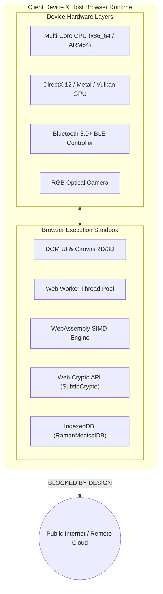

# 📋 RAMAN AI – Software Requirements Specification (SRS)
### *Experiment No. 170: Offline Client-Side Diagnostic Sandbox*
### *Compliant with IEEE 830 / ISO/IEC/IEEE 29148 Standards*

---

## 1. Introduction

### 1.1 Purpose
This Software Requirements Specification (SRS) establishes the complete functional, interface, performance, and verification requirements for **RAMAN AI (Experiment No. 170)** across its v1.0 baseline and v2.0/v3.0 strategic roadmap. It serves as the formal technical contract for system verification, validation, and clinical safety compliance.

### 1.2 Document Conventions
* **`REQ-SRS-[CATEGORY]-[ID]`**: Unique identifier for formal requirements.
* **`SHALL`**: Mandatory design or behavioral constraint.
* **`SHOULD`**: Highly recommended practice or target specification.
* **`MAY`**: Permissible optional configuration.

### 1.3 Intended Audience
Clinical systems engineers, biomedical software auditors, regulatory compliance officers (FDA/MDR), security architects, and open-source contributors.

### 1.4 Product Scope
RAMAN AI is a 100% client-side, zero-cloud medical diagnostic sandbox and clinical simulation platform. The system operates within modern web browser sandboxes to deliver real-time symptom classification, therapeutic contraindication interception, 3D hemodynamic WebGPU simulations, and zero-knowledge health attestations with absolute zero outbound network connectivity.

---

## 2. Overall Description

### 2.1 Product Perspective & Context

### 2.2 Design & Implementation Constraints
* **`REQ-SRS-CON-01`**: The system **SHALL NOT** make any outbound HTTP/HTTPS, WebSocket, or WebRTC network requests during core diagnostic operations.
* **`REQ-SRS-CON-02`**: The core application **SHALL** run within standard browser sandboxes without requiring root/administrator device privileges or native binary installers.
* **`REQ-SRS-CON-03`**: Total memory footprint for core heuristic inference **SHALL NOT** exceed $150\text{ MB}$ of browser heap.
* **`REQ-SRS-CON-04`**: All cryptographic operations **SHALL** utilize browser-native standard implementations (`window.crypto.subtle`) without third-party proprietary math libraries.

---

## 3. External Interface Requirements

### 3.1 User Interfaces
* **`REQ-SRS-UI-01`**: The interface **SHALL** provide a responsive, cyber-glassmorphic HUD adapting dynamically from mobile viewports ($320\text{px}$) to 4K displays ($3840\text{px}$).
* **`REQ-SRS-UI-02`**: Devices with screen width $\le 900\text{px}$ **SHALL** present a 4-tab bottom navigation bar (`Consult`, `Vitals`, `Diary`, `Records`) with touch targets $\ge 44 \times 44\text{px}$.
* **`REQ-SRS-UI-03`**: The interface **SHALL** feature an interactive 10-target SVG body scanner allowing one-touch organ symptom localization.
* **`REQ-SRS-UI-04`**: Every clinical consultation card **SHALL** render active pharmaceutical compositions, milligram strengths, standard brand names, and interactive online bio-equivalent search links.

### 3.2 Hardware Interfaces
* **`REQ-SRS-HW-01` (Web Bluetooth):** The system **SHALL** interface with BLE medical peripherals via `navigator.bluetooth` supporting Heart Rate (`0x180D`) and Pulse Oximeter (`0x1822`) services.
* **`REQ-SRS-HW-02` (WebGPU):** The system **SHALL** acquire an optimal graphics adapter via `navigator.gpu.requestAdapter()` for hardware-accelerated 3D volume rendering and PK/PD compute shaders.
* **`REQ-SRS-HW-03` (Camera):** The system **SHALL** capture optical video streams via `navigator.mediaDevices.getUserMedia()` for offline computer vision analysis.

### 3.3 Software Interfaces
* **`REQ-SRS-SW-01` (IndexedDB):** The system **SHALL** persist encrypted session ledgers and simulated diagnostic imaging files in `RamanMedicalDB`.
* **`REQ-SRS-SW-02` (Web Audio API):** The system **SHALL** synthesize 7 distinct clinical waveforms (laser sweep, telemetry click, triple warning alarm, transition slide, success chime, discordant error, keyboard tick) in-memory without audio asset downloads.
* **`REQ-SRS-SW-03` (Service Worker):** The system **SHALL** cache all required assets via a Cache-First Service Worker (`sw.js`) enabling 100% offline cold boot.

---

## 4. Detailed System Features

### 4.1 Hybrid Quad-Model SLM Diagnostic Inference
* **Description:** Classifies natural language symptom descriptions into ICD-11 conditions using fused linear SVM, Naive Bayes, 4-Layer MLP, and Fuzzy Trie predictions.
* **Stimulus/Response Sequence:**
  1. *Stimulus:* User submits text query (e.g., *"crushing chest pain radiating to left arm"*).
  2. *Processing:* Tokenizer generates unigrams, bigrams, trigrams, quadgrams, and character 3/4-grams. Vectorizer computes L2-normalized TF-IDF vector.
  3. *Inference:* SVM computes decision margin; Naive Bayes accumulates log-probabilities; 4-layer MLP propagates forward pass; Fuzzy Trie matches exact phrase substrings.
  4. *Response:* Fusion layer normalizes scores via temperature-scaled Softmax ($T=2.5$), returning condition leaderboard and top diagnosis within $< 1.0\text{ ms}$.

### 4.2 WebGPU 3D Anatomical & PK/PD Simulation
* **Description:** Renders real-time 3D raymarched cardiac/pulmonary anatomy and multi-compartment drug distribution curves driven by live vitals.
* **Stimulus/Response Sequence:**
  1. *Stimulus:* User modifies heart rate to 110 bpm or connects Bluetooth pulse oximeter.
  2. *Processing:* WebGPU WGSL compute shader recalculates 4th-order Runge-Kutta drug distribution differential equations; raymarching fragment shader evaluates cardiac chamber deformation SDFs.
  3. *Response:* Canvas updates at $\ge 60\text{ FPS}$ showing contracting 3D heart chambers and dynamic drug clearance curves.

### 4.3 Autonomous Web Worker Multi-Agent Pipeline
* **Description:** Background Web Worker parses unrecognized colloquial symptoms, maps ICD-11/SNOMED codes, and executes sparse backpropagation model retraining without UI thread interruption.
* **Stimulus/Response Sequence:**
  1. *Stimulus:* User submits unclassified colloquial Odia phrase.
  2. *Processing:* Main thread dispatches JSON-RPC 2.0 command to `mcp_agent_worker.js`. Worker activates Ingestion, Compiler, and Training agents sequentially.
  3. *Response:* Worker transfers serialized weights delta `ArrayBuffer` back to main thread; UI displays auto-ingestion completion banner and renders updated prescription.

### 4.4 Interoperable Health Vault & Zero-Knowledge Verification
* **Description:** Exports consultation ledgers in HL7 FHIR R4 JSON format and compiles client-side zk-SNARK / Bulletproof proofs for selective health verification.
* **Stimulus/Response Sequence:**
  1. *Stimulus:* User requests proof of zero penicillin allergy for clinic intake.
  2. *Processing:* WASM ZKP prover compiles witness from encrypted vault and evaluates arithmetic circuit.
  3. *Response:* UI generates cryptographic proof QR code ($\pi$) verifying criterion without revealing patient identity or raw medical records.

---

## 5. Non-Functional Requirements

### 5.1 Performance Requirements
* **`REQ-SRS-PERF-01`**: Heuristic ensemble inference latency **SHALL NOT** exceed $2.0\text{ ms}$ (target: $< 0.5\text{ ms}$).
* **`REQ-SRS-PERF-02`**: WASM quantized SLM generation rate **SHALL** achieve $\ge 12\text{ tokens/sec}$ on modern client hardware.
* **`REQ-SRS-PERF-03`**: Web Worker background retraining **SHALL NOT** introduce main UI thread frame drops below $55\text{ FPS}$.

### 5.2 Safety & Clinical Governance Requirements
* **`REQ-SRS-SAFE-01`**: On documented NSAID allergy, the system **SHALL** block Aspirin, Ibuprofen, and Diclofenac, automatically substituting Paracetamol 650mg.
* **`REQ-SRS-SAFE-02`**: On documented Penicillin allergy, the system **SHALL** block Amoxicillin, automatically substituting Azithromycin 500mg.
* **`REQ-SRS-SAFE-03`**: On documented G6PD deficiency, the system **SHALL** flag Nitrofurantoin and recommend safe alternatives (Ciprofloxacin 500mg).
* **`REQ-SRS-SAFE-04`**: Every screen and generated prescription **SHALL** prominently display the statutory clinical disclaimer emphasizing educational simulation status.

### 5.3 Security & Cryptographic Requirements
* **`REQ-SRS-SEC-01`**: Vault encryption **SHALL** use AES-256-GCM with a 12-byte random IV and 128-bit authentication tag.
* **`REQ-SRS-SEC-02`**: Key derivation **SHALL** execute PBKDF2 with HMAC-SHA-256 and a minimum iteration count of $100,000$.
* **`REQ-SRS-SEC-03`**: Content Security Policy (CSP) **SHALL** restrict script and connect sources to `'self'` (except explicit user-configured external LLM endpoints).

---

## 6. Verification & Validation Traceability Matrix

| Requirement ID | Description | Verification Method | Acceptance Criteria |
| :--- | :--- | :--- | :--- |
| **`REQ-SRS-CON-01`** | Zero Outbound Network Requests | Automated E2E Test | Zero network requests captured by Playwright network listener. |
| **`REQ-SRS-UI-02`** | 4-Tab Bottom Navigation $\le 900\text{px}$ | Visual & DOM Inspection | Bottom nav visible, active tab toggles correct view, tap target $\ge 44\text{px}$. |
| **`REQ-SRS-HW-01`** | Web Bluetooth GATT Ingestion | Mocked GATT Unit Test | Correctly parses Heart Rate (uint8/uint16) and SpO2 from byte streams. |
| **`REQ-SRS-PERF-01`** | SLM Inference Latency $< 2.0\text{ ms}$ | Automated Benchmark | `console.time('inference')` records $< 2.0\text{ ms}$ across 20 test runs. |
| **`REQ-SRS-SAFE-01`** | NSAID Allergy Override | Unit Test Assertion | Prescription output contains Paracetamol 650mg; Ibuprofen strictly excluded. |
| **`REQ-SRS-SAFE-03`** | G6PD Deficiency Contraindication | Unit Test Assertion | `checkPgxConflicts()` returns Nitrofurantoin conflict badge and alternative. |
| **`REQ-SRS-SEC-01`** | AES-256-GCM Vault Integrity | Cryptographic Test | Decryption with altered byte fails with DOMException; correct key decrypts payload. |