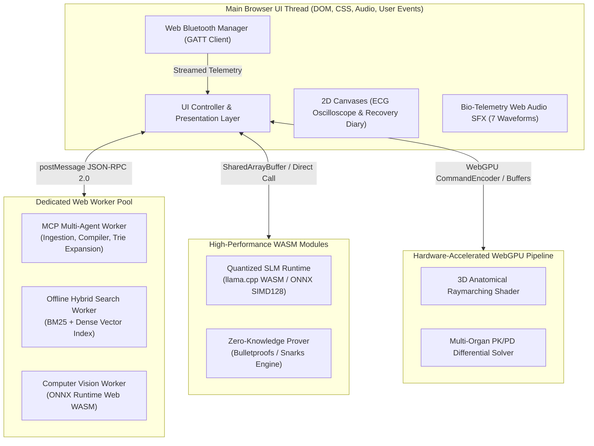
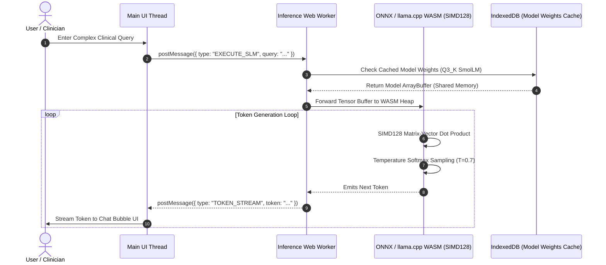
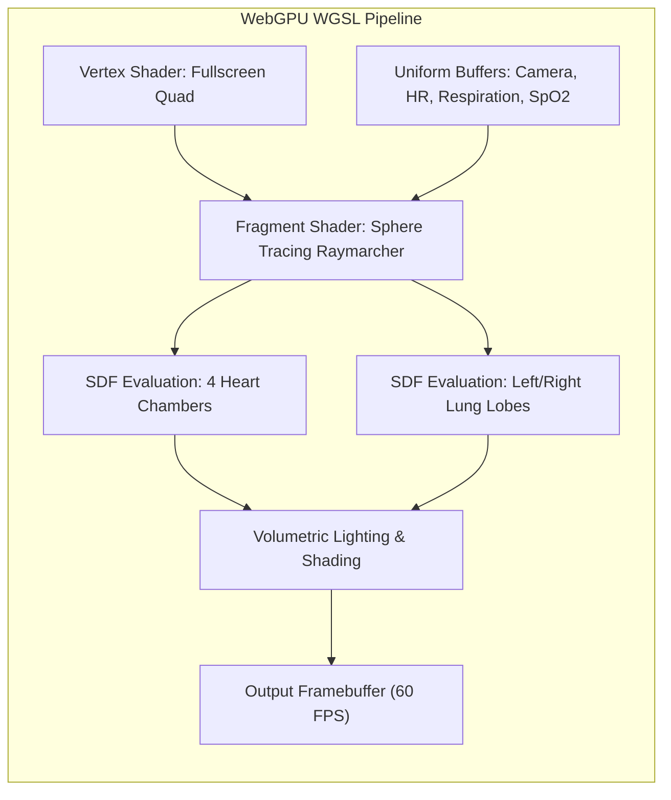
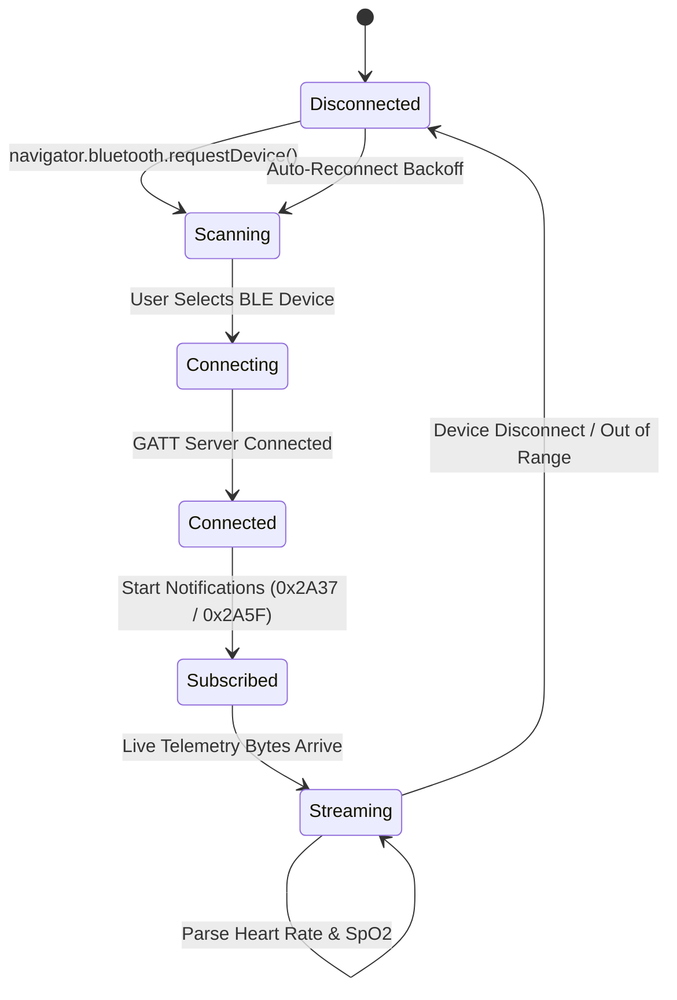
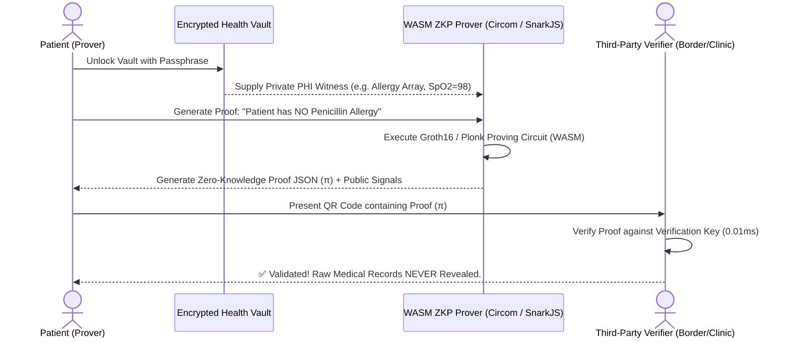

# 🛠️ RAMAN AI – Technical Requirements Document (TRD)
### *Next-Generation Client-Side Medical Intelligence & Clinical Simulation Platform*

---

## 📌 Document Overview & Engineering Scope

| Parameter | Specification |
| :--- | :--- |
| **System** | RAMAN AI (Experiment No. 170) |
| **Document Version** | 2.0-TECHNICAL |
| **Target Runtime** | Modern Browser Engines (V8, JavaScriptCore, SpiderMonkey), WebAssembly, WebGPU |
| **Hardware Targets** | Desktop (x86_64 / ARM64), Mobile (ARM64 iOS 16+, Android 12+) |
| **Lead Architect** | Ramanuja Pathy |
| **Architecture Paradigm** | Zero-Cloud, Multi-Threaded Client Runtime (WASM + Web Workers + WebGPU) |

---

## 🏛️ 1. System Architecture & Module Decomposition

To break the monolithic structure of `app.js` and support heavy computation without UI thread blocking, RAMAN AI v2.0 adopts a decoupled, multi-threaded architectural pattern:



---

## 🧠 2. Pillar 1: Next-Generation Local Intelligence Specifications

### 2.1 WASM-Accelerated Quantized SLM Runtime



#### A. Runtime & Model Parameters:
* **Engine:** ONNX Runtime Web (`ort-wasm-simd-threaded.wasm`) or llama.cpp compiled to WebAssembly via Emscripten.
* **Target Model Topologies:** SmolLM-135M-Instruct or Phi-3-mini-4K quantized to 2-bit or 3-bit (`Q2_K` / `Q3_K`) GGUF/ONNX formats.
* **Memory Constraints:** Model weights file size $\le 180\text{ MB}$; runtime WASM linear memory allocation capped at $512\text{ MB}$ (`INITIAL_MEMORY = 256MB`, `MAXIMUM_MEMORY = 1024MB`).
* **Vector Optimization:** Mandatory WASM SIMD128 vector extensions enabling 4-way parallel float32 and 16-way int8 dot-product operations.

#### B. Dynamic Complexity Router:
Before invoking the WASM SLM, queries pass through an instantaneous complexity gate:
* *Heuristic Queries* ($\le 12$ words, matching known dictionary terms) $\to$ Instant JS Ensemble ($< 0.5\text{ ms}$).
* *Multi-Symptom / Narrative Queries* ($> 12$ words or cross-organ complaints) $\to$ WASM SLM Inference Pipeline.

---

### 2.2 Dynamic Adaptive MLP Neural Scaling

The 4-layer MLP topology must dynamically adjust its weight matrices at runtime when new medical conditions are registered:

$$\mathbf{W}_1 \in \mathbb{R}^{V \times 32}, \quad \mathbf{W}_2 \in \mathbb{R}^{32 \times 16}, \quad \mathbf{W}_3 \in \mathbb{R}^{16 \times 8}, \quad \mathbf{W}_4 \in \mathbb{R}^{8 \times C}$$

When the condition count $C$ expands ($C \to C + \Delta C$):
1. **Output Matrix Reallocation:** Preserve existing weights $\mathbf{W}_{4, [8 \times C]}$ and append $\Delta C$ newly initialized columns using Xavier uniform initialization.
2. **Dynamic Hidden Layer Expansion:** If $|V| > 1,500$ tokens, the hidden layer width dynamically scales:
   * Layer 1: $32 \to 64$ units.
   * Layer 2: $16 \to 32$ units.
   * Layer 3: $8 \to 16$ units.
3. **Sparse Gradient Updates:** Continue utilizing sparse backpropagation, updating only weights corresponding to active input indices $X_v > 0$.

---

### 2.3 Offline BM25 + Dense Hybrid Search Engine

To query medical reference manuals and drug interactions offline:
* **BM25 Lexical Inverted Index:**
  $$\text{Score}_{BM25}(D, Q) = \sum_{t \in Q} \text{IDF}(t) \cdot \frac{f(t, D) \cdot (k_1 + 1)}{f(t, D) + k_1 \cdot \left(1 - b + b \cdot \frac{|D|}{\text{avgdl}}\right)}$$
  Parameters calibrated to $k_1 = 1.2$, $b = 0.75$.
* **Dense Semantic Embeddings:** Pre-computed 64-dimensional float16 embedding vectors for top 2,500 clinical concepts.
* **Score Fusion (Reciprocal Rank Fusion - RRF):**
  $$\text{RRF\_Score}(d) = \frac{1}{60 + \text{Rank}_{BM25}(d)} + \frac{1}{60 + \text{Rank}_{\text{Dense}}(d)}$$

---

## ⚡ 3. Pillar 2: Advanced WebGPU Simulation Specifications

### 3.1 3D Volumetric Raymarching Anatomical Shaders

The WebGPU pipeline transitions from 2D point scatterplots to full 3D shader-based raymarching volumetric rendering:



#### A. Signed Distance Function (SDF) Formulation:
* **Cardiac Ventricles & Atria:** Modeled using smooth minimum blends of deformed ellipsoids:
  $$d_{\text{chamber}}(\mathbf{p}, t) = \|\mathbf{p} \cdot \mathbf{S}(t)\| - r_{\text{base}}$$
  where $\mathbf{S}(t) = [1.0 + A_{\text{systole}} \cdot \sin(\omega t), 1.0 - A_{\text{systole}} \cdot \sin(\omega t), 1.0]$ scales with live patient heart rate $\omega = 2\pi \cdot (\text{BPM} / 60)$.
* **Lung Lobes Inflation:** Dual ellipsoids expanding along the lateral axis driven by respiratory rate ($\text{RR}$).

#### B. WGSL Fragment Shader Specification:
```wgsl
struct VitalsUniforms {
    heartRate: f32,
    respirationRate: f32,
    spo2: f32,
    time: f32,
    resolution: vec2<f32>,
};

@group(0) @binding(0) var<uniform> vitals: VitalsUniforms;

@fragment
fn fs_main(@builtin(position) fragCoord: vec4<f32>) -> @location(0) vec4<f32> {
    let uv = (fragCoord.xy - 0.5 * vitals.resolution) / vitals.resolution.y;
    var rayOrigin = vec3<f32>(0.0, 0.0, -3.0);
    var rayDir = normalize(vec3<f32>(uv, 1.0));
    
    // Raymarching loop (maximum 64 steps for 60fps performance)
    var distTraveled = 0.0;
    for (var i = 0; i < 64; i++) {
        let p = rayOrigin + rayDir * distTraveled;
        let d = evaluateAnatomySDF(p, vitals.heartRate, vitals.time);
        if (d < 0.001) {
            let normal = calculateNormal(p, vitals.heartRate, vitals.time);
            let color = computeCardiacColor(normal, vitals.spo2);
            return vec4<f32>(color, 1.0);
        }
        distTraveled += d;
        if (distTraveled > 10.0) { break; }
    }
    return vec4<f32>(0.05, 0.08, 0.15, 0.0); // Neon cyber dark background
}
```

---

### 3.2 Multi-Organ Pharmacokinetic (PK/PD) Compute Shader

Simulates drug concentration curves using a 2-compartment open pharmacokinetic model implemented in parallel WGSL compute passes:

$$\frac{dC_g}{dt} = -k_a \cdot C_g \quad \text{(Gastrointestinal Absorption)}$$
$$V_c \frac{dC_c}{dt} = k_a C_g - (CL + k_{12}) C_c + k_{21} C_p \quad \text{(Central Vascular Compartment)}$$
$$V_p \frac{dC_p}{dt} = k_{12} C_c - k_{21} C_p \quad \text{(Peripheral Tissue Compartment)}$$

* **Solver:** 4th-Order Runge-Kutta (RK4) integration executed across 1,024 parallel threads representing discrete patient metabolic cohorts.
* **Organ Clearances:** Hepatic and renal clearance constants dynamically adjust based on patient demographic inputs (eGFR and LFT).

---

## 🤖 4. Pillar 3: Autonomous Web Worker MCP Agent Hub

### 4.1 Multi-Agent Web Worker Architecture

To guarantee zero main-thread jank, the MCP pipeline is offloaded to a dedicated worker script: `mcp_agent_worker.js`.

```mermaid
flowchart TD
    subgraph MainThread ["Main Thread (app.js)"]
        UI_Event["Unrecognized Symptom Observed"] --> SendCmd["postMessage: INGEST_AND_RETRAIN"]
        RecvDelta["Apply Weights Delta to In-Memory SLM"] <-- OnMessage["postMessage: RETRAIN_COMPLETE"]
    end

    subgraph Worker ["mcp_agent_worker.js"]
        OnCmd["onmessage Handler"] --> Agent1["Agent 1: Ingestion & Parser"]
        Agent1 --> Agent2["Agent 2: Pharmacotherapy & SNOMED Compiler"]
        Agent2 --> Agent3["Agent 3: Corpus Tokenizer & Trie Mutator"]
        Agent3 --> Agent4["Agent 4: Sparse Backprop Retraining"]
        Agent4 --> GenBuffer["Compile Serialized Model Delta Buffer"]
    end
    SendCmd --> OnCmd
    GenBuffer --> OnMessage
```

#### A. JSON-RPC 2.0 Web Worker Protocol:
```json
// Main Thread -> Web Worker Request
{
  "jsonrpc": "2.0",
  "id": 1042,
  "method": "mcp/ingestAndRetrain",
  "params": {
    "conditionKey": "otitis",
    "colloquialPhrases": [
      "kano bitha heuchi pani baharuche",
      "throbbing ear ache fluid discharge"
    ],
    "medications": [
      { "name": "Ofloxacin 0.3% Otic", "snomed": "387207008", "dose": "5 drops bid" }
    ]
  }
}

// Web Worker -> Main Thread Response
{
  "jsonrpc": "2.0",
  "id": 1042,
  "result": {
    "status": "SUCCESS",
    "updatedVocabSize": 1842,
    "deltaWeightsBuffer": "<Transferable ArrayBuffer>",
    "trainingDurationMs": 2.45
  }
}
```

### 4.2 Self-Healing Vocabulary Expansion Algorithm
1. **OOV Token Detection:** When incoming symptom reports have $\ge 40\%$ out-of-vocabulary (OOV) tokens, the text is routed to the Self-Healing Analyzer.
2. **Fuzzy Synonym Clustering:** Token sequences are evaluated against WordNet and clinical synonym embeddings via Trie nearest-neighbor search.
3. **Automated Trie Mutation:** If a candidate phrase clusters with an existing condition centroid with cosine similarity $> 0.82$, the phrase is automatically inserted into the Fuzzy Trie with a $0.85$ discount factor.

---

## 📡 5. Pillar 4: Edge Hardware & Bio-Telemetry Specifications

### 5.1 Web Bluetooth GATT Integration



#### A. Supported Bluetooth SIG Standard Profiles:
* **Heart Rate Service (`0x180D`):**
  * Characteristic: Heart Rate Measurement (`0x2A37`).
  * Byte Parsing Logic:
    * Flags (Byte 0): Bit 0 indicates HR format (`0` = uint8, `1` = uint16).
    * Heart Rate Value (Byte 1 or Bytes 1-2).
    * Energy Expended & RR-Interval (optional trailing bytes).
* **Pulse Oximeter Service (`0x1822`):**
  * Characteristic: PLX Continuous Measurement (`0x2A5F`).
  * Byte Parsing Logic:
    * SpO2 value (SFLOAT format, Bytes 1-2).
    * Pulse rate (SFLOAT format, Bytes 3-4).

#### B. Failure Recovery & Exponential Backoff:
* On `gattserverdisconnected` event, the system initiates up to 3 reconnection attempts using exponential backoff ($1\text{s}, 2\text{s}, 4\text{s}$).
* If reconnection fails, seamlessly fall back to manual vitals sliders with an audible Discordant Alert waveform (`BioTelemetrySFX.playError()`).

---

### 5.2 Offline Computer Vision for Visual Diagnostics

* **Inference Engine:** ONNX Runtime Web using WASM SIMD execution.
* **Model Topologies:** MobileNetV3-Small (quantized int8, $< 8\text{ MB}$ weight binary) fine-tuned for:
  1. *Dermatological Lesions:* Classification across 6 classes (Benign Nevus, Erythema, Eczema, Psoriasis, Urticaria, Melanoma-Risk Indicator).
  2. *Ocular Redness:* Conjunctival injection vs. normal sclera.
  3. *Lateral-Flow Test Strips:* Colorimetric band detection for COVID-19/Malaria RDT strips.
* **Image Processing Pipeline:**
  * Native `<video>` frame capture $\to$ `<canvas>` extraction $\to$ Bilinear resize to $224 \times 224 \times 3$ $\to$ L2-normalization $(x - \mu) / \sigma \to$ Tensor Float32Array $\to$ Inference in $< 35\text{ ms}$.

---

## 🔒 6. Pillar 5: Interoperability & Zero-Knowledge Security Specs

### 6.1 HL7 FHIR Release 4 (R4) JSON Bundle Schema

Clinical consultation summaries are formatted as standards-compliant FHIR R4 Document Bundles:

```json
{
  "resourceType": "Bundle",
  "id": "raman-consult-RMN-E3B9F2",
  "type": "document",
  "timestamp": "2026-10-23T04:45:00Z",
  "entry": [
    {
      "resource": {
        "resourceType": "Patient",
        "id": "patient-001",
        "gender": "male",
        "birthDate": "1992-05-15"
      }
    },
    {
      "resource": {
        "resourceType": "Condition",
        "id": "condition-001",
        "clinicalStatus": {
          "coding": [{ "system": "http://terminology.hl7.org/CodeSystem/condition-clinical", "code": "active" }]
        },
        "code": {
          "coding": [{ "system": "http://id.who.int/icd/release/11/mms", "code": "BA41", "display": "Angina Pectoris / Chest Pain" }]
        },
        "subject": { "reference": "Patient/patient-001" }
      }
    },
    {
      "resource": {
        "resourceType": "Observation",
        "id": "obs-spo2",
        "status": "final",
        "code": {
          "coding": [{ "system": "http://loinc.org", "code": "2708-6", "display": "Oxygen saturation in Arterial blood" }]
        },
        "valueQuantity": { "value": 94, "unit": "%", "system": "http://unitsofmeasure.org", "code": "%" }
      }
    },
    {
      "resource": {
        "resourceType": "MedicationStatement",
        "id": "med-001",
        "status": "active",
        "medicationCodeableConcept": {
          "coding": [{ "system": "http://snomed.info/sct", "code": "387207008", "display": "Paracetamol 650mg" }]
        },
        "subject": { "reference": "Patient/patient-001" }
      }
    }
  ]
}
```

---

### 6.2 Client-Side Zero-Knowledge Proof (ZKP) Architecture

To enable patients to verify health criteria without revealing their full PHI, RAMAN AI integrates client-side zk-SNARK / Bulletproof circuits:



* **Circuit Logic:** Proves statement $\mathcal{P}(\mathbf{w}, \mathbf{x}) = 1$ where private witness $\mathbf{w} \in \text{Vault}$ and public input $\mathbf{x} \in \{\text{Rule ID}, \text{Timestamp}\}$.
* **Performance:** Groth16 proof generation in WASM: $\le 1.8\text{ seconds}$ on client CPU; verification time $< 5\text{ ms}$.