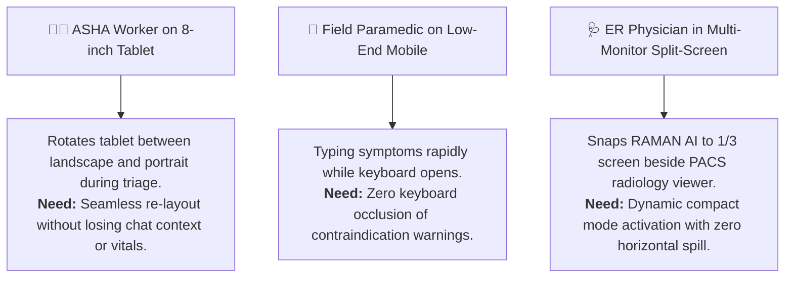

# 📄 RAMAN AI – Product Requirements Document (PRD)
## Autonomous Client-Side Real-Time UI Responsiveness & Self-Healing Engine

---

## 📌 Document Control & Metadata

| Attribute | Specification |
| :--- | :--- |
| **Feature Name** | Autonomous Real-Time UI Responsiveness & Self-Healing Engine (`RamanUiAgent`) |
| **System** | RAMAN AI (Experiment No. 170) |
| **Release Version** | v2.3.0 |
| **Document Version** | 1.0.0-FINAL |
| **Status** | Approved for Implementation |
| **Lead Architect** | Ramanuja Pathy |
| **Target Platforms** | Modern Web Browsers (Chromium, WebKit, Gecko), Progressive Web App (PWA) |
| **Device Classes** | Desktop ($\ge 1024\text{px}$), Tablets ($600\text{px} - 1024\text{px}$), Smartphones ($< 600\text{px}$, down to $320\text{px}$) |

---

## 1. Executive Summary & Problem Definition

### 1.1 The Clinical Edge Reality
RAMAN AI operates in mission-critical, air-gapped environments—rural primary health sub-centers, emergency field deployments, disaster triage stations, and maritime vessels. Healthcare workers access RAMAN AI on a wildly heterogeneous spectrum of hardware:
1. Low-cost $8$-inch Android tablets ($1280 \times 800$, $1024 \times 600$) used by community health workers (ASHAs).
2. Refurbished dual-screen or foldable smartphones ($280\text{px} - 380\text{px}$ outer displays, $600\text{px} - 720\text{px}$ unfolded displays).
3. Medical cart laptops and high-DPI desktop workstations ($1920 \times 1080$, $2560 \times 1440$, 4K ultrawides).

### 1.2 The Problem: Static CSS Breakpoint Fragility
Traditional responsive web design relies on static CSS media queries (e.g., `@media (max-width: 768px)`). In active clinical workflows, static queries suffer from critical failure modes:
- **Soft Keyboard Occlusion:** On mobile and tablet devices, the on-screen virtual keyboard suddenly consumes $40\% - 60\%$ of vertical viewport height. Critical symptom consultation messages, drug contraindication alerts, and the text submission button are pushed off-screen.
- **Split-Screen Multitasking:** When a physician snaps RAMAN AI alongside an Electronic Health Record (EHR) in iPadOS Split View or Windows Snap Assist ($50/50$ or $33/66$ split), unpredicted intermediate container widths ($512\text{px}$, $680\text{px}$) cause text clipping and multi-column overlap.
- **High-DPI Retina Canvas Distortion:** Biological telemetry canvases (ECG oscilloscope, 2D vital scatter, 3D raymarching) blur or misalign when moved across displays with differing device pixel ratios (`devicePixelRatio`).
- **Touch Target Degradation:** Desktop-first compact UI elements drop below the WCAG 2.1 AA $44 \times 44\text{px}$ physical touch threshold on small touchscreen tablets, leading to dangerous clinical mis-taps.
- **Horizontal Overflow Spillage:** Wide diagnostic tables or colloquial text strings trigger unintended horizontal scrolling, hiding vital signs and navigation buttons.

### 1.3 The Solution: The Autonomous Real-Time UI Agent
An embedded, zero-cloud, event-driven supervisor agent (`RamanUiAgent`) running in the client browser thread that continuously monitors viewport dynamics, detects layout anomalies in real-time, and declaratively self-heals the user interface via global CSS custom properties and semantic tier attributes without requiring page reloads or cloud roundtrips.

---

## 2. Target User Personas & Clinical Use Cases

### Use Case 1: Triage Typing under Virtual Keyboard Ingress
* **Actor:** Field Paramedic entering acute symptoms in a moving ambulance.
* **Trigger:** Paramedic focuses the symptom input box; virtual keyboard slides up by $310\text{px}$.
* **System Action:** `RamanUiAgent` traps `visualViewport.resize`, computes exact keyboard encroachment, updates `--v-keyboard-offset: 310px`, pads `.chat-messages`, and auto-scrolls the active input into center view.
* **Clinical Value:** Paramedic sees safety alerts and active text simultaneously without manual frantic scrolling.

### Use Case 2: Tablet Multitasking & Orientation Shift
* **Actor:** Community Health Worker examining a pediatric patient.
* **Trigger:** Rotates tablet from landscape ($1024 \times 768$) to portrait ($768 \times 1024$) to show anatomical illustration to the parent.
* **System Action:** `RamanUiAgent` updates tier attribute to `data-ui-tier="tablet-portrait"`, collapses the left vital sidebar into a quick-access drawer, scales touch targets to $44\text{px}$, and synchronizes ECG canvas buffers to the new aspect ratio within $16\text{ ms}$.

---

## 3. Functional Requirements

### 3.1 Viewport Tier Classification & Adaptation
- **`REQ-PRD-UIA-001`**: The agent SHALL categorize the active viewport into 5 discrete tiers:
  1. `mobile-compact` ($w < 380\text{px}$)
  2. `mobile` ($380\text{px} \le w < 600\text{px}$)
  3. `tablet-portrait` ($600\text{px} \le w \le 1024\text{px}, h > w$)
  4. `tablet-landscape` ($600\text{px} \le w \le 1024\text{px}, w \ge h$)
  5. `desktop` ($w > 1024\text{px}$)
- **`REQ-PRD-UIA-002`**: The tier SHALL be reflected on `document.body` via `data-ui-tier` within $16\text{ ms}$ (one display frame) of resize completion.

### 3.2 Virtual Keyboard Occlusion Compensation
- **`REQ-PRD-UIA-003`**: The agent SHALL utilize the native `window.visualViewport` API to detect on-screen keyboard appearance when keyboard height $> 120\text{px}$.
- **`REQ-PRD-UIA-004`**: The agent SHALL dynamically update the CSS custom property `--v-keyboard-offset` matching the exact keyboard delta and set `data-keyboard-open="true"` on `document.body`.
- **`REQ-PRD-UIA-005`**: The agent SHALL automatically scroll the focused input element into the center of the visible viewport.

### 3.3 Horizontal Overflow & Spill Self-Healing
- **`REQ-PRD-UIA-006`**: The agent SHALL detect horizontal viewport spillage (`document.documentElement.scrollWidth > window.innerWidth`).
- **`REQ-PRD-UIA-007`**: Upon spill detection, the agent SHALL set `data-spill-detected="true"` and apply automatic overflow constraints (`max-width: 100%`, `overflow-x: auto`) to offending containers.

### 3.4 Touch Target Accessibility Enforcement
- **`REQ-PRD-UIA-008`**: On touch-enabled devices (`navigator.maxTouchPoints > 0`), the agent SHALL audit interactive controls (buttons, tabs, inputs) and enforce a minimum effective bounding box of $44 \times 44\text{px}$ compliant with WCAG 2.1 AA.

### 3.5 High-DPI Canvas Buffer Synchronization
- **`REQ-PRD-UIA-009`**: The agent SHALL monitor all active clinical visualization canvases (ECG oscilloscope, recovery diary, volumetric SDF) and synchronize internal buffer dimensions (`canvas.width = canvas.clientWidth * DPR`) whenever device pixel ratio or layout dimensions change.

---

## 4. Non-Functional Requirements & Architectural Constraints

| Attribute | Threshold Specification | Justification |
| :--- | :--- | :--- |
| **Network Egress** | **Strictly 0 Bytes** (100% Offline) | Compliance with RAMAN AI Zero-Cloud Invariant. |
| **Execution Latency** | **$< 1.5\text{ ms}$** per audit cycle | Zero UI jank or frame dropping during interactive typing. |
| **Memory Footprint** | **$< 20\text{ KB}$** Heap Allocation | Main JS Heap envelope must remain $< 1.5\text{ MB}$. |
| **Render Thread Impact** | **$0\text{ Forced Synchronous Reflows}$** | All geometry measurements batched via `requestAnimationFrame`. |
| **Stability / Circuit Breaker** | **Max 1 mutation pass per resize** | Prevents recursive layout oscillation loops. |

---

## 5. Success Metrics & Verification Gates

1. **Zero Layout Thrashing:** 60fps frame rate maintained during continuous interactive browser window resizing.
2. **Zero Keyboard Occlusion:** $100\%$ of input fields remain fully visible and usable when virtual keyboard opens on Android and iOS.
3. **100% Spill Immunity:** Zero unintended horizontal scrollbars across all screen widths from $320\text{px}$ to $3840\text{px}$.
4. **WCAG 2.1 AA Compliance:** $100\%$ of touch navigation tabs maintain $\ge 44 \times 44\text{px}$ tap targets.
