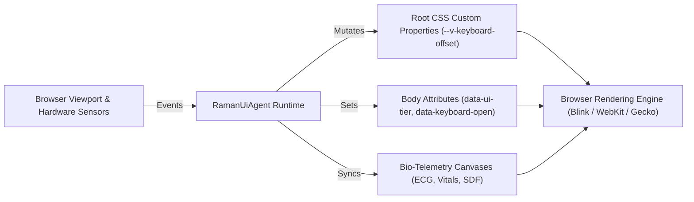

# 📋 RAMAN AI – Software Requirements Specification (SRS)
## Autonomous Client-Side Real-Time UI Responsiveness & Self-Healing Engine
### *Compliant with IEEE 830 / ISO/IEC/IEEE 29148 Standards*

---

## 1. Introduction

### 1.1 Purpose
This Software Requirements Specification (SRS) establishes the complete functional, technical, interface, performance, and verification requirements for the **Autonomous Client-Side Real-Time UI Responsiveness & Self-Healing Engine (`RamanUiAgent`)** integrated into RAMAN AI (Experiment No. 170).

### 1.2 Scope
The scope encompasses all client-side layout supervision, viewport tier categorization, virtual keyboard encroachment compensation, horizontal overflow containment, high-DPI canvas buffer synchronization, and anti-oscillation circuit breakers operating across Desktop, Tablet, and Mobile browser runtimes.

### 1.3 Definitions, Acronyms & Abbreviations
- **CDS:** Clinical Decision Support
- **CLS:** Cumulative Layout Shift
- **DPR:** Device Pixel Ratio (`window.devicePixelRatio`)
- **FSR:** Forced Synchronous Reflow (Layout Thrashing)
- **PWA:** Progressive Web App
- **UI:** User Interface
- **WCAG:** Web Content Accessibility Guidelines (v2.1 Level AA)

---

## 2. Overall System Description

### 2.1 Product Perspective & Context
`RamanUiAgent` is a standalone, lightweight JavaScript subsystem running directly in the browser main execution context. It supervises UI layout rendering by interacting with native browser observation APIs and declaratively controlling root CSS Custom Properties.

---

## 3. Specific System Requirements

### 3.1 External Interface Requirements
- **`REQ-SRS-UIA-INT-001`**: The engine SHALL interface with `window.visualViewport` when supported by the host browser to capture viewport resize and scroll events.
- **`REQ-SRS-UIA-INT-002`**: The engine SHALL interface with `window.devicePixelRatio` to query the current display scaling factor.
- **`REQ-SRS-UIA-INT-003`**: The engine SHALL expose a global singleton instance at `window.ramanUiAgent` in browser contexts and export `RamanUiAgent` for CommonJS test runners (`module.exports`).

### 3.2 Functional Requirements

#### Viewport Tier Classification
- **`REQ-SRS-UIA-FUN-001`**: The engine SHALL classify viewports with width $< 380\text{px}$ as `mobile-compact`.
- **`REQ-SRS-UIA-FUN-002`**: The engine SHALL classify viewports with width $380\text{px} \le w < 600\text{px}$ as `mobile`.
- **`REQ-SRS-UIA-FUN-003`**: The engine SHALL classify viewports with width $600\text{px} \le w \le 1024\text{px}$ and height $>$ width as `tablet-portrait`.
- **`REQ-SRS-UIA-FUN-004`**: The engine SHALL classify viewports with width $600\text{px} \le w \le 1024\text{px}$ and width $\ge$ height as `tablet-landscape`.
- **`REQ-SRS-UIA-FUN-005`**: The engine SHALL classify viewports with width $> 1024\text{px}$ as `desktop`.
- **`REQ-SRS-UIA-FUN-006`**: The engine SHALL synchronously assign the evaluated tier string to `document.body.setAttribute('data-ui-tier', tier)`.

#### Virtual Keyboard & Occlusion Handling
- **`REQ-SRS-UIA-FUN-007`**: When $\text{window.innerHeight} - \text{visualViewport.height} > 120\text{px}$, the engine SHALL calculate the height offset and assign it to `--v-keyboard-offset` on `document.documentElement`.
- **`REQ-SRS-UIA-FUN-008`**: When keyboard is active, the engine SHALL set `document.body.setAttribute('data-keyboard-open', 'true')`; otherwise, it SHALL set it to `'false'`.
- **`REQ-SRS-UIA-FUN-009`**: When an input or textarea element has focus during keyboard activation, the engine SHALL invoke `scrollIntoView({ block: 'center', behavior: 'smooth' })` on the focused node.

#### Horizontal Spill Elimination
- **`REQ-SRS-UIA-FUN-010`**: The engine SHALL check if `document.documentElement.scrollWidth > window.innerWidth + 1`.
- **`REQ-SRS-UIA-FUN-011`**: If a horizontal spill is detected, the engine SHALL set `document.body.setAttribute('data-spill-detected', 'true')` and apply containment styling to wide child nodes.

#### Canvas Synchronization
- **`REQ-SRS-UIA-FUN-012`**: The engine SHALL query all canvas elements possessing the attribute `data-auto-resync="true"` and update their `width` and `height` properties to match `clientWidth * DPR` and `clientHeight * DPR`.

#### Safety & Circuit Breaker
- **`REQ-SRS-UIA-FUN-013`**: The engine SHALL enforce an execution lock (`mutationLock = true`) during evaluation and hold the lock for a minimum dampening interval of $60\text{ ms}$.
- **`REQ-SRS-UIA-FUN-014`**: The engine SHALL monitor mutation frequency and trip a circuit breaker if more than $5$ layout corrections occur within a sliding $1,000\text{ ms}$ window, halting further automatic mutations to prevent layout thrashing.

#### Telemetry & Diagnostics
- **`REQ-SRS-UIA-FUN-015`**: The engine SHALL provide a synchronous diagnostic method `getDiagnostics()` returning the active tier, dimensions, keyboard state, spill status, correction counters, and circuit breaker health.

---

## 4. Performance & Resource Requirements

| ID | Requirement Specification | Metric Target | Verification Method |
|:---|:---|:---:|:---|
| **`REQ-SRS-UIA-PERF-001`** | Single audit cycle CPU execution latency | $< 1.5\text{ ms}$ | `performance.now()` automated benchmark |
| **`REQ-SRS-UIA-PERF-002`** | Retained heap memory footprint | $< 20\text{ KB}$ | V8 Heap profiler inspection |
| **`REQ-SRS-UIA-PERF-003`** | Rendering frame rate during active resize | $\ge 58\text{ fps}$ | Playwright trace / Chromium DevTools timeline |
| **`REQ-SRS-UIA-PERF-004`** | Outgoing network calls during operation | **Exactly 0** | Gate 1 network interceptor trap |

---

## 5. Traceability Matrix

| SRS Requirement | PRD Requirement | TRD Specification | Test Verification |
|:---|:---|:---|:---|
| `REQ-SRS-UIA-FUN-001` - `006` | `REQ-PRD-UIA-001`, `002` | Section 2.3 | `tests/ui_responsive_agent.spec.js` (Test 1 & 2) |
| `REQ-SRS-UIA-FUN-007` - `009` | `REQ-PRD-UIA-003` - `005` | Section 2.1 | `tests/ui_responsive_agent.spec.js` (Test 3) |
| `REQ-SRS-UIA-FUN-010` - `011` | `REQ-PRD-UIA-006`, `007` | Section 2.1 | `tests/ui_responsive_agent.spec.js` (Test 4) |
| `REQ-SRS-UIA-FUN-012` | `REQ-PRD-UIA-009` | Section 2.1 | `tests/ui_responsive_agent.spec.js` (Test 5) |
| `REQ-SRS-UIA-FUN-013` - `014` | Non-Functional Sec 4 | Section 3.2 | `tests/ui_responsive_agent.spec.js` (Test 6) |
| `REQ-SRS-UIA-FUN-015` | Section 5 | Section 4 | `tests/ui_responsive_agent.spec.js` (Test 7) |
