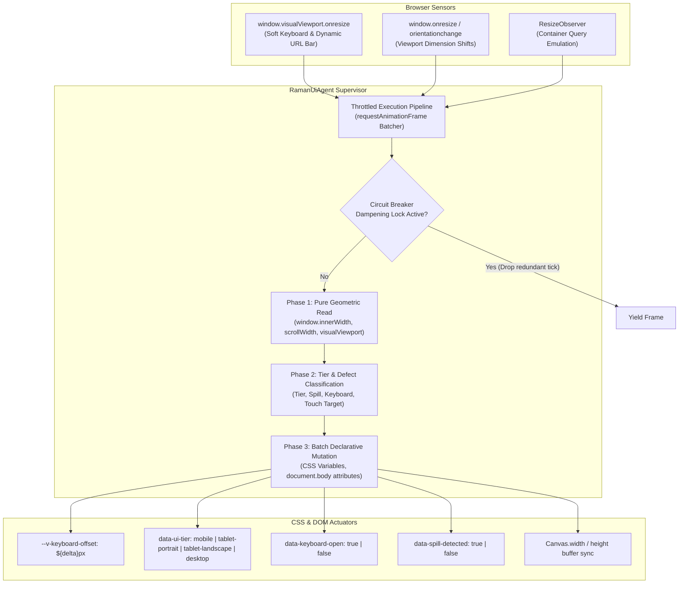

# 🛠️ RAMAN AI – Technical Requirements Document (TRD)
## Autonomous Client-Side Real-Time UI Responsiveness & Self-Healing Engine

---

## 📌 Document Overview & Engineering Specifications

| Parameter | Specification |
| :--- | :--- |
| **Module Name** | `ui_responsive_agent.js` |
| **System** | RAMAN AI (Experiment No. 170) |
| **Document Version** | 1.0.0-TECHNICAL |
| **Runtime Environment** | Modern Browser Main Thread (ES6+ / CommonJS Compatible) |
| **Target Engines** | V8 (Chromium 100+), JavaScriptCore (WebKit / Safari 15+), SpiderMonkey (Gecko / Firefox 100+) |
| **Core Invariants** | Zero-Cloud (0 Network Calls), Non-Blocking (< 1.5ms Execution), Zero Layout Thrashing |

---

## 🏛️ 1. Architecture & Execution Pipeline

The autonomous UI responsiveness engine operates on an **event-driven, sensor-actuator control loop** decoupled from static CSS media queries. Instead of directly mutating individual DOM elements, the agent modifies high-level **declarative CSS Custom Properties** and **DOM data attributes**, allowing the browser's hardware-accelerated style recalculation engine to handle visual rendering smoothly.



---

## ⚙️ 2. Core Subsystems & Technical Mechanics

### 2.1 Sensor & Ingestion Layer
The agent avoids performance-degrading polling loops (`setInterval`). It attaches passive listeners to native browser lifecycle events:

1. **`window.visualViewport` API:**
   - Detects on-screen soft keyboard height changes on Android Chrome and iOS Safari.
   - Calculates keyboard height differential:
     $$\Delta_{\text{keyboard}} = \max\left(0, \text{window.innerHeight} - \text{window.visualViewport.height}\right)$$
   - When $\Delta_{\text{keyboard}} > 120\text{px}$, the keyboard is flagged as active.
2. **`window.resize` & `window.orientationchange`:**
   - Detects device rotation, desktop window resizing, and split-screen snapping.
   - Schedules an audit via `window.requestAnimationFrame`.
3. **`ResizeObserver`:**
   - Attached to critical dynamic containers (`.chat-area`, `.sidebar`, `.hud-canvas-container`) to detect size changes driven by internal DOM mutations.

### 2.2 Forced Synchronous Reflow (FSR) Elimination
To prevent layout thrashing, execution is strictly partitioned into two atomic phases:
1. **Read Phase:** All layout metrics (`window.innerWidth`, `window.innerHeight`, `document.documentElement.scrollWidth`, `visualViewport.height`) are queried synchronously in a single burst.
2. **Write Phase:** All CSS custom property updates and attribute mutations are executed consecutively without intervening geometric queries.

### 2.3 Tier Classification Matrix
The agent computes the active layout tier using deterministic thresholding:

```javascript
function classifyViewportTier(width, height) {
  if (width < 380) {
    return 'mobile-compact';
  } else if (width < 600) {
    return 'mobile';
  } else if (width <= 1024) {
    return (height > width) ? 'tablet-portrait' : 'tablet-landscape';
  } else {
    return 'desktop';
  }
}
```

### 2.4 Declarative CSS Custom Property Contract

| Property / Attribute | Type | Default | Description |
|---|---|---|---|
| `--v-keyboard-offset` | `<length>` | `0px` | Active height consumed by virtual keyboard; used to pad bottom of chat containers. |
| `--ui-touch-target-min` | `<length>` | `44px` on touch, `32px` on mouse | Enforces WCAG 2.1 AA tap target sizing on touch-enabled hardware. |
| `data-ui-tier` | `string` | `"desktop"` | Reflects active device classification tier on `document.body`. |
| `data-keyboard-open` | `"true" \| "false"` | `"false"` | Flags active soft keyboard presence for targeted styling. |
| `data-spill-detected` | `"true" \| "false"` | `"false"` | Flags horizontal layout spillage to apply strict boundary clipping. |

---

## 🛡️ 3. Anti-Oscillation Circuit Breaker & Safety Invariants

### 3.1 The Layout Thrashing Threat
If an agent's corrective action alters element width, that alteration could trigger a subsequent `ResizeObserver` event, leading to an **infinite mutation feedback loop** that pegs CPU utilization at 100% and crashes the browser tab.

### 3.2 Dampening Lock Pattern
The agent implements a multi-layer circuit breaker:
1. **Frame Locking (`mutationLock`):** While an audit is executing or within $60\text{ ms}$ of a DOM modification, all secondary resize triggers are dropped.
2. **Rate Limiting (`MAX_MUTATIONS_PER_SEC = 5`):** Tracks corrective mutations over a sliding $1,000\text{ ms}$ window. If mutations exceed $5$, the circuit breaker **trips**, locking the layout into a safe fallback mode and emitting a diagnostic warning.
3. **Declarative Isolation:** The agent NEVER writes inline `style.width` or `style.height` directly to individual chat bubbles or body text. Mutations are restricted to root CSS custom properties and high-level body attributes.

---

## 📊 4. Telemetry & Diagnostic Interface

The agent exposes a comprehensive diagnostics API accessible via `window.ramanUiAgent.getDiagnostics()`:

```typescript
interface RamanUiDiagnostics {
  version: string;
  activeTier: 'mobile-compact' | 'mobile' | 'tablet-portrait' | 'tablet-landscape' | 'desktop';
  viewport: {
    width: number;
    height: number;
    visualWidth: number;
    visualHeight: number;
    devicePixelRatio: number;
  };
  keyboard: {
    isOpen: boolean;
    offsetPx: number;
  };
  spillDetected: boolean;
  touchEnabled: boolean;
  totalAudits: number;
  totalCorrections: number;
  circuitBreakerTripped: boolean;
  executionLatencyMs: number;
}
```

---

## 5. Verification & Performance Budget

| Parameter | Budget | Measurement Mechanism |
|---|---|---|
| **Audit Execution Latency** | $< 1.5\text{ ms}$ | `performance.now()` micro-benchmark during window resizing. |
| **Continuous Heap Allocation** | $< 10\text{ KB}$ | V8 heap profiler over 200 consecutive resize events. |
| **FPS Stability** | $\ge 58\text{ fps}$ | Chromium DevTools Frame Rendering timeline during rapid drag-resize. |
| **Automated Test Coverage** | $100\%$ Pass Rate | Playwright cross-device test suite (`tests/ui_responsive_agent.spec.js`). |
