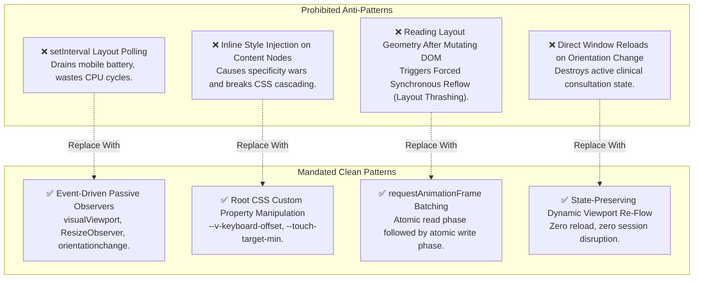

# 📐 RAMAN AI – Engineering Guidelines & Architectural Restrictions
## Autonomous Real-Time UI Responsiveness & Layout Architecture

---

## 🏛️ 1. Core Engineering Principles

To ensure that real-time layout adaptations do not compromise clinical performance, predictability, or frame rates, all engineers and automated coding agents modifying the UI must adhere to the following principles:

1. **Declarative State Over Inline Mutation:** Always prefer mutating root CSS custom properties (`--v-keyboard-offset`) or body attributes (`data-ui-tier`) rather than writing direct inline styles on specific DOM nodes.
2. **Passive Sensor Subscriptions:** Never poll layout metrics using `setInterval` or `setTimeout` loops. Use passive event listeners (`visualViewport.onresize`, `window.onresize`, `ResizeObserver`).
3. **Atomic Read/Write Partitioning:** Never interleave DOM geometry reads with DOM style writes. Always complete all layout queries before executing layout mutations.
4. **Zero Layout Thrashing Invariant:** No dynamic adaptation may trigger forced synchronous reflow (FSR) exceeding $1.5\text{ ms}$.

---

## ⛔ 2. Explicit Restrictions & Prohibited Patterns



### Prohibited Pattern 1: Polling with `setInterval`
```javascript
// ❌ STRICTLY FORBIDDEN:
setInterval(() => {
  if (window.innerWidth < 600) setMobileLayout();
}, 200);

// ✅ MANDATED:
window.addEventListener('resize', () => ramanUiAgent.scheduleLayoutAudit(), { passive: true });
```

### Prohibited Pattern 2: Interleaved Read/Write (Forced Synchronous Reflow)
```javascript
// ❌ STRICTLY FORBIDDEN (Triggers FSR on every iteration):
elements.forEach(el => {
  const h = el.clientHeight; // READ
  el.style.height = (h + 10) + 'px'; // WRITE
});

// ✅ MANDATED (Batched read, then batched write):
const heights = Array.from(elements, el => el.clientHeight); // BATCH READ
elements.forEach((el, i) => {
  el.style.height = (heights[i] + 10) + 'px'; // BATCH WRITE
});
```

### Prohibited Pattern 3: Hardcoded Fixed Pixel Widths on Core Containers
```css
/* ❌ STRICTLY FORBIDDEN: */
.chat-messages {
  width: 760px; /* Truncates on mobile, breaks on tablets */
}

/* ✅ MANDATED: */
.chat-messages {
  width: 100%;
  max-width: var(--chat-max-width, 820px);
  min-width: 0; /* Prevents flexbox overflow spillage */
}
```

---

## 📱 3. Responsive Form-Factor Guidelines

### 3.1 Mobile Form Factors ($< 600\text{px}$)
- **Virtual Keyboard Awareness:** All scrollable containers hosting inputs must include `padding-bottom: var(--v-keyboard-offset, 0px)`.
- **Single-Column Stacking:** All multi-column grids (`.vitals-grid`, `.consultation-panel`) must collapse to a single column or horizontal chip scroller.
- **Fixed Single-Row Header:** The application header must not exceed $52\text{px}$ in height to preserve vertical clinical workspace.

### 3.2 Tablet Form Factors ($600\text{px} - 1024\text{px}$)
- **Portrait Mode ($768 \times 1024$):** Prioritize the clinical consultation flow; collapse the secondary anatomical scanner and auxiliary telemetry sidebars into accessible sliding drawers.
- **Landscape Mode ($1024 \times 768$):** Support dual-column layout with fixed-width navigation and fluid chat pane.
- **Hybrid Input Support:** Never assume a tablet is touch-only. Trackpads and external keyboards (Apple Magic Keyboard, Surface Type Cover) require hover states and tooltips to remain functional alongside $44\text{px}$ touch targets.

### 3.3 Desktop Form Factors ($> 1024\text{px}$)
- **Maximum Reading Bounds:** Content containers must cap line lengths at $80 - 100$ characters (`max-width: 1440px`) to prevent visual strain.
- **Multi-Monitor High-DPI Adaptation:** Telemetry and raymarching canvases must register `data-auto-resync="true"` to dynamically adjust buffer dimensions when dragged across displays with differing scale factors.

---

## ♿ 4. Accessibility & Touch Target Standards (WCAG 2.1 AA)

- All primary interactive touch targets (navigation buttons, prescription action triggers, quick-symptom buttons) must maintain an effective hit-box of at least $44 \times 44\text{px}$.
- If visual design necessitates a visually compact button ($32\text{px}$ icon), engineers must expand the interactive touch area using transparent pseudo-elements:
  ```css
  .compact-btn {
    position: relative;
    width: 32px;
    height: 32px;
  }
  .compact-btn::after {
    content: '';
    position: absolute;
    top: -6px;
    bottom: -6px;
    left: -6px;
    right: -6px; /* Expands effective tap area to 44x44px */
  }
  ```
