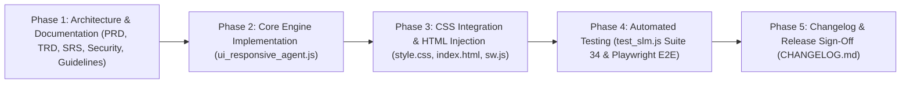

# 🚀 RAMAN AI – Implementation Plan
## Autonomous Real-Time UI Responsiveness & Self-Healing Engine (`RamanUiAgent`)

---

## 📌 Implementation Overview

| Attribute | Specification |
|:---|:---|
| **Target Version** | v2.3.0 |
| **Component** | `ui_responsive_agent.js`, `style.css`, `index.html`, `sw.js` |
| **Test Suites** | `test_slm.js` (Test Suite 34), `tests/ui_responsive_agent.spec.js` |
| **Target Platforms** | Desktop ($\ge 1024\text{px}$), Tablets ($600 - 1024\text{px}$), Mobile ($< 600\text{px}$) |
| **Verification Gate** | Zero-Cloud Invariant, Sub-2ms Latency, Zero Layout Thrashing |

---

## 📅 Phased Execution Roadmap

---

## 📋 Detailed Task Breakdown

### Phase 1: Architecture & Technical Specifications [COMPLETED]
- [x] Create Product Requirements Document: `docs/UI_RESPONSIVENESS_AGENT_PRD.md`
- [x] Create Technical Requirements Document: `docs/UI_RESPONSIVENESS_AGENT_TRD.md`
- [x] Create Software Requirements Specification: `docs/UI_RESPONSIVENESS_AGENT_SRS.md`
- [x] Create Engineering Guidelines & Restrictions: `docs/UI_RESPONSIVENESS_GUIDELINES_AND_RESTRICTIONS.md`
- [x] Create Security & Trust Architecture: `docs/UI_RESPONSIVENESS_SECURITY_ARCHITECTURE.md`
- [x] Create Implementation Plan: `docs/UI_RESPONSIVENESS_IMPLEMENTATION_PLAN.md`

### Phase 2: Core Engine Implementation (`ui_responsive_agent.js`)
- [ ] Author `ui_responsive_agent.js` with zero external dependencies.
- [ ] Implement event listeners for `window.visualViewport.resize`, `window.resize`, `window.orientationchange`.
- [ ] Implement atomic Read Phase: Viewport dimensions, `scrollWidth`, `visualViewport.height`, and pointer capabilities.
- [ ] Implement Viewport Tier Classifier:
  - `mobile-compact` ($< 380\text{px}$)
  - `mobile` ($380\text{px} - 600\text{px}$)
  - `tablet-portrait` ($600\text{px} - 1024\text{px}$, $h > w$)
  - `tablet-landscape` ($600\text{px} - 1024\text{px}$, $w \ge h$)
  - `desktop` ($> 1024\text{px}$)
- [ ] Implement Virtual Keyboard Encroachment Calculator:
  - Calculates $\Delta = \text{innerHeight} - \text{visualViewport.height}$.
  - Sets `--v-keyboard-offset: ${delta}px` and `data-keyboard-open="true"`.
  - Auto-scrolls focused input element to visible center.
- [ ] Implement Horizontal Overflow & Spill Containment (`data-spill-detected`).
- [ ] Implement High-DPI Canvas Buffer Synchronization (`data-auto-resync="true"`).
- [ ] Implement Anti-Oscillation Circuit Breaker (`mutationLock`, sliding window threshold).
- [ ] Implement Diagnostic API (`getDiagnostics()`).
- [ ] Support both browser global attachment (`window.ramanUiAgent`) and CommonJS exports (`module.exports`).

### Phase 3: CSS Integration, HTML Wiring & PWA Cache
- [ ] Update `style.css`:
  - Bind `--v-keyboard-offset` into `.chat-messages` padding bottom.
  - Add tier selectors: `body[data-ui-tier="tablet-portrait"]`, `body[data-ui-tier="mobile-compact"]`.
  - Add sticky positioning for `.clinical-alert` and `.contraindication-card` during keyboard activation.
  - Add touch target hit-box pseudo-element rules for touch hardware.
- [ ] Update `index.html`:
  - Inject `` before main UI init.
  - Tag clinical canvases (`ecgCanvas`, `vitalScatterCanvas`) with `data-auto-resync="true"`.
- [ ] Update `sw.js`:
  - Add `'ui_responsive_agent.js'` to cache manifest and bump version to `raman-ai-v2.6`.

### Phase 4: Automated Testing & Verification
- [ ] Update `test_slm.js`:
  - Add Test Suite 34: "Autonomous Real-Time UI Responsiveness & Self-Healing Agent Verification".
  - Verify tier classification, keyboard offset calculation, spill containment, canvas DPR sync, and circuit breaker.
  - Run `node test_slm.js` and verify all 34 suites pass.
- [ ] Create Playwright E2E Test Suite: `tests/ui_responsive_agent.spec.js`:
  - Desktop Viewport Test ($1920 \times 1080$): Asserts `data-ui-tier="desktop"`.
  - Tablet Landscape Test ($1024 \times 768$): Asserts `data-ui-tier="tablet-landscape"`.
  - Tablet Portrait Test ($768 \times 1024$): Asserts `data-ui-tier="tablet-portrait"` and sidebar transformation.
  - Mobile Compact Test ($360 \times 640$): Asserts `data-ui-tier="mobile-compact"`.
  - Virtual Keyboard Test: Simulates visual viewport resize and asserts `--v-keyboard-offset` and `data-keyboard-open`.
  - Circuit Breaker Test: Dispatches rapid resize events and asserts zero reflow loops and circuit breaker trip immunity.
- [ ] Run full 3-Gate verification script: `node scripts/verify_3gates.js`.

### Phase 5: Changelog & Release Sign-Off
- [ ] Update root `CHANGELOG.md` with version **[2.3.0]**.
- [ ] Update `docs/CHANGELOG.md`.
- [ ] Provide comprehensive completion report.
