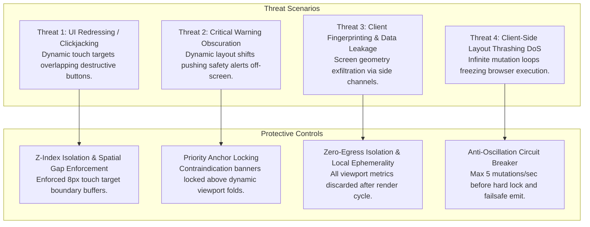

# 🔒 RAMAN AI – Security & Trust Architecture
## Autonomous Client-Side Real-Time UI Responsiveness & Layout Manipulation

---

## 📌 Document Overview & Security Classification

| Security Attribute | Specification |
| :--- | :--- |
| **System** | RAMAN AI (Experiment No. 170) |
| **Module** | `ui_responsive_agent.js` |
| **Security Classification** | Critical Client-Side UI & Clinical Safety Integrity |
| **Threat Profile** | UI Redressing (Clickjacking), Warning Obscuration, Fingerprinting, Denial-of-Service |
| **Regulatory Baseline** | HIPAA Privacy Rule, GDPR Article 25 (Privacy by Design), ISO 14971 Medical Risk Management |

---

## 🛡️ 1. Threat Modeling & Attack Surface Analysis

Although RAMAN AI runs 100% offline with zero cloud connectivity, dynamic client-side DOM and layout manipulation introduces distinct security and clinical hazard surfaces:

---

## ⚔️ 2. Threat Mitigations & Defensive Controls

### 2.1 Threat 1: UI Redressing & Hitbox Collisions (Clickjacking Prevention)
- **Attack Vector:** An over-aggressive touch-target expansion algorithm expands an icon button's tap area by $+12\text{px}$. If positioned near a high-consequence button (e.g. *"Purge Encrypted Vault"* or *"Clear Patient Records"*), a user intending to tap a safe tab accidentally triggers a destructive operation.
- **Defensive Control:**
  - The agent NEVER expands hit-boxes globally across all elements.
  - Critical confirmation modals and destructive action buttons are wrapped in dedicated `isolation: isolate` stacking contexts with fixed $16\text{px}$ minimum visual and spatial margins.
  - High-consequence operations require secondary modal confirmation that suppresses all agent layout adjustments while open.

### 2.2 Threat 2: Clinical Warning Obscuration
- **Hazard:** When the soft keyboard slides open or when tablet screen size shifts, clinical drug contraindication banners (e.g., *"Penicillin Allergy Intercepted -> Substituted Azithromycin"*) must NEVER be pushed behind the keyboard or clipped outside visible bounds.
- **Defensive Control:**
  - Clinical warning banners (`.clinical-alert`, `.contraindication-card`) are designated as **Priority Anchors**.
  - When `data-keyboard-open="true"`, Priority Anchors are styled with `position: sticky; top: 0; z-index: 100;` ensuring they remain visible at the top of the visible viewport regardless of scroll position or keyboard elevation.

### 2.3 Threat 3: Device Fingerprinting & Telemetry Exfiltration
- **Risk:** Viewport dimensions, device pixel ratios, and visual viewport height curves can be harvested by malicious third-party scripts to fingerprint patient hardware or track user typing cadences.
- **Defensive Control:**
  - **Zero Outbound Egress:** Under no circumstances does `RamanUiAgent` dispatch HTTP, WebSocket, or WebRTC packets containing layout measurements.
  - **Zero Long-Term Metric Storage:** Viewport dimensions are transient; they are never persisted to `localStorage` or `IndexedDB`.
  - **Read-Only Diagnostics:** `getDiagnostics()` returns live operational health but does not log or persist historical dimension time-series.

### 2.4 Threat 4: Layout Thrashing & CPU Denial-of-Service
- **Risk:** Rapid window resizing or conflicting CSS rules cause infinite reflow oscillation, locking the browser UI thread and preventing patient triage in an emergency.
- **Defensive Control:**
  - Strict **Circuit Breaker Pattern**: If layout mutations exceed $5$ passes within $1,000\text{ ms}$, the engine automatically disables dynamic mutations, logs a high-priority diagnostic warning, and locks the interface into a safe CSS fallback tier.

---

## 🔒 3. Integrity Verification & Security Invariants

| Security Invariant | Requirement Specification | Verification Protocol |
|:---|:---|:---|
| **Zero Network Egress** | Exactly 0 bytes dispatched | Automated network interceptor trap (`scripts/verify_3gates.js`). |
| **Destructive Button Isolation** | Minimum $16\text{px}$ separation between dynamic targets and vault deletion triggers | Automated bounding box collision tests (`tests/ui_responsive_agent.spec.js`). |
| **Warning Visibility** | Safety contraindication alerts maintain $100\%$ visibility during keyboard open | Visual viewport visibility assertions in Playwright test suite. |
| **Memory Isolation** | Agent state inaccessible to external scripts via prototype mutation | Scoped singleton pattern with frozen configuration properties. |
